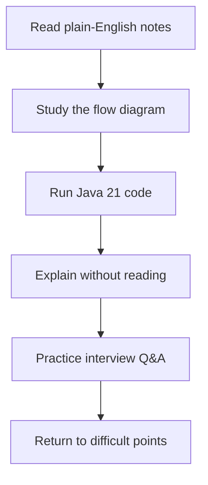

# Java Backend Interview Handbook

**Understand the concept. Run the example. Explain it with confidence.**

Welcome! This is a structured, growing study resource for experienced Java developers preparing for backend engineering interviews.

## Start here

1. [See the roadmap and progress](roadmap.md)
2. [Learn JDK, JRE, JVM & execution](notes/java-execution.md)
3. [Deep dive into HashMap internals](notes/hashmap-internals.md)
4. [Practice the 30-question interview set](interview-questions/30-questions.md)

!!! note "What is included today?"
    Two detailed study chapters and an initial question bank. Other chapters are planned and will be added incrementally. The progress table is the source of truth.

## Learning method

**Senior-level tip:** In a real interview, go beyond definitions: explain trade-offs, failure cases, complexity, and what you would do in production.
