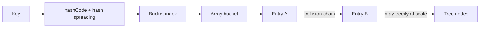

# Chapter 2 — How HashMap works internally

**Goal:** Understand insertion, lookup, collisions, resizing, and the contract between `equals()` and `hashCode()`.

## 1. Simple explanation

A `HashMap<K,V>` stores **key–value pairs**. You give it a key, and it uses the key's hash to find a location in an internal array. A normal lookup is fast because it does not need to scan every entry.

Example: In an invoice application, you might store a lookup of invoice ID → invoice status.

```java
Map<Long, String> invoiceStatus = new HashMap<>();
invoiceStatus.put(101L, "APPROVED");
invoiceStatus.put(102L, "PENDING");
System.out.println(invoiceStatus.get(101L)); // APPROVED
```

## 2. Internal picture (simplified)



A real `HashMap` stores nodes in an array of buckets. Multiple entries may occupy one bucket due to hash collisions. In recent OpenJDK implementations, long collision chains **can become red-black trees** under certain conditions.

## 3. What happens in `put(key, value)`?

1. Calculate a hash using the key's `hashCode()` (with implementation-specific spreading).
2. Locate the bucket index using the array capacity.
3. If that bucket is empty, insert the entry.
4. If entries exist, compare hash and keys using `==` / `equals()` to find an existing key. Replace its value if the key matches, otherwise add another entry in the bucket.
5. When size crosses the resize threshold, grow and redistribute entries.

**Default starting behavior in common OpenJDK implementations:** default capacity is 16 when first allocated; default load factor is `0.75`. A table of capacity 16 generally resizes when insertion increases the size beyond 12. These are implementation details, not interface guarantees.

## 4. Collision example

```java
import java.util.HashMap;
import java.util.Map;

public class CollisionDemo {
    record Key(int id) {
        @Override public int hashCode() { return 7; } // force collision
    }
    public static void main(String[] args) {
        Map<Key, String> map = new HashMap<>();
        map.put(new Key(1), "One");
        map.put(new Key(2), "Two");
        System.out.println(map.get(new Key(2))); // Two
    }
}
```

Both keys return the same hash code, but `equals()` distinguishes them. A hash collision **does not mean the keys are equal**.

## 5. Why `equals()` and `hashCode()` matter

The rule is: **if `a.equals(b)` is true, their hash codes must be equal.** Different objects may share a hash code without being equal.

An incorrect implementation can make a key impossible to find after insertion. Avoid changing any field involved in a map key's equality or hash while it is in the map.

## 6. Complexity and trade-offs

| Operation | Expected | Worst case (general) |
|---|---|---|
| `get` | O(1) | Can degrade with extreme collisions |
| `put` | O(1) amortized | Can degrade with collisions and resizing |
| `remove` | O(1) | Can degrade with collisions |

Treeification improves many collision-heavy cases, but it does not justify claiming an unconditional O(log n) worst-case for arbitrary keys and comparability behavior.

**Thread safety:** `HashMap` is not designed for concurrent structural modifications without external synchronization. For shared concurrent access, consider `ConcurrentHashMap` or other coordinated designs.

**Nulls:** `HashMap` permits one null key and null values. `ConcurrentHashMap` permits neither.

**Ordering:** `HashMap` does not promise stable iteration order. Use `LinkedHashMap` when insertion-order traversal is required; `TreeMap` for key ordering.

## 7. Practical Spring Boot example

A local `HashMap` is fine for temporary request-level lookups. It is **not** a distributed cache: each service instance has its own map and the entries disappear on restart. For cross-instance caching, use a shared system such as Redis when appropriate.

## 8. Interview answers

**Q: How does HashMap work internally?**

> HashMap maintains an array of buckets. It calculates a hash from the key, finds a bucket, and compares keys to find the right entry. When multiple keys collide, entries are handled within that bucket using linked nodes and, for sufficiently large collision-heavy buckets, tree nodes. The map resizes when its threshold is exceeded. Average get and put operations are constant time.

**Q: What happens if two keys have the same hash code?**

> They may land in the same bucket. HashMap then checks key equality to distinguish them. Identical hash codes alone do not mean equal keys.

**Q: Why should HashMap keys be immutable?**

> It is important that the fields used in equality and hashing do not change while the key is stored; otherwise the map may look in the wrong bucket. Immutable keys make this safer.

## 9. Revision checklist

- [ ] Explain bucket indexing and collisions.
- [ ] Explain the `equals()` / `hashCode()` contract.
- [ ] Explain the load factor and resize trigger.
- [ ] Distinguish HashMap, LinkedHashMap and ConcurrentHashMap.
- [ ] Explain why in-memory maps are not distributed caches.
