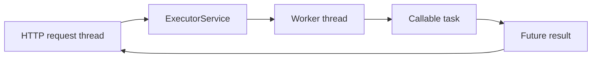
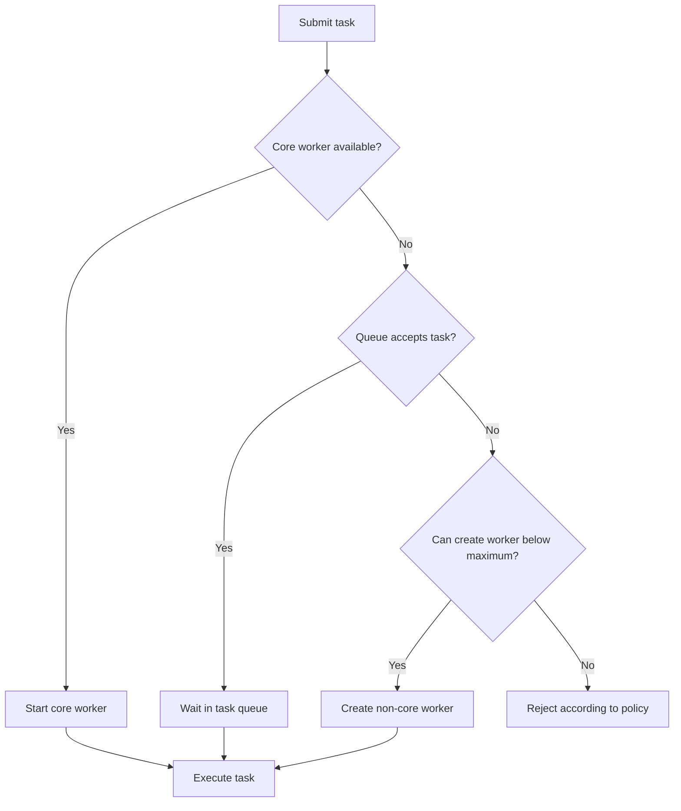
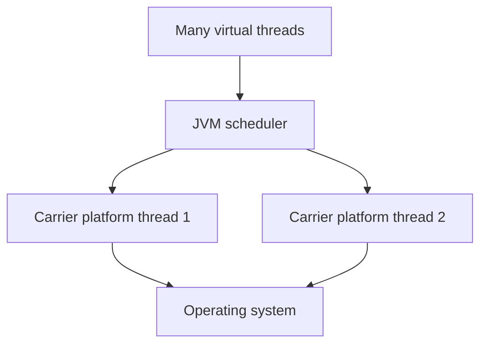

# Chapter 10 — Advanced Java Concurrency: Executors, CompletableFuture and Virtual Threads

> **Learning objective:** Select the right concurrency model for backend workloads, control resource usage, and explain asynchronous failures and cancellation accurately.

**Java version:** 21 | **Level:** Intermediate–senior | **Study order:** Concepts → examples → diagrams → interview answers → exercises.

## 1. Why advanced concurrency matters

Imagine an invoice service that must validate invoices, call another service, and send notifications. Doing everything sequentially can waste time while waiting for I/O. But creating an unlimited number of threads or tasks can overload databases and downstream APIs. Advanced concurrency is about **safe parallelism, controlled resource usage, and clear failure handling**, not just making code asynchronous.

## 2. Runnable, Callable, Future and ExecutorService

- `Runnable.run()` performs a task without a returned result and cannot declare checked exceptions.
- `Callable<V>.call()` returns a value and may declare checked exceptions.
- `Future<V>` represents a result that may not be ready; `get()` blocks and may throw `ExecutionException`.
- `ExecutorService` accepts tasks and manages their execution separately from callers.



### Runnable vs Callable example

```java
import java.util.concurrent.*;

public class ExecutorDemo {
    public static void main(String[] args) throws Exception {
        ExecutorService executor = Executors.newFixedThreadPool(2);
        try {
            Future<Integer> total = executor.submit(() -> 1200 + 800);
            System.out.println("Invoice total: " + total.get());
        } finally {
            executor.shutdown();
        }
    }
}
```

**Output:** `Invoice total: 2000`.

`get()` waits for completion; `get(timeout, unit)` bounds how long the caller waits. A timeout does **not** automatically cancel the task.

## 3. Thread pool internals

A typical `ThreadPoolExecutor` manages core workers, additional workers up to a maximum, a queue and a rejection policy. The admission rules depend on its queue and configuration.



**Critical interview detail:** `Executors.newFixedThreadPool(n)` uses an unbounded queue in its standard implementation, so bursts can accumulate queued tasks and consume memory. It does not mean the application can process unlimited work safely.

### Bounded pool example

```java
import java.util.concurrent.*;

public class BoundedExecutorDemo {
    public static void main(String[] args) {
        ThreadPoolExecutor pool = new ThreadPoolExecutor(
            2, 4, 30, TimeUnit.SECONDS,
            new ArrayBlockingQueue<>(20),
            new ThreadPoolExecutor.CallerRunsPolicy());
        try {
            pool.execute(() -> System.out.println("Job processed"));
        } finally {
            pool.shutdown();
        }
    }
}
```

**Output:** `Job processed` (the task may run on a worker or, under saturation, on the caller thread).

`CallerRunsPolicy` provides a form of feedback but can slow request threads, and after shutdown it does not execute rejected tasks. Choose a rejection policy intentionally and monitor queue size and active workers.

## 4. Pool sizing: CPU-bound vs I/O-bound

- **CPU-bound:** Start near the available processor count; benchmark throughput and latency.
- **Blocking I/O:** More concurrency may help while tasks wait, but database connection pools, rate limits, memory and downstream capacity determine safe limits.
- **Do not** use one universally correct thread count formula for production.

Measure task latency, active threads, queue wait time, rejection rate and downstream health under representative load.

## 5. Executor shutdown and cancellation

`shutdown()` stops accepting new tasks but allows previously submitted tasks to finish. `shutdownNow()` requests interruption of running tasks and returns tasks that never commenced; it cannot forcibly terminate arbitrary code.

```java
pool.shutdown();
if (!pool.awaitTermination(5, TimeUnit.SECONDS)) {
    pool.shutdownNow();
}
```

The calling method must handle `InterruptedException` appropriately (often by restoring interrupt status when it cannot propagate it). A task must cooperate with interruption for cancellation to work reliably.

## 6. CompletableFuture — composing asynchronous work

`CompletableFuture<T>` is both a `Future` and a `CompletionStage`: it can be completed asynchronously and supports dependent stages.


```java
import java.util.concurrent.*;

public class CompletableFutureDemo {
    public static void main(String[] args) {
        try (ExecutorService executor = Executors.newFixedThreadPool(2)) {
            CompletableFuture<Integer> invoiceAmount =
                CompletableFuture.supplyAsync(() -> 1000, executor)
                    .thenApply(amount -> amount + 180);
            System.out.println(invoiceAmount.join());
        }
    }
}
```

**Output:** `1180`. `join()` throws an unchecked `CompletionException` for exceptional completion; `get()` uses checked interruption and execution exceptions.

### `thenApply` vs `thenCompose` vs `thenCombine`

- `thenApply`: Transform `T` into `U` (synchronous function; no flattening).
- `thenCompose`: Chain a function returning another `CompletionStage<U>`; flatten nested asynchronous stages.
- `thenCombine`: Combine results of two independent completion stages.

```java
CompletableFuture<String> a = CompletableFuture.completedFuture("PO-");
CompletableFuture<String> b = CompletableFuture.completedFuture("101");
System.out.println(a.thenCombine(b, String::concat).join()); // PO-101
```

**Important:** Methods without the `Async` suffix do not guarantee execution on a separate worker; stages may execute in the completing thread. Async methods without an explicit executor usually use the common ForkJoinPool (with implementation-specific fallback behavior). Prefer explicit executors when operational control matters.

## 7. Handling asynchronous failures

```java
CompletableFuture<Integer> result = CompletableFuture
    .<Integer>supplyAsync(() -> { throw new IllegalStateException("Remote API failed"); })
    .exceptionally(error -> -1);
System.out.println(result.join()); // -1
```

- `exceptionally`: Recover with a replacement result on exceptional completion.
- `handle`: Inspect success or failure and return a new value.
- `whenComplete`: Observe completion and its failure without normally transforming the result.

Avoid logging then silently returning success-shaped fallback values for business-critical operations. A fallback must be acceptable under your service contract.

## 8. allOf, anyOf and independent tasks

`CompletableFuture.allOf(a, b)` completes when all supplied stages have completed (or exceptionally when applicable), but **does not aggregate their results**; read each future after coordination. `anyOf` completes when one does, including if the first completion is exceptional. These methods do not automatically cancel other tasks.

```java
var f1 = CompletableFuture.completedFuture(5);
var f2 = CompletableFuture.completedFuture(7);
CompletableFuture.allOf(f1, f2).join();
System.out.println(f1.join() + f2.join()); // 12
```

For reliable systems, explicitly decide how to handle partial failures, cancellation, timeouts, and idempotency.

## 9. Java 21 Virtual Threads

Virtual threads are lightweight Java threads managed by the JVM. They make **thread-per-request style blocking I/O** more scalable by reducing the cost of having many waiting threads. They do not make CPU work faster and do not remove downstream capacity limits.



```java
import java.util.concurrent.*;

public class VirtualThreadDemo {
    public static void main(String[] args) throws Exception {
        try (ExecutorService executor =
                 Executors.newVirtualThreadPerTaskExecutor()) {
            Future<String> result = executor.submit(() -> {
                Thread.sleep(50);
                return "Validation completed";
            });
            System.out.println(result.get());
        }
    }
}
```

**Output:** `Validation completed`.

**Do not pool virtual threads merely to reduce their count**; use a semaphore or other limit to bound access to expensive resources such as JDBC connections or third-party APIs.

### Platform threads vs virtual threads

| Platform threads | Virtual threads |
|---|---|
| OS-thread-backed; comparatively expensive to create in large numbers | JVM-managed; cheaper for many blocking tasks |
| Conventional bounded thread pools often used | Typically create per task |
| Useful for CPU-bound work and specialized workloads | Especially useful for high-concurrency blocking I/O |
| Still subject to downstream resource limits | Same downstream limits apply |

**Java 21 caveat:** Virtual-thread pinning can occur, notably when blocking while holding a `synchronized` monitor or during native/foreign calls. Diagnose pinning using appropriate JFR events and JVM diagnostics. Java behavior evolves by release; these notes target Java 21 specifically.

## 10. ThreadLocal and virtual threads

`ThreadLocal` values are associated with a thread. Virtual threads support ThreadLocal, but creating huge numbers of threads with large thread-local state can be costly. Avoid assuming request context automatically propagates across arbitrary asynchronous stages or executors.

## 11. Spring Boot production scenario

**Use case:** An invoice endpoint calls a vendor validation API and a tax service.

Ask these questions before introducing concurrency:

1. Are the calls independent, or does tax validation depend on vendor validation?
2. What are the API timeouts, bulkheads and retry policies?
3. How many concurrent calls can each downstream service safely handle?
4. Does the security context or trace context propagate correctly?
5. What should happen on partial success or one service failing?
6. Does any operation require a database transaction? (Do not assume transactions propagate across threads.)

A `@Transactional` context normally binds to the current thread; simply creating a CompletableFuture does not transparently share the transaction with its worker thread. Prefer clear transaction boundaries.

## 12. Avoid these concurrency mistakes

- Creating a new platform thread for every unbounded task.
- Using `newFixedThreadPool()` without considering its potentially unbounded task queue.
- Thinking `future.get(timeout)` cancels execution automatically.
- Calling a blocking `join()` inside a supposedly nonblocking hot path without reasoning about capacity.
- Running blocking I/O in the shared common pool under heavy load without control.
- Assuming `thenApply()` always uses a background thread.
- Assuming `CompletableFuture.allOf()` gives a `List` of values.
- Using virtual threads to bypass database pool or API rate limits.
- Assuming thread-local transaction/security contexts automatically move across worker threads.
- Swallowing interruptions or losing the original exception cause.

## 13. Interview questions with natural answers

**1. What is ExecutorService?** It separates task submission from execution and manages workers, queues and lifecycle. I use it when I need controlled concurrency instead of manually creating threads.

**2. Runnable vs Callable?** Runnable returns no result and cannot declare checked exceptions from `run`; Callable returns a value and may throw checked exceptions.

**3. Future vs CompletableFuture?** Future primarily lets me wait for or cancel a result. CompletableFuture supports composition, callbacks, combinations and recovery stages.

**4. Why can a fixed thread pool cause memory problems?** The standard `newFixedThreadPool` uses an unbounded queue, so tasks can accumulate faster than workers process them.

**5. How does ThreadPoolExecutor reject work?** When a task cannot be accepted because capacity is exhausted (or the executor is shut down), the configured handler decides what happens.

**6. shutdown vs shutdownNow?** Shutdown rejects new tasks and finishes accepted ones. ShutdownNow attempts interruption and returns queued tasks but does not guarantee termination of already running code.

**7. thenApply vs thenCompose?** thenApply transforms a value. thenCompose chains another asynchronous stage and flattens it instead of nesting futures.

**8. thenCombine vs allOf?** thenCombine combines two stage results through a function. allOf coordinates completion of several stages without returning their combined values.

**9. get vs join?** Both can wait for the result. get reports checked `InterruptedException`/`ExecutionException`; join reports unchecked `CompletionException` on failure.

**10. What is the common ForkJoinPool?** A shared execution pool used by many default asynchronous operations and parallel streams. Shared workloads can interfere, so explicit executors may be safer.

**11. What are virtual threads?** Lightweight JVM-managed threads, introduced as a finalized feature in Java 21, well suited to many concurrent blocking I/O tasks.

**12. Are virtual threads always faster?** No. They reduce the cost of waiting threads, not CPU computation; resource constraints and workload behavior still determine throughput.

**13. What is virtual-thread pinning in Java 21?** Some operations prevent a virtual thread from unmounting from its carrier while blocked, which can reduce scalability.

**14. How do you limit database requests with virtual threads?** Use the database connection pool and additional explicit concurrency limits when needed, such as semaphores; virtual threads do not create more database capacity.

**15. Does @Transactional propagate to CompletableFuture?** Not automatically. Spring's typical thread-bound transaction context does not carry to arbitrary executor threads.

**16. How do you handle asynchronous failures?** Decide which results are required, propagate meaningful errors, apply bounded timeouts and safe fallbacks, and monitor failures. Avoid hiding a critical error as a successful response.

## 14. Quick revision checklist

- ExecutorService = task execution + lifecycle.
- ThreadPoolExecutor = workers + queue + rejection.
- Future = deferred result, usually blocking retrieval.
- CompletableFuture = asynchronous composition + recovery.
- `thenCompose` flattens nested completion stages.
- `allOf` coordinates completion, not result aggregation.
- Explicit executors offer resource isolation.
- Virtual threads excel at high-volume blocking tasks, not CPU speedups.
- Bound external resources, even when virtual threads are cheap.
- Transactions/security contexts require explicit propagation decisions.

## 15. Coding and design practice

1. Implement a fixed pool that computes invoice totals and shuts down gracefully.
2. Demonstrate rejection with a bounded queue and explain why `CallerRunsPolicy` changes request latency.
3. Combine two independent completed stages with `thenCombine`.
4. Chain asynchronous validation with `thenCompose` and recover with `exceptionally`.
5. Write a timeout example; distinguish waiting timeout from task cancellation.
6. Run 100 simulated blocking tasks using virtual threads and measure elapsed time; compare against a small platform-thread pool without claiming a universal benchmark conclusion.
7. Draw a safe flow for vendor validation, tax calculation and a notification with partial failures.
8. Explain why a transaction started in a controller thread is not shared with an executor worker by default.

## References

- [Java SE 21 ExecutorService API](https://docs.oracle.com/en/java/javase/21/docs/api/java.base/java/util/concurrent/ExecutorService.html)
- [Java SE 21 CompletableFuture API](https://docs.oracle.com/en/java/javase/21/docs/api/java.base/java/util/concurrent/CompletableFuture.html)
- [JEP 444 — Virtual Threads](https://openjdk.org/jeps/444)

**Next chapter recommendation:** JVM memory, garbage collection and production diagnostics.
