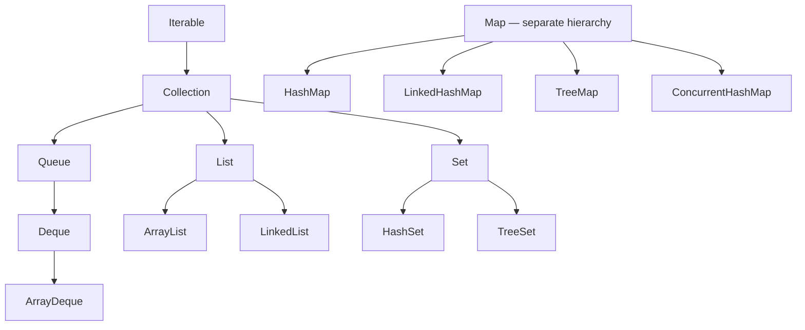
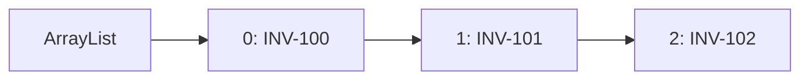
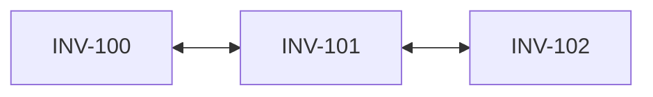

# Chapter 4 — Java Collections Framework

> **Goal:** Choose the right collection, explain its internal data structure and time complexity, and use collections safely in production.

**Java:** 21 · **Audience:** Senior Java / Backend Engineer · **Study sequence:** Concept → diagram → Java example → interview answer → practice

## 1. Why collections?

Imagine an invoice application: a page of invoice records, a set of unique vendor codes, a mapping of invoice number to invoice, and a queue of pending jobs. Arrays alone do not provide convenient APIs for all of these requirements.

The **Java Collections Framework (JCF)** provides standard interfaces and implementations for organizing, searching and updating groups of objects.

- **List:** Ordered sequence; duplicates allowed.
- **Set:** No duplicate elements according to its equality/ordering rules.
- **Queue/Deque:** Processing order, including FIFO and double-ended operations.
- **Map:** Keys mapped to values. **Map is not a subtype of Collection.**

## 2. Main hierarchy



*Simplified interface/implementation map; not all relationships are shown. In particular, `LinkedList` also implements `Deque`.*

## 3. The selection guide

| Requirement | Typically choose | Reason |
|---|---|---|
| Ordered sequence, frequent indexed reads | `ArrayList` | Efficient random access |
| Unique items, no order requirement | `HashSet` | Expected constant-time membership |
| Unique items, iteration in insertion order | `LinkedHashSet` | Maintains insertion order |
| Unique items sorted by comparator/natural order | `TreeSet` | Sorted tree |
| Key-value lookup | `HashMap` | Expected constant-time operations |
| Key-value order of insertion | `LinkedHashMap` | Predictable iteration |
| Sorted keys/range queries | `TreeMap` | Balanced search tree |
| Queue or stack on one thread | `ArrayDeque` | Efficient operations at either end |
| Concurrent key-value updates | `ConcurrentHashMap` | Thread-safe operations and atomic methods |
| Producer-consumer handoff | `BlockingQueue` implementation | Can block when empty/full |

**Caution:** Big-O is not a complete performance prediction; allocation, memory locality, contention, data size and access pattern matter.

## 4. List: ArrayList vs LinkedList

### ArrayList internals

`ArrayList` uses a resizable backing array. Getting an element by index is constant-time; adding at the end is amortized constant-time; insertion/removal near the beginning or middle requires shifting elements.



`ArrayList` increases its backing capacity as required, but **do not depend on a particular growth multiplier**: the exact resizing policy is not guaranteed by its public contract.

### LinkedList internals

`LinkedList` stores nodes with references to previous and next nodes. Finding a node at index *i* requires traversal (linear time); adding/removing a node with an already-known position can be efficient, but locating that position may dominate the operation.



| Operation | ArrayList | LinkedList |
|---|---|---|
| `get(index)` | O(1) | O(n) |
| Append | Amortized O(1) | O(1) |
| Insert at front | O(n) | O(1) |
| Remove by index | O(n) in general | O(n) to locate node |
| Memory locality | Usually better | Usually worse (per-node overhead) |

**Practical recommendation:** Default to `ArrayList` for ordinary application lists. Use `ArrayDeque` for queues; do not assume `LinkedList` is faster simply because insertion is O(1).

### Example

```java
import java.util.ArrayList;
import java.util.List;

public class InvoiceListDemo {
    public static void main(String[] args) {
        List<String> invoices = new ArrayList<>();
        invoices.add("INV-101");
        invoices.add("INV-102");
        invoices.add(1, "INV-103");
        System.out.println(invoices);
        System.out.println(invoices.get(0));
    }
}
```

**Output:**

```text
[INV-101, INV-103, INV-102]
INV-101
```

## 5. Set: uniqueness and equality

A Set prevents duplicate elements. For `HashSet`, duplicate detection relies on `hashCode()` and `equals()`. `TreeSet` uses its ordering comparison to determine uniqueness.

```java
import java.util.LinkedHashSet;
import java.util.Set;

public class VendorSetDemo {
    public static void main(String[] args) {
        Set<String> vendors = new LinkedHashSet<>();
        vendors.add("V001");
        vendors.add("V002");
        vendors.add("V001");
        System.out.println(vendors);
    }
}
```

**Output:** `[V001, V002]`

`HashSet` does **not** guarantee iteration order. `LinkedHashSet` preserves insertion order. `TreeSet` maintains sorted order. Do not accidentally depend on HashSet's observed order.

### When equals/hashCode matter

```java
record Vendor(String code, String name) {}
```

Records implement value-based equality from their components. Two `new Vendor("V001", "Acme")` instances compare equal, so only one is retained in a HashSet.

**Caution:** Mutating fields used by a hash-based key's `equals` or `hashCode` after insertion can break retrieval.

## 6. Map: key-value storage

A `Map<K,V>` associates keys with values. Putting the same key again replaces its previous value.

```java
import java.util.HashMap;
import java.util.Map;

public class InvoiceMapDemo {
    public static void main(String[] args) {
        Map<String, Integer> amountByInvoice = new HashMap<>();
        amountByInvoice.put("INV-101", 5000);
        amountByInvoice.put("INV-102", 7000);
        amountByInvoice.put("INV-101", 5500);
        System.out.println(amountByInvoice.get("INV-101"));
    }
}
```

**Output:** `5500`.

**Map implementations:**

- `HashMap`: No guaranteed order; allows one null key and null values.
- `LinkedHashMap`: Predictable iteration order, normally insertion order; can be configured for access order.
- `TreeMap`: Keys sorted by natural order or comparator; O(log n) navigational operations.
- `ConcurrentHashMap`: Safe concurrent operations; null keys and values are not permitted.

`HashMap` uses hash-derived bucket indexes; collisions can use linked nodes or tree bins in modern OpenJDK implementations. For the complete internals, see [HashMap Internals](hashmap-internals.md).

## 7. Queue and Deque

Use a queue when work should be processed in a defined order. `ArrayDeque` implements a resizable double-ended queue.

```java
import java.util.ArrayDeque;
import java.util.Deque;

public class ApprovalQueueDemo {
    public static void main(String[] args) {
        Deque<String> queue = new ArrayDeque<>();
        queue.addLast("INV-101");
        queue.addLast("INV-102");
        System.out.println(queue.removeFirst());
        System.out.println(queue.peekFirst());
    }
}
```

**Output:**

```text
INV-101
INV-102
```

For concurrent production workers, prefer appropriate `BlockingQueue` implementations (such as `ArrayBlockingQueue` or `LinkedBlockingQueue`) rather than unsynchronized `ArrayDeque`.

## 8. Comparable vs Comparator

`Comparable<T>` defines a type's natural ordering; `Comparator<T>` defines an external ordering strategy.

```java
import java.util.ArrayList;
import java.util.Comparator;
import java.util.List;

public class InvoiceSortDemo {
    record Invoice(String number, int amount) {}
    public static void main(String[] args) {
        List<Invoice> invoices = new ArrayList<>(List.of(
            new Invoice("INV-102", 4000),
            new Invoice("INV-101", 7000)
        ));
        invoices.sort(Comparator.comparingInt(Invoice::amount).reversed());
        System.out.println(invoices);
    }
}
```

**Output:**

```text
[Invoice[number=INV-101, amount=7000], Invoice[number=INV-102, amount=4000]]
```

**Interview trap:** Comparators returning zero for distinct values cause `TreeSet`/`TreeMap` to treat those values as equivalent keys. Ensure ordering is consistent with your business definition of uniqueness.

## 9. Fail-fast vs weakly consistent iteration

Many standard mutable collections have iterators that may throw `ConcurrentModificationException` when the collection is structurally modified during iteration outside the iterator's own supported operations.

```java
import java.util.ArrayList;
import java.util.Iterator;
import java.util.List;

public class SafeRemovalDemo {
    public static void main(String[] args) {
        List<String> ids = new ArrayList<>(List.of("A", "B", "C"));
        Iterator<String> it = ids.iterator();
        while (it.hasNext()) {
            if (it.next().equals("B")) {
                it.remove();
            }
        }
        System.out.println(ids);
    }
}
```

**Output:** `[A, C]`

Fail-fast behavior is **best effort**, not a correctness mechanism for concurrent programs. ConcurrentHashMap iterators are *weakly consistent*: they do not throw `ConcurrentModificationException` and may reflect some changes made during iteration.

## 10. Thread safety — HashMap vs ConcurrentHashMap

`HashMap` is not safe for unsynchronized concurrent structural updates. `ConcurrentHashMap` supports concurrent access and atomic methods such as `putIfAbsent`, `compute`, `merge` and `replace`.

```java
import java.util.concurrent.ConcurrentHashMap;

public class CounterDemo {
    public static void main(String[] args) {
        var counts = new ConcurrentHashMap<String, Integer>();
        counts.merge("approved", 1, Integer::sum);
        counts.merge("approved", 1, Integer::sum);
        System.out.println(counts.get("approved"));
    }
}
```

**Output:** `2`.

**Important:** `map.get(key)` followed by `map.put(key, value)` is a compound operation and not automatically atomic, even with ConcurrentHashMap. Use an appropriate atomic method. For high-contention counters, `ConcurrentHashMap<String, LongAdder>` can be useful.

## 11. Immutable and unmodifiable collections

Three ideas are often confused:

- `Collections.unmodifiableList(list)` produces an **unmodifiable view** of an existing list. Mutations to the underlying list can still become visible.
- `List.copyOf(list)` produces an **unmodifiable list** with independently held elements; it does not deep-copy mutable element objects.
- `List.of(...)` creates an unmodifiable list and rejects null elements.

```java
import java.util.ArrayList;
import java.util.Collections;
import java.util.List;

public class UnmodifiableDemo {
    public static void main(String[] args) {
        List<String> original = new ArrayList<>(List.of("A"));
        List<String> view = Collections.unmodifiableList(original);
        List<String> snapshot = List.copyOf(original);
        original.add("B");
        System.out.println(view);
        System.out.println(snapshot);
    }
}
```

**Output:**

```text
[A, B]
[A]
```

Unmodifiable collection does **not** necessarily mean the objects stored inside it are immutable.

## 12. Null behavior matters

- `ArrayList`, `LinkedList`, `HashSet`, `HashMap` accept null in various positions.
- `List.of`, `Set.of`, `Map.of`, `ArrayDeque`, `ConcurrentHashMap` reject null.
- `TreeMap` null-key acceptance depends on its comparator; natural ordering does not support null keys.
- `Map.get(key) == null` does **not** reliably distinguish “absent key” from “mapped to null” in a HashMap; use `containsKey` if needed.

## 13. Java 21: Sequenced Collections

Java 21 introduces sequenced interfaces for collections with a defined encounter order. Important APIs include `getFirst()`, `getLast()`, `reversed()` and `SequencedMap`.

```java
import java.util.ArrayList;
import java.util.List;

public class SequencedDemo {
    public static void main(String[] args) {
        List<String> items = new ArrayList<>(List.of("first", "middle", "last"));
        System.out.println(items.getFirst());
        System.out.println(items.getLast());
        System.out.println(items.reversed());
    }
}
```

**Output:**

```text
first
last
[last, middle, first]
```

A `reversed()` result is a reverse-ordered view where supported; do not assume it is a detached copy.

## 14. Production scenario: pagination and memory

**Problem:** A Spring Boot endpoint returns 300,000 invoices by loading all records into a List before sending JSON.

**Why it hurts:** High heap allocation, GC pressure, larger network payloads and slow serialization.

**Better approach:** Push filtering/sorting/pagination into the database, return a bounded page, and consider streaming/export jobs for large reports.

Collections are only one part of performance. The database query, persistence context, serialization and response size may be the dominant costs.

## 15. Complexity quick revision

These are typical/expected cases, not absolute worst-case guarantees for every implementation.

| Collection | Access | Insert | Contains |
|---|---|---|---|
| ArrayList | Index O(1) | End amortized O(1); middle O(n) | O(n) |
| LinkedList | Index O(n) | Ends O(1) | O(n) |
| HashSet | N/A | Expected O(1) | Expected O(1) |
| TreeSet | N/A | O(log n) | O(log n) |
| HashMap | Key lookup expected O(1) | Expected O(1) | Key expected O(1) |
| TreeMap | Key lookup O(log n) | O(log n) | Key O(log n) |

Space and iteration complexity should also be considered. A HashMap's iteration cost can depend on capacity and number of mappings.

## 16. Interview questions — natural answers

**Q1. What is the Collections Framework?**  
It is a standard set of interfaces and implementations for storing and processing groups of objects, including List, Set, Queue and Map. Map forms a separate interface hierarchy.

**Q2. ArrayList vs LinkedList?**  
ArrayList is backed by a resizable array and is usually better for indexed access and typical application lists. LinkedList uses linked nodes and can add/remove at its ends efficiently, but random access requires traversal.

**Q3. How does HashSet ensure uniqueness?**  
It uses a hash-based backing structure. For normal key comparisons, `hashCode()` narrows the search and `equals()` checks logical equality.

**Q4. Why is HashMap not thread-safe?**  
Concurrent modification without synchronization can cause data races or inconsistent results. ConcurrentHashMap provides safe concurrent operations and specific atomic APIs.

**Q5. HashMap vs TreeMap?**  
HashMap is optimized for expected constant-time key operations without ordering; TreeMap maintains keys sorted with logarithmic navigation.

**Q6. Comparable vs Comparator?**  
Comparable defines natural ordering on the type. Comparator supplies reusable external orderings, such as sorting invoices by amount or date.

**Q7. What is fail-fast iteration?**  
Some iterators detect structural changes and may throw ConcurrentModificationException. This is best-effort bug detection, not a guarantee of thread safety.

**Q8. Why do we use ArrayDeque?**  
It is an efficient general-purpose non-thread-safe queue/deque, supporting operations at both ends; it is often preferable to LinkedList for queues.

**Q9. Can we store null in HashMap and ConcurrentHashMap?**  
HashMap allows one null key and null values. ConcurrentHashMap rejects null keys and values.

**Q10. Is `Collections.unmodifiableList` immutable?**  
It is an unmodifiable view; changes to its underlying collection can still appear. It does not deep-copy elements.

**Q11. What happens when I change a key after adding it to HashMap?**  
If mutation changes the key's hash/equality behavior, lookup may fail. Prefer immutable keys.

**Q12. What is new for collections in Java 21?**  
Sequenced collection interfaces provide common ordered operations such as getFirst/getLast and reversed views.

**Q13. How would you remove elements during ArrayList iteration?**  
Use an Iterator's `remove()`, `removeIf`, or an appropriate safe approach rather than structurally modifying the collection from a for-each loop.

**Q14. How would you handle a list used by multiple writer threads?**  
Choose a structure suited to the workload (for example, a concurrent queue or a synchronized collection), and ensure compound operations have the required synchronization. CopyOnWriteArrayList can help for read-heavy, rarely modified lists.

**Q15. What determines which collection you choose?**  
Access pattern, ordering, uniqueness, data size, memory use, concurrency requirements and API semantics, not merely what is familiar.

## 17. Practice exercises

1. Write a program that removes duplicate vendor codes while preserving the first-seen order.
2. Sort invoices by amount descending, then invoice number ascending.
3. Create a frequency map for invoice statuses with `merge`.
4. Show why mutating an object used as a HashMap key is dangerous.
5. Compare an unmodifiable view with a snapshot from `List.copyOf`.
6. Build a FIFO approval queue using ArrayDeque.
7. Explain the difference between ConcurrentHashMap's `merge` and a non-atomic `get` + `put`.
8. Use Java 21 `getFirst()`, `getLast()` and `reversed()` on a List.

### Completion check

You are ready to move on if you can explain **ArrayList vs LinkedList**, **HashSet uniqueness**, **Map variants**, **comparator consistency**, **concurrent access**, and **unmodifiable vs immutable** without reading these notes.

**Next:** HashMap internals (existing deep-dive chapter), followed by Java Streams and functional programming.

### Further reading

- [Java SE 21 Collections Framework overview](https://docs.oracle.com/en/java/javase/21/docs/api/java.base/java/util/doc-files/coll-overview.html)
- [Java 21 Sequenced Collections — JEP 431](https://openjdk.org/jeps/431)
