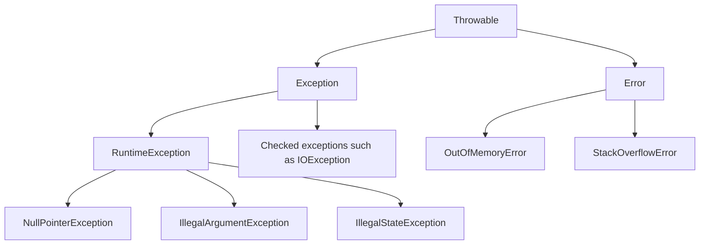
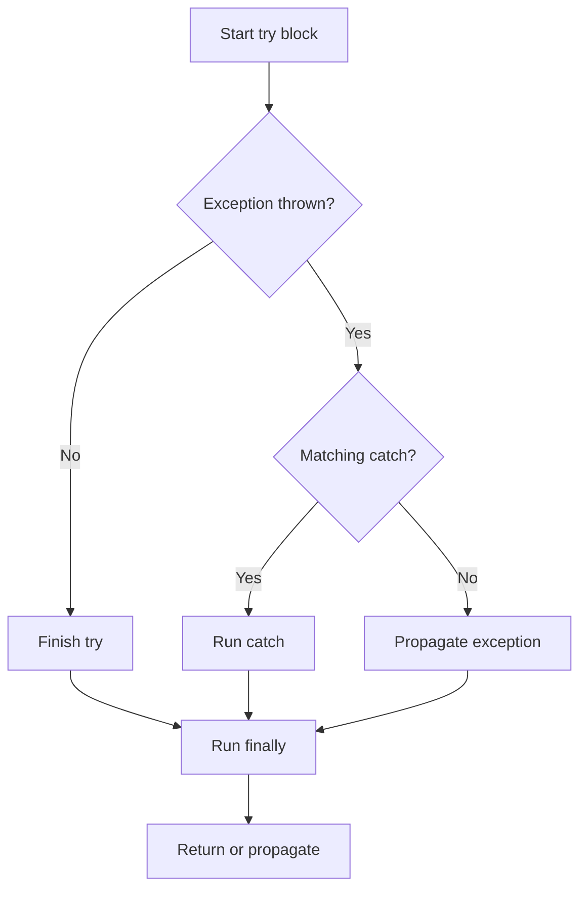
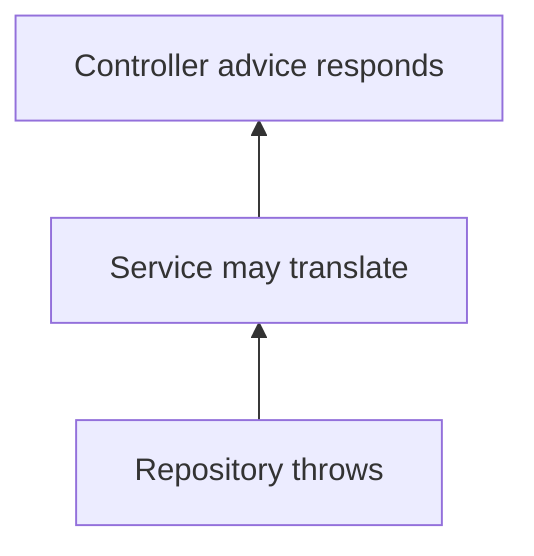
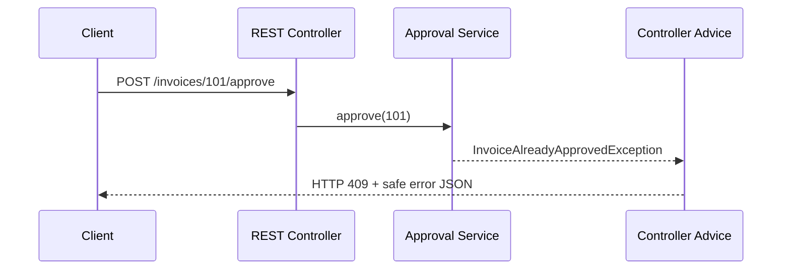

# Chapter 7 — Java Exception Handling and Production Error Design

> **Goal:** Understand Java exception mechanics, write safe cleanup code, and build predictable error handling in Spring Boot APIs.

**Level:** Core → Senior Java | **Java:** 21 | **Suggested study:** 60–90 minutes

## 1. Why exceptions matter

Imagine an invoice approval request: a client sends an unknown invoice number, a database connection times out, or an invoice is already approved. These situations need *different* responses. Exception handling lets us separate normal business processing from abnormal or invalid execution paths.

An exception is an object describing a problem. It can be **thrown**, **caught**, **wrapped**, or **propagated** to a caller. Exception handling does not replace normal validation or a well-defined API error contract.

## 2. The exception hierarchy



**Checked exceptions:** Subclasses of `Exception` that are not `RuntimeException`. The compiler requires them to be caught or declared with `throws` (subject to the language rules).

**Unchecked exceptions:** `RuntimeException` and `Error` subtypes. The compiler does not require a catch or declaration.

An `Error` normally represents a serious VM/system problem; business logic should not routinely catch `Error` or `Throwable` and continue processing.

| Situation | Example | Reasonable handling |
|---|---|---|
| Invalid caller input | `IllegalArgumentException` | Validate and report the bad input |
| Invalid business transition | `IllegalStateException` / custom domain exception | Return domain-specific rejection |
| File or network operation | `IOException` | Handle, propagate or translate with context |
| Programming defect | `NullPointerException` | Fix root cause, not hide the bug |
| JVM resource exhaustion | `OutOfMemoryError` | Investigate memory/resource failure |

## 3. try, catch, finally — execution order



`finally` generally runs whether an exception occurs or not, including after `return`. It is **not guaranteed** if the process terminates abruptly, a JVM crash occurs, or execution never reaches it. Avoid `return` or throwing a new exception in `finally`: doing so can suppress an earlier result or exception.

```java
public class ExceptionFlowDemo {
    public static void main(String[] args) {
        try {
            System.out.println("Try");
            int number = Integer.parseInt("invalid");
            System.out.println(number);
        } catch (NumberFormatException e) {
            System.out.println("Catch: invalid number");
        } finally {
            System.out.println("Finally: cleanup");
        }
    }
}
```

**Expected output:**

```text
Try
Catch: invalid number
Finally: cleanup
```

## 4. throw vs throws

- **`throw`** actually raises one exception object at a particular point.
- **`throws`** declares possible exception types in a method signature, especially important for checked exceptions.

```java
import java.io.IOException;

class InvoiceReader {
    String read(String fileName) throws IOException {
        if (fileName == null) {
            throw new IOException("Filename is required");
        }
        return fileName;
    }
}
```

`throws` does not itself throw an exception; it describes part of a method's contract.

## 5. Exception propagation and stack unwinding

When a called method throws an exception that it does not handle, the exception propagates up the call stack until a matching handler is found (or the thread ends with an uncaught exception).



**Senior-level tip:** Do not catch an exception only to immediately rethrow it unchanged unless you have a meaningful reason (cleanup, logging at a boundary, or contextual translation). Repeatedly logging the same exception in every layer creates noisy production logs.

## 6. Multiple catch blocks and multi-catch

Specific exception handlers must appear before more general handlers, or later handlers may be unreachable.

```java
try {
    Integer.parseInt("abc");
} catch (NumberFormatException e) {
    System.out.println("Invalid number");
} catch (RuntimeException e) {
    System.out.println("Other runtime problem");
}
```

For unrelated exception types that require identical handling, Java supports `catch (IOException | SQLException e)` when the alternatives are legal and neither is a subtype of the other.

## 7. try-with-resources — the preferred cleanup pattern

Use `try-with-resources` for objects implementing `AutoCloseable`, including streams, readers, and JDBC connections/statements/results. Java closes resources automatically in reverse declaration order.

```java
import java.io.IOException;
import java.nio.file.Files;
import java.nio.file.Path;

public class ReadFirstLineDemo {
    public static void main(String[] args) throws IOException {
        Path path = Path.of("invoices.txt");
        try (var reader = Files.newBufferedReader(path)) {
            System.out.println(reader.readLine());
        }
    }
}
```

**Input preparation:** Create `invoices.txt` with first line `INV-101`. **Expected output:** `INV-101`.

### Suppressed exceptions

If the `try` body throws and closing the resource also throws, the body exception is normally primary, and close exceptions are available through `getSuppressed()`.

```java
try (AutoCloseable resource = () -> { throw new Exception("close failed"); }) {
    throw new Exception("work failed");
} catch (Exception e) {
    System.out.println(e.getMessage()); // work failed
    System.out.println(e.getSuppressed()[0].getMessage()); // close failed
}
```

This behavior is a key advantage over manual cleanup that may accidentally replace an original exception.

## 8. Create meaningful custom exceptions

A domain-specific exception is useful when callers need to distinguish an expected business failure from technical failures.

```java
class InvoiceAlreadyApprovedException extends RuntimeException {
    InvoiceAlreadyApprovedException(String invoiceNumber) {
        super("Invoice already approved: " + invoiceNumber);
    }
}

class InvoiceApprovalService {
    void approve(String invoiceNumber, boolean alreadyApproved) {
        if (alreadyApproved) {
            throw new InvoiceAlreadyApprovedException(invoiceNumber);
        }
        System.out.println("Approved " + invoiceNumber);
    }
}
```

Prefer clear exception messages, stable error codes where needed, and preserved causes when wrapping underlying failures. Avoid one custom class per trivial validation rule if a consistent domain error type is clearer.

## 9. Preserve the original cause

```java
class InvoiceImportException extends RuntimeException {
    InvoiceImportException(String message, Throwable cause) {
        super(message, cause);
    }
}
```

```java
try {
    importFile();
} catch (java.io.IOException e) {
    throw new InvoiceImportException("Unable to import invoice file", e);
}
```

Wrapping exceptions without retaining the cause makes diagnosis difficult. Translate exceptions **at appropriate architecture boundaries**, not at every method.

## 10. Spring Boot REST error handling

A REST client should receive a **stable HTTP status and sanitized response body**. Internal Java stack traces or SQL messages should not be sent to the caller.

Typical mappings:

| Condition | HTTP code | Explanation |
|---|---|---|
| Invalid request fields | 400 | Request validation failed |
| Unauthenticated | 401 | Valid authentication required |
| Authenticated but forbidden | 403 | Caller lacks access |
| Invoice does not exist | 404 | Requested resource absent |
| Invalid state transition | 409 | Request conflicts with current resource state |
| Unexpected server error | 500 | Internal server failure |

These are typical design choices, not universal mappings. For example, domain validation errors may also be represented by 422 depending on the API contract.

### Example with `@RestControllerAdvice`

```java
import org.springframework.http.HttpStatus;
import org.springframework.http.ResponseEntity;
import org.springframework.web.bind.annotation.ExceptionHandler;
import org.springframework.web.bind.annotation.RestControllerAdvice;

record ApiError(String code, String message) {}

@RestControllerAdvice
class GlobalExceptionHandler {
    @ExceptionHandler(InvoiceAlreadyApprovedException.class)
    ResponseEntity<ApiError> handleAlreadyApproved(InvoiceAlreadyApprovedException e) {
        return ResponseEntity.status(HttpStatus.CONFLICT)
                .body(new ApiError("INVOICE_ALREADY_APPROVED", e.getMessage()));
    }
}
```

This is a **Spring Boot project snippet** and requires Spring dependencies; it is not a standalone `javac` example. For other exceptions, add focused handlers and a secure general fallback using your application's conventions. Spring also offers `ProblemDetail` for standardized error representations.

### Error flow in a real API



## 11. Exceptions and `@Transactional`

With the usual Spring transaction interceptor configuration, an **unchecked exception** triggers rollback by default, while a checked exception does **not** trigger rollback by default unless configured (e.g., `rollbackFor`). Rules can be customized.

```java
@Transactional(rollbackFor = java.io.IOException.class)
public void importInvoice() throws java.io.IOException {
    // JDBC/JPA business operations
}
```

**Important traps:** Transaction boundaries usually rely on Spring proxy interception. Calling a transactional method through `this.method()` from within the same object often bypasses proxy advice. Catching an exception inside a transaction and treating the operation as successful can also affect whether rollback occurs; understand rollback-only markers and actual transaction boundaries.

## 12. Errors in async tasks and CompletableFuture

A failure in an asynchronous task may be delivered through a `Future` or `CompletableFuture` rather than thrown directly on the caller's thread.

```java
import java.util.concurrent.CompletableFuture;

public class AsyncErrorDemo {
    public static void main(String[] args) {
        String result = CompletableFuture.supplyAsync(() -> {
            throw new IllegalStateException("Service unavailable");
        }).exceptionally(ex -> "fallback").join();
        System.out.println(result);
    }
}
```

**Expected output:** `fallback`.

A `.join()` on an exceptionally completed future ordinarily throws `CompletionException` (or directly a `CancellationException` for cancellation); `.get()` uses checked `ExecutionException` and `InterruptedException`. Never silently ignore async errors in business-critical workflows.

## 13. InterruptedException and thread interruption

`InterruptedException` is often a **cancellation signal**, not a normal business error. If you cannot propagate it, restore the interrupt status and stop the operation where appropriate.

```java
try {
    Thread.sleep(1000);
} catch (InterruptedException e) {
    Thread.currentThread().interrupt();
    return;
}
```

Do not broadly catch `Exception` in workers and continue looping forever; that can hide interruption and shutdown requests.

## 14. Logging and observability

When logging failures, include meaningful context such as request ID, operation, and a safe business identifier. Avoid logging tokens, passwords, secrets, personal data, or raw sensitive payloads.

**Bad:** Log the same stack trace in controller, service and repository.

**Better:** Handle known domain errors without unnecessary stack traces; log unexpected exceptions once at an appropriate boundary, preserving their cause and correlation context.

## 15. Common mistakes

1. Catching `Exception` or `Throwable` everywhere and silently continuing.
2. Returning `null` after a serious error instead of expressing failure clearly.
3. Calling `printStackTrace()` in production application code.
4. Forgetting to close JDBC/file resources.
5. Catching a checked exception and throwing a new one without the cause.
6. Using exceptions for ordinary control flow when a simple conditional is clearer.
7. Returning exception class names, SQL messages or stack traces to external API users.
8. Assuming every exception automatically rolls back a Spring transaction.
9. Swallowing `InterruptedException` without considering cancellation.
10. Throwing or returning inside `finally`, thereby hiding earlier exceptions/results.

## 16. Interview questions and natural answers

**Q1. What is the difference between checked and unchecked exceptions?**

Checked exceptions are compiler-enforced and normally must be handled or declared; unchecked exceptions include RuntimeException and Error. I choose exceptions based on whether callers can reasonably recover and on API design, rather than using only one category everywhere.

**Q2. What is the difference between `throw` and `throws`?**

`throw` raises an exception object. `throws` declares exceptions that may escape a method.

**Q3. Why do we use `finally`?**

It allows cleanup logic regardless of normal completion or exception propagation, but try-with-resources is usually safer for AutoCloseable resources.

**Q4. How does try-with-resources handle multiple failures?**

It preserves the exception from the try body as the primary failure and records closing failures as suppressed exceptions.

**Q5. Should we catch NullPointerException?**

Usually it indicates a defect that should be fixed. Catching it generically can hide programming errors; handle expected absence through validation or explicit contracts.

**Q6. What makes a good custom exception?**

A meaningful domain name, clear context, stable mapping to API error behavior, and the original cause where appropriate.

**Q7. How do exceptions propagate?**

If a method does not handle the exception, the JVM unwinds the call stack to an eligible handler. If none handles it, the thread terminates with an uncaught exception.

**Q8. How do you handle exceptions in Spring Boot?**

I use validation, domain-specific exceptions, and centralized `@RestControllerAdvice` to return consistent status codes and safe error responses. Unexpected failures are logged with correlation context.

**Q9. Does `@Transactional` roll back for checked exceptions?**

By default, Spring's usual transaction rules roll back on unchecked exceptions and Errors, not checked exceptions. We can configure `rollbackFor` or global defaults as needed.

**Q10. What happens if you catch an exception inside a transactional method?**

The transaction interceptor may see normal method completion, so rollback may not happen automatically. But the transaction could already be marked rollback-only. The correct behavior depends on where and how failure occurs.

**Q11. How do you handle exceptions in CompletableFuture?**

With methods such as `exceptionally`, `handle` or `whenComplete`, and by checking the result at the caller. I avoid ignoring failures from fire-and-forget tasks.

**Q12. How do you handle InterruptedException?**

Propagate it when appropriate; otherwise restore the interrupt flag and stop or cancel the operation as needed.

**Q13. Is Error caught by `catch (Exception e)`?**

No. Error and Exception are separate direct branches under Throwable.

**Q14. Can a `finally` block override an exception?**

Yes. A new exception or return from `finally` can replace a pending result or exception, so those patterns should generally be avoided.

**Q15. How would you distinguish validation, business and technical failures in an invoice API?**

I validate request syntax early, enforce invoice-state rules in the service/domain layer, translate known failures into stable client error codes, and keep technical diagnostics in logs rather than exposing them in HTTP responses.

## 17. Coding and scenario practice

1. Write a custom `InvoiceNotFoundException` and map it to HTTP 404.
2. Write a try-with-resources program that reads the first CSV line.
3. Demonstrate suppressed exceptions with an AutoCloseable.
4. Explain the result of a method that returns in `try` and also returns in `finally`.
5. Decide whether a transient database timeout should be retried; account for idempotency.
6. Write a `CompletableFuture` pipeline with a fallback and a failure log.
7. Describe how a transaction should behave when invoice validation fails.
8. Demonstrate thread interruption without swallowing the signal.

## 18. Quick revision

- **Checked:** catch or declare, except compiler-specific rules.
- **Unchecked:** RuntimeException and Error.
- **throw:** raise; **throws:** declare.
- **finally:** cleanup, with caveats; prefer try-with-resources for resources.
- **Suppressed exceptions:** closing failures retained alongside primary failure.
- **Custom domain exceptions:** give business meaning to failures.
- **Spring advice:** consistent HTTP error contract.
- **Transactions:** rollback behavior must be understood and explicitly configured when required.
- **Production:** preserve causes, log with context, avoid exposing internals.

**Next chapter recommendation:** Java Generics and Type Erasure, then Multithreading, JVM memory and concurrency.

### References

- [Java SE 21 Language Specification — Exceptions](https://docs.oracle.com/javase/specs/jls/se21/html/jls-11.html)
- [Java SE 21 `AutoCloseable`](https://docs.oracle.com/en/java/javase/21/docs/api/java.base/java/lang/AutoCloseable.html)
- [Spring Framework transaction rollback rules](https://docs.spring.io/spring-framework/reference/data-access/transaction/declarative/rolling-back.html)
