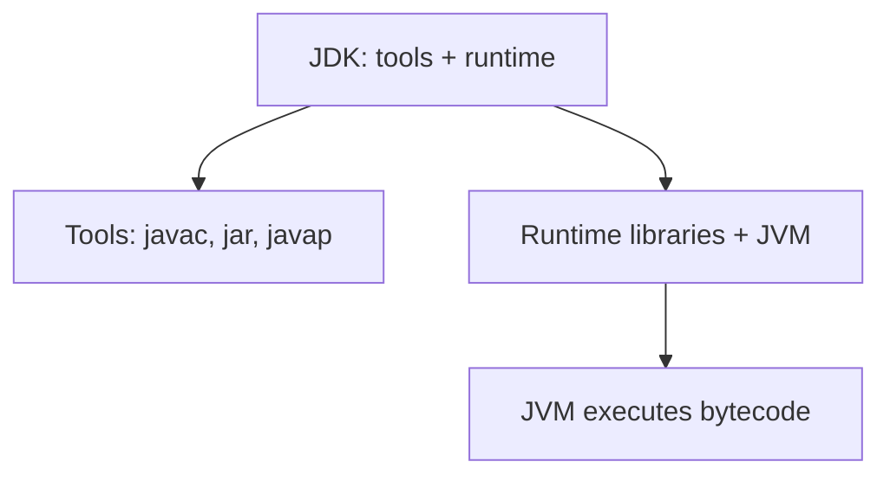
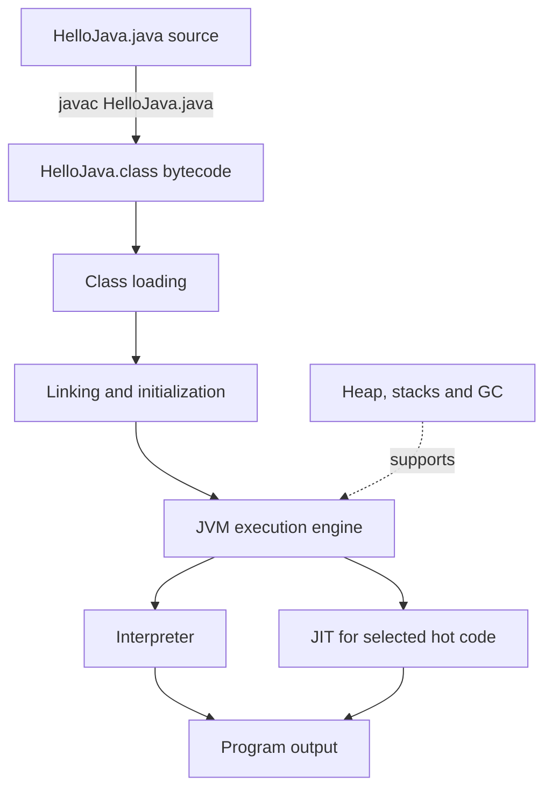
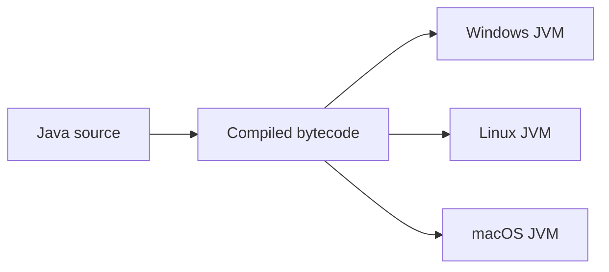
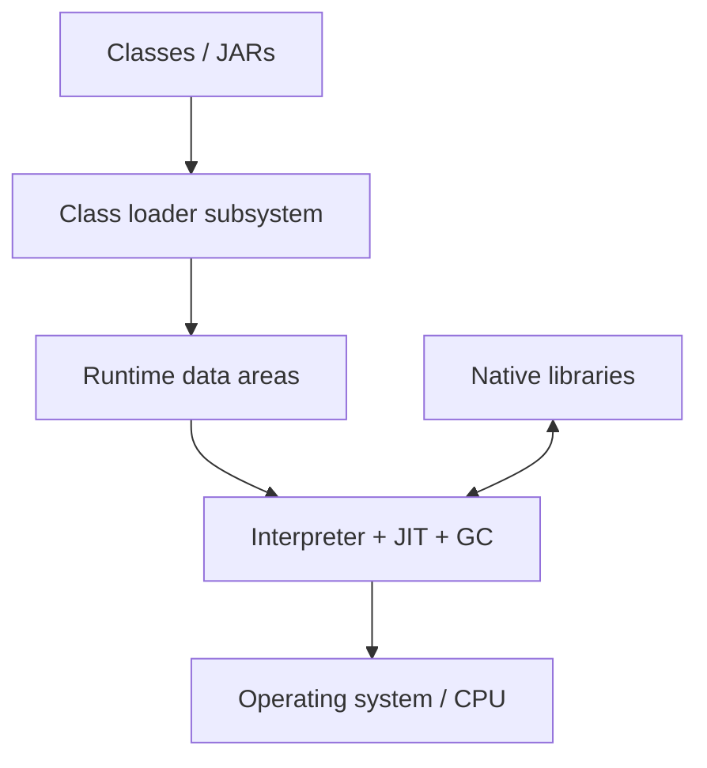
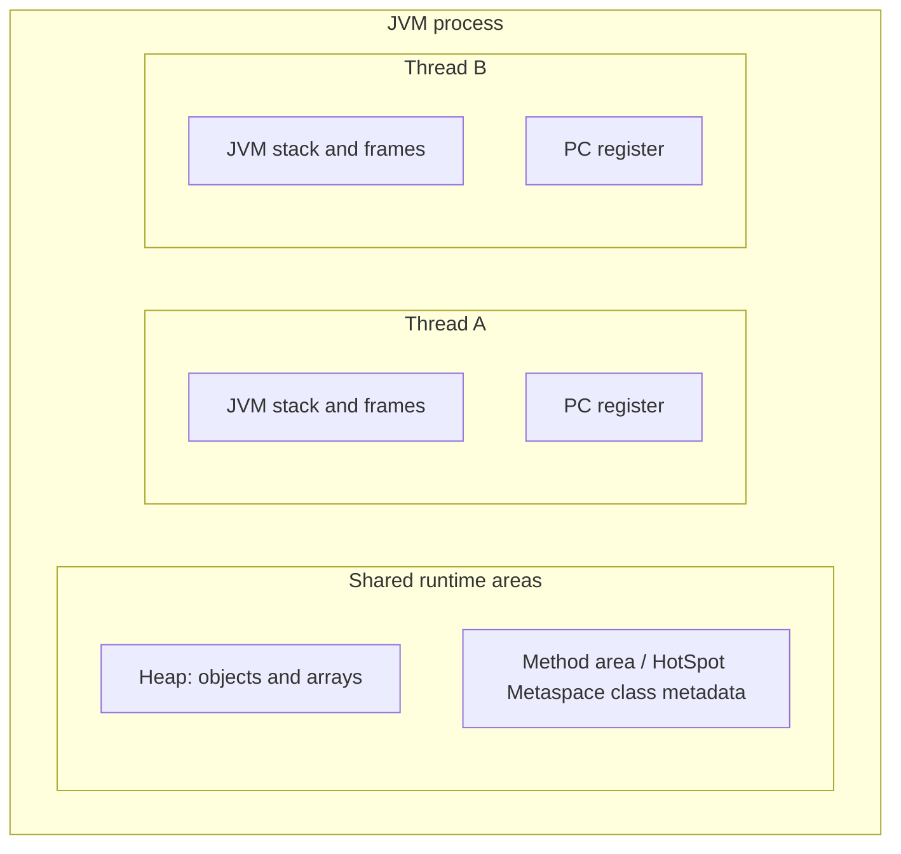

# Chapter 1 — Java Architecture: JDK, JRE, JVM and Execution Flow

> **Learning objective:** Understand what happens between writing a Java program and seeing its output, and explain it confidently in a senior Java interview.

**Target:** Java 21 · **Study time:** 45–60 minutes · **Format:** Notes → diagrams → examples → interview Q&A → revision

## 1. Why learn this?

Imagine your Spring Boot application works on your Windows laptop, then runs on a Linux server. Why can the same Java bytecode run on both? When you run `java -jar app.jar`, what happens internally? And when memory usage climbs in production, which Java runtime components should you inspect?

Understanding the **JDK, JVM, bytecode, class loading, JIT compilation and runtime memory** helps answer these questions.

## 2. JDK vs JRE vs JVM

| Term | Full name | Meaning | Responsibility |
|---|---|---|---|
| **JDK** | Java Development Kit | Toolkit for Java developers | Compile, run, debug and package applications |
| **JRE** | Java Runtime Environment | Traditional name for a Java runtime installation | JVM plus runtime libraries and resources |
| **JVM** | Java Virtual Machine | Execution engine for Java bytecode | Class loading, bytecode execution, runtime memory and GC |

The JDK contains tools such as `javac`, `java`, `jar`, `javadoc`, `javap` and `jcmd`. A modern JDK, including Java 21, does **not** necessarily include a separately installable JRE package. The `jlink` utility can create custom runtime images.

**Easy memory trick:** JDK = **develop**; JVM = **execute**; JRE = **runtime environment**.



## 3. How a Java program executes

Create a file called `HelloJava.java`:

```java
public class HelloJava {
    public static void main(String[] args) {
        int invoiceCount = 3;
        System.out.println("Invoices: " + invoiceCount);
    }
}
```

Compile and execute:

```bash
javac HelloJava.java
java HelloJava
```

**Output:**

```text
Invoices: 3
```

The `javac` compiler creates `HelloJava.class`, containing **bytecode** rather than Windows- or Linux-specific native instructions.



**Execution steps:**

1. **Source:** Write Java code in a `.java` file.
2. **Compilation:** `javac` performs checks and writes `.class` files.
3. **Class loading:** The JVM locates and loads required classes.
4. **Linking:** It verifies bytecode, prepares class structures and resolves symbolic references when required.
5. **Initialization:** Static initialization occurs when the JVM requires it.
6. **Execution:** The interpreter executes bytecode; the JIT may compile frequently used paths to optimized native code.
7. **Runtime management:** Memory areas and garbage collection support the running application.

**Important distinction:** Class **loading**, **linking** and **initialization** are separate stages. Resolution can be lazy. Not every class is initialized at startup.

Java 21 also supports single-file source launching:

```bash
java HelloJava.java
```

This mode compiles and launches the source for you; it does not mean the JVM generally interprets raw `.java` files.

## 4. Why is Java platform independent?

A compatible JVM for each operating system understands the same Java bytecode.



Java is **largely platform independent**, but native libraries, file paths, OS behavior and environment settings may still be platform-specific. A Java 17 runtime also cannot execute class files compiled for Java 21 without targeting an older supported release.

## 5. What is inside a JVM?

Think of a JVM as **class loaders + runtime data areas + execution engine + native integration**.



### 5.1 Class loaders

- **Bootstrap class loader:** Loads fundamental Java platform classes.
- **Platform class loader:** Loads platform classes not handled by bootstrap.
- **Application class loader:** Loads application classes from the class path or module path.

The usual delegation mechanism asks a parent loader before loading the class itself. Specialized class loaders may behave differently.

Try:

```java
public class LoaderDemo {
    public static void main(String[] args) {
        System.out.println(String.class.getClassLoader());
        System.out.println(LoaderDemo.class.getClassLoader());
    }
}
```

For a standard JVM, the first line usually prints `null` to represent the bootstrap loader. The second line displays the application class loader, with implementation-dependent details.

### 5.2 Loading vs linking vs initialization

| Stage | What happens |
|---|---|
| Loading | Class is located and represented in the JVM |
| Verification | Class-file and bytecode constraints are checked |
| Preparation | Static fields receive their initial default values |
| Resolution | Symbolic references are connected to runtime targets, as necessary |
| Initialization | Static initializer logic is executed |

A common interview mistake is to say that loading a class automatically executes its static block. Initialization is a separate phase.

## 6. JVM memory: heap, stack and method area



| Memory area | Typical purpose | Sharing |
|---|---|---|
| Heap | Most objects and arrays | Shared across threads |
| JVM stack | Method frames, operands and local variables | One stack per thread |
| PC register | Current execution position | One per thread |
| Method area | JVM runtime class information | Shared |
| Native method stacks | Native execution, when used | Thread specific |

**Implementation detail:** HotSpot commonly stores class metadata in native-memory **Metaspace**. The JVM specification describes a *method area* abstractly; it does not mandate HotSpot's internal layout.

Example:

```java
public class MemoryDemo {
    static class Invoice {
        final int id;
        Invoice(int id) { this.id = id; }
    }

    public static void main(String[] args) {
        int count = 2;
        Invoice invoice = new Invoice(101);
        System.out.println(count + " : " + invoice.id);
    }
}
```

**Output:** `2 : 101`.

**Conceptual explanation:** The method frame contains local values such as `count` and the `invoice` reference; the `Invoice` object normally resides on the heap. Optimizing JVMs can eliminate allocations or alter physical representation, so this is a logical model, not a fixed physical-memory promise.

## 7. Interpreter vs JIT compiler

The interpreter executes bytecode instructions. The Just-in-Time compiler produces native machine code for selected paths, usually based on runtime profiling.

| Interpreter | JIT compiler |
|---|---|
| Can start executing without ahead-of-time native compilation | Spends some time optimizing and compiling |
| Often helps initial startup | Can improve throughput for frequently executed methods |
| Executes bytecode directly | Produces optimized native code |

The JVM may **deoptimize** compiled methods when prior assumptions no longer hold. It is incorrect to claim that the JIT compiles every method once at startup.

## 8. Garbage collection, OOM and memory leaks

Garbage collection reclaims objects that are **unreachable**. It cannot reclaim objects the application still holds references to.

```java
import java.util.ArrayList;
import java.util.List;

public class RetainedObjects {
    private static final List<byte[]> CACHE = new ArrayList<>();

    public static void main(String[] args) {
        CACHE.add(new byte[1_000_000]);
        System.out.println("Retained entries: " + CACHE.size());
    }
}
```

**Output:** `Retained entries: 1`.

The static list keeps the array reachable. If a long-running application adds entries without eviction, heap usage can grow continuously.

- `OutOfMemoryError: Java heap space`: Heap allocation failed.
- `StackOverflowError`: A thread stack was exhausted, often through recursion.
- `OutOfMemoryError: Metaspace`: Class metadata allocation could not continue.

Increasing `-Xmx` is **not** a universal fix for all three problems.

## 9. Try these Java 21 diagnostic commands

```bash
java -version
javac -version
javap -c HelloJava
java -XshowSettings:vm -version
jcmd -l
```

The `javap -c` command shows bytecode instructions for a compiled class. `jcmd -l` lists discoverable JVM processes. Use diagnostic tools carefully in production; some outputs and heap dumps may contain confidential data.

## 10. Spring Boot production scenario

**Problem:** After a few hours, an invoice-report API becomes slow while heap usage keeps rising.

**Investigation approach:**

1. Compare response times with request volume, database latency and recent deployments.
2. Monitor heap occupancy, GC frequency, pause durations and allocation rate.
3. Examine whether reports load huge datasets or caches retain objects indefinitely.
4. Look at thread activity, object retention and memory diagnostics when authorized.
5. Fix application-level causes; then validate JVM and container memory limits under load.

**Good interview explanation:** “I first identify whether the bottleneck is in the API, database, external dependency or JVM. I use metrics and logs to narrow it down before changing heap or GC settings.”

## 11. Interview questions and natural answers

**Q1. What is the difference between JDK, JRE and JVM?**

The JDK has the tools required to build Java applications. The JVM runs compiled bytecode and manages runtime memory. JRE is the traditional term for the runtime environment; modern Java installations do not always provide a separate JRE package.

**Q2. Why is Java platform independent?**

Java compilation produces bytecode that a compatible JVM can run on different operating systems. The actual JVM executable is platform-specific. Native dependencies can still limit portability.

**Q3. What happens when we run a Java application?**

The JVM loads, links and initializes the necessary classes, then executes the entry point. The interpreter handles bytecode, and JIT compilation may optimize frequently executed paths. Runtime areas and GC support execution.

**Q4. How do heap and stack differ?**

The heap is shared and normally stores objects. Each thread has its own JVM stack containing method frames and local variables. Physical storage can be optimized by the JVM, so we should treat this as a conceptual explanation.

**Q5. Does the JVM only interpret bytecode?**

No. HotSpot combines interpretation and JIT compilation and can optimize frequently executed methods at runtime.

**Q6. What does a class loader do?**

A class loader locates and defines classes. It supports loading code as needed and can help isolate application components or plugins.

**Q7. Can Java have memory leaks even with garbage collection?**

Yes. A reachable object cannot be collected. For example, an unbounded static cache can retain objects for the entire application lifetime.

**Q8. What is the difference between `OutOfMemoryError` and `StackOverflowError`?**

Out-of-memory errors can reflect failed allocations in areas such as the heap or Metaspace. Stack overflow occurs when a thread exhausts its call stack, often because of unbounded recursion.

**Q9. Can garbage collection affect API latency?**

Yes. Allocation pressure and GC pauses can increase latency. We should measure pause time, heap occupancy and request metrics before changing GC configuration.

**Q10. Why might Java 21 bytecode fail on a Java 17 server?**

Because the older runtime does not support that newer class-file format. Use a compatible runtime or compile against a supported release target when the code allows it.

## 12. Common mistakes

- “The JVM executes `.java` source directly.” Normally, the JVM executes compiled bytecode.
- “JVM and JRE mean the same thing.” The JVM is a runtime component.
- “Every primitive goes on the stack, every reference goes on the heap.” This is oversimplified.
- “Garbage collection prevents all memory leaks.” Reachable objects may be retained indefinitely.
- “All classes load when a Java application starts.” Many classes load on demand.
- “Increasing heap always fixes memory issues.” Root causes differ by memory area and workload.

## 13. One-minute revision

**JDK → tools. JRE → runtime environment. JVM → bytecode execution.**

**Source → `javac` → `.class` → class loading → linking → initialization → interpreter/JIT → output.**

**Heap → commonly objects, shared. Stack → method frames, per thread. Metaspace → HotSpot class metadata. GC → unreachable objects only.**

## 14. Practice assignment

1. Create and execute `HelloJava.java` using Java 21.
2. Run `javap -c HelloJava` and inspect the bytecode.
3. Draw the execution flow without looking at the diagram.
4. Explain heap vs stack aloud in under a minute.
5. Explain how an unbounded cache can cause heap exhaustion.

**Done when:** You can explain JDK/JVM/JRE, class loading versus initialization, interpreter versus JIT, and heap versus stack without checking these notes.

---

**Next chapter:** Classes, objects, constructors and OOP fundamentals.

**Primary references:** [Java SE 21 JVM Specification](https://docs.oracle.com/javase/specs/jvms/se21/html/index.html) · [Java 21 tool documentation](https://docs.oracle.com/en/java/javase/21/docs/specs/man/index.html)
