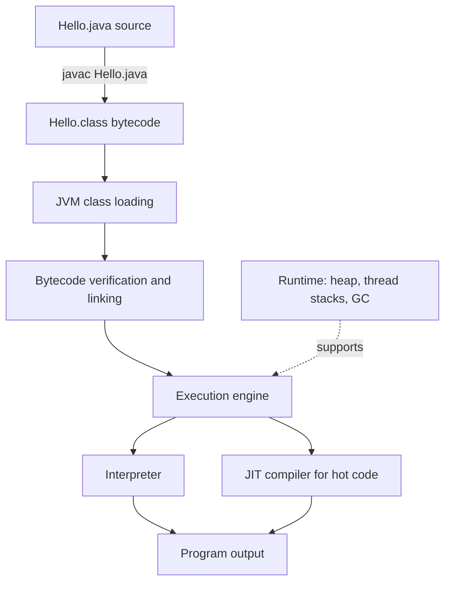

# Chapter 1 — JDK, JRE, JVM and Java execution

**Goal:** Explain what happens between writing `Hello.java` and seeing output on screen.

## 1. The simple idea

Java code is written in a `.java` file. The Java compiler turns it into **bytecode** (`.class`), which the Java Virtual Machine (JVM) can execute. The JVM can interpret bytecode, and a Just-In-Time (JIT) compiler can compile frequently executed code to native machine instructions for better performance.

Think of it this way: **you write Java once; the JVM for each operating system handles machine-specific execution.** Platform independence has limits when you depend on native libraries or platform-specific behavior.

## 2. JDK vs JRE vs JVM

| Term | Meaning | What it includes / does |
|---|---|---|
| JDK | Java Development Kit | Development tools such as `javac`, `java`, `javadoc`, `jar`, `jdb` plus runtime components |
| JRE | Java Runtime Environment | Traditional name for components needed to run Java programs (JVM + standard runtime libraries); modern JDK distributions no longer always ship a separate JRE |
| JVM | Java Virtual Machine | Loads, verifies, and executes bytecode; manages runtime memory and garbage collection |

**Remember:** JDK is the toolkit, JVM is the runtime engine; JRE is the historical packaging/concept for a runnable environment.

## 3. Execution flow



### Step by step

1. **Compilation:** `javac` checks syntax/types and produces `.class` bytecode.
2. **Class loading:** The JVM finds needed classes through class loaders.
3. **Linking:** Bytecode verification and resolution/preparation make classes ready for execution. Initialization follows when required.
4. **Execution:** The JVM starts executing bytecode; hot code paths may be JIT-compiled.
5. **Memory and cleanup:** Objects usually live on the heap, methods use thread stack frames, and the GC reclaims unreachable heap objects.

## 4. Try it yourself

```java
public class Hello {
    public static void main(String[] args) {
        String message = "Java 21";
        System.out.println("Learning " + message);
    }
}
```

Save as `Hello.java` then run:

```bash
javac Hello.java
java Hello
```

**Output**

```text
Learning Java 21
```

For a quick experiment, modern Java can also launch a single-file source program with `java Hello.java`.

## 5. Real Spring Boot connection

When you start a Spring Boot application, the JVM loads Spring, application and dependency classes. Framework startup creates application context objects, configures beans, and starts the embedded web server when applicable. The JVM remains responsible for executing bytecode, managing threads, memory and GC.

**Production scenario:** If API latency increases along with long GC pauses, investigate heap usage, allocation rate, GC logs and memory configuration—rather than assuming the controller method is slow.

## 6. Common mistakes

- Saying **JVM compiles `.java` directly**: `javac` normally produces bytecode first.
- Saying **all bytecode is always interpreted**: HotSpot uses both interpretation and JIT compilation.
- Saying **JRE must always be installed separately**: Modern JDK distributions may not provide a separate JRE package.
- Saying **GC prevents every memory leak**: reachable objects can still accumulate unintentionally.

## 7. Interview answers

**Q: What is the difference between JDK, JRE and JVM?**

> The JDK is what developers use to build Java applications, including the compiler and other tools. The JVM runs Java bytecode. JRE is the traditional term for the runtime components needed to execute a Java program. With modern JDK distributions, a standalone JRE is not always provided.

**Q: Why is Java platform-independent?**

> Java source is compiled to platform-neutral bytecode. A compatible JVM on each operating system executes that bytecode. The actual JVM implementation is platform-specific.

**Q: Does the JVM only interpret code?**

> No. A JVM such as HotSpot can start with interpretation and use a JIT compiler to optimize frequently executed code paths.

## 8. Quick revision

`Hello.java` → `javac` → `Hello.class` → class loading/verifying → interpreter/JIT → execution.

**Practice:** Explain this flow out loud in 60 seconds, then run `java -version` and `javac -version` on your laptop.
