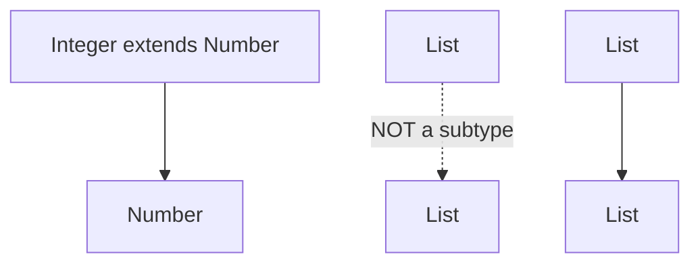
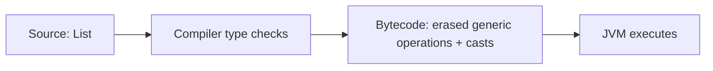

# Chapter 8 — Java Generics, Wildcards and Type Erasure

> **Goal:** Learn to create type-safe reusable APIs and explain the tricky compiler rules commonly tested in senior Java interviews.

**Version:** Java 21 · **Study time:** 60–90 minutes · **Approach:** Explanation → diagram → runnable example → interview answers → practice.

## 1. Why generics exist

Suppose an Invoice Tracking application stores invoice numbers. Without generics, collections can hold any object and require unsafe casts. Generics allow us to express **which type** a class, method or collection expects, and the compiler verifies most mistakes before the application runs.

```java
import java.util.ArrayList;
import java.util.List;

public class BasicGenericsDemo {
    public static void main(String[] args) {
        List<String> invoiceNumbers = new ArrayList<>();
        invoiceNumbers.add("INV-101");
        // invoiceNumbers.add(123); // Compile-time error
        String id = invoiceNumbers.get(0); // No cast required
        System.out.println(id);
    }
}
```

**Output:** `INV-101`. The benefit is *compile-time type checking*, not a new runtime collection implementation.

## 2. Generic types and type parameters

`T`, `E`, `K`, `V` are conventional names, not language keywords. A type parameter can be any valid identifier.

```java
final class Result<T> {
    private final T data;
    Result(T data) { this.data = data; }
    T data() { return data; }
}

public class GenericTypeDemo {
    public static void main(String[] args) {
        Result<String> result = new Result<>("APPROVED");
        System.out.println(result.data());
    }
}
```

**Output:** `APPROVED`.

`Result<String>` and `Result<Integer>` provide different *compile-time* types, but usually share the same runtime class because of type erasure.

## 3. Generic methods

A generic method declares its own type parameters **before** its return type:

```java
import java.util.List;

public class GenericMethodDemo {
    public static <T> T first(List<T> values) {
        if (values.isEmpty()) throw new IllegalArgumentException("Empty list");
        return values.get(0);
    }

    public static void main(String[] args) {
        System.out.println(first(List.of("PO-1", "PO-2")));
        System.out.println(first(List.of(10, 20)));
    }
}
```

**Output:**

```text
PO-1
10
```

A static generic method is allowed even though a static method cannot use a class's own type parameter directly.

## 4. Invariance: `List<Integer>` is not a `List<Number>`

This is one of the most common interview traps:

```java
// List<Number> numbers = new ArrayList<Integer>(); // Does not compile
```

If it were allowed, a caller could add `Double` into a list that was originally designed to hold only `Integer`.



**Remember:** Java generics are invariant. A wildcard may provide a safe *view* of related types.

## 5. Wildcards: `?`, `extends`, and `super`

| Declaration | Reads | Writes | Best use |
|---|---|---|---|
| `List<?>` | As `Object` | Cannot add non-null values | Unknown element type |
| `List<? extends Number>` | As `Number` | Cannot add ordinary `Number` values | Produce/read numbers |
| `List<? super Integer>` | As `Object` | Can add `Integer` values | Consume/write integers |

The restrictions are about **type safety**, not collection mutability. Wildcard-typed references can still refer to mutable lists.

### `extends` — producer

```java
import java.util.List;

public class ExtendsDemo {
    static double total(List<? extends Number> values) {
        double sum = 0;
        for (Number value : values) sum += value.doubleValue();
        return sum;
    }
    public static void main(String[] args) {
        System.out.println(total(List.of(10, 20, 30)));
        System.out.println(total(List.of(1.5, 2.5)));
    }
}
```

**Output:**

```text
60.0
4.0
```

### `super` — consumer

```java
import java.util.ArrayList;
import java.util.List;

public class SuperDemo {
    static void addDefaultPriority(List<? super Integer> target) {
        target.add(1);
        target.add(2);
    }
    public static void main(String[] args) {
        List<Number> priorities = new ArrayList<>();
        addDefaultPriority(priorities);
        System.out.println(priorities);
    }
}
```

**Output:** `[1, 2]`.

## 6. PECS: Producer Extends, Consumer Super


A practical, reusable copy method:

```java
import java.util.List;

public class PecsDemo {
    static <T> void copy(List<? extends T> source, List<? super T> destination) {
        for (T item : source) destination.add(item);
    }
}
```

**Meaning:** The source *produces* `T` values; the destination *consumes* `T` values. PECS is a useful guide, not a reason to add wildcards everywhere.

## 7. Bounded type parameters

You can restrict the allowed types using `extends` even when the bound is an interface:

```java
public class BoundedDemo {
    static <T extends Comparable<? super T>> T greater(T a, T b) {
        return a.compareTo(b) >= 0 ? a : b;
    }
    public static void main(String[] args) {
        System.out.println(greater(15, 20));
    }
}
```

**Output:** `20`.

Multiple bounds are written like `<T extends SomeClass & FirstInterface & SecondInterface>`; if a class bound is present, it must come first.

## 8. Type erasure — what really happens

Most generic type arguments are erased from the runtime representation. The compiler checks generic usage, inserts casts when needed, and may generate bridge methods to preserve polymorphism.



```java
import java.util.List;

public class ErasureDemo {
    public static void main(String[] args) {
        System.out.println(List.of("A").getClass() == List.of(1).getClass());
    }
}
```

**Output:** `true` in this example. Both `List.of` calls use the same implementation class for these inputs; importantly, generic type arguments do not create a distinct runtime `List<String>` class.

**Interview precision:** Type erasure doesn't mean *all* generic information disappears. Declarations and generic signatures may be available through reflection, such as the generic return type of a declared method. An arbitrary `new ArrayList<String>()` does not retain its element argument as a runtime class identity.

## 9. Compile-time restrictions caused by erasure

You cannot write:

```java
// new T();                       // type variable cannot be instantiated
// new T[10];                     // generic array creation
// if (value instanceof List<String>) { } // non-reifiable generic test
```

A generic class cannot extend `Throwable`, and overloads that erase to the same signature are illegal:

```java
// void save(List<String> names) {}
// void save(List<Integer> ids) {} // same erasure: save(List)
```

Use `Class<T>`, factories, `Supplier<T>`, or a type token when runtime type information is required.

## 10. Primitive types, boxing, and specialized alternatives

Java generics accept reference types, not primitives:

```java
List<Integer> amounts = List.of(10, 20); // not List<int>
```

`Integer` values can introduce boxing/unboxing and extra allocations. In numeric processing, `IntStream`, `LongStream`, and `DoubleStream` may be preferable.

## 11. Raw types and heap pollution

A raw `List` bypasses generic type checking and can introduce values of the wrong type:

```java
import java.util.ArrayList;
import java.util.List;

public class RawTypeDemo {
    public static void main(String[] args) {
        List<String> values = new ArrayList<>();
        List raw = values;  // Avoid: raw type
        raw.add(100);      // Unchecked warning
        try {
            String first = values.get(0);
            System.out.println(first);
        } catch (ClassCastException ex) {
            System.out.println("Type safety broken");
        }
    }
}
```

**Output:** `Type safety broken`, with compiler warnings about unchecked operations. Use parameterized types, and isolate unavoidable unsafe casts.

## 12. Generic varargs and `@SafeVarargs`

Varargs use arrays, but arrays and non-reifiable generic element types do not combine safely in every case. Methods such as `static <T> void process(List<T>... lists)` can generate warnings about possible heap pollution.

Use `@SafeVarargs` **only** when the implementation does not perform unsafe operations on its varargs array. It is not a blanket warning suppressor.

## 13. Bridge methods — preserve overriding after erasure

Consider:

```java
class Parent<T> {
    T get() { return null; }
}
class Child extends Parent<String> {
    @Override String get() { return "done"; }
}
```

The compiler can generate a synthetic bridge so calls through an erased `Parent` reference still dispatch correctly to `Child.get()`.

To explore compiled methods, use:

```bash
javac ChildDemo.java
javap -c -p Child
```

(The file must contain the `Parent`/`Child` definitions shown above and be named appropriately for any public class it declares.)

## 14. Real Spring Boot use cases

**Repository contract:** `JpaRepository<InvoiceEntity, Long>` uses generic entity and identifier types to reduce repetitive and unsafe casting.

**API response wrapper:** `ApiResponse<T>` can represent responses for different DTOs, but avoid wrapping every API simply for the sake of generics.

**Batch mapping:** `<S,T> List<T> map(List<S> sources, Function<? super S,? extends T> mapper)` can express safe reusable transformations.

**Runtime JSON nuance:** Deserializing `List<InvoiceDto>` may require retained generic type metadata (`TypeReference`, `ParameterizedTypeReference`, or equivalent), because `List.class` alone cannot represent element type information.

## 15. Generics and overloaded methods: senior interview traps

- `List<Object>` cannot accept a `List<String>` reference.
- `List<? extends Object>` accepts a list of a reference type, but won't let you add an arbitrary `Object`.
- You cannot overload methods solely by `List<String>` vs `List<Integer>`.
- `List<?>` does not mean its element type is `Object`; it means the element type is unknown.
- `T extends Comparable<? super T>` is more flexible than `T extends Comparable<T>` in some inheritance designs.
- `Class<T>` does not reveal nested type arguments such as `List<String>` by itself.

## 16. Interview questions and natural answers

**Q1. Why use generics?**  
To catch type errors at compile time, avoid unnecessary casts, and create reusable type-safe APIs.

**Q2. What is type erasure?**  
Java typically removes type parameters from executable generic operations during compilation. It performs type checks, introduces casts where needed and may create bridge methods.

**Q3. Why isn't `List<Integer>` assignable to `List<Number>`?**  
Because generics are invariant; otherwise a caller could put a `Double` into an Integer-only collection.

**Q4. What is PECS?**  
Producer Extends, Consumer Super. Use `? extends T` when reading values of type T, and `? super T` when inserting T values.

**Q5. What is the difference between `List<Object>` and `List<?>`?**  
The first is a list whose element type is Object. The second is a list of some unknown type; we can read elements as Object but generally cannot add non-null elements.

**Q6. What is a bounded generic type?**  
A type parameter limited to a class/interface boundary, such as `<T extends Number>`.

**Q7. Why can't we create `new T()`?**  
At runtime, the specific type parameter generally isn't available as a concrete class constructor. Pass a factory, Supplier, or Class object instead.

**Q8. Can you use primitives as generic arguments?**  
No, use wrapper classes such as Integer, or primitive streams when suitable.

**Q9. What is a raw type?**  
A generic type used without its type arguments, which bypasses much generic checking and can cause heap pollution and ClassCastException.

**Q10. What is a bridge method?**  
A compiler-generated method that preserves correct overriding behavior after generic type erasure.

**Q11. Can I do `instanceof List<String>`?**  
No, because `List<String>` is non-reifiable at runtime. A check like `instanceof List<?>` is allowed.

**Q12. Why use generics in Spring Data?**  
Generic repository contracts encode entity and identifier types, making DAO operations safer and reusable.

**Q13. Difference between `<T>` and `<?>`?**  
`<T>` declares a named type parameter that can connect multiple positions in a signature. `<?>` represents an unknown type where that relationship need not be named.

**Q14. Are Java generics fully absent at runtime?**  
No. Runtime object instances usually lack element type arguments, but some generic declarations can be inspected via reflection metadata.

**Q15. Can two overloaded methods accept `List<String>` and `List<Integer>`?**  
No, they have the same erased method signature.

## 17. Practice exercises

1. Build a generic `ApiResult<T>` and print a `String` result.
2. Implement `max(List<? extends T>)` using a `Comparator<? super T>`.
3. Write a safe `copy` method using PECS.
4. Explain why `List<? extends Number>` cannot accept a `Double` using `add`.
5. Use `Supplier<T>` to create new values in a generic factory.
6. Compile the raw-type example with `javac -Xlint:unchecked` and explain the warning.
7. Inspect generic signatures and bridge methods with `javap`.
8. Design a generic Spring-style `PageResponse<T>` for bounded paginated results.

## 18. Quick revision checklist

- Generics = compile-time type safety and reusable contracts.
- Invariance: `List<Integer>` != `List<Number>`.
- PECS: producer extends, consumer super.
- Erasure explains most runtime restrictions.
- Raw types undermine type safety.
- Generic method syntax: `static <T> T method(...)`.
- Bridge methods can preserve polymorphism.
- Reflection may retain declaration-level type information.
- Design for readability; wildcards everywhere are not inherently better.

**Next chapter:** Java Multithreading and Concurrency Fundamentals.

**References:** [Java SE 21 Language Specification](https://docs.oracle.com/javase/specs/jls/se21/html/index.html), [Java generics tutorial](https://docs.oracle.com/javase/tutorial/java/generics/index.html).
