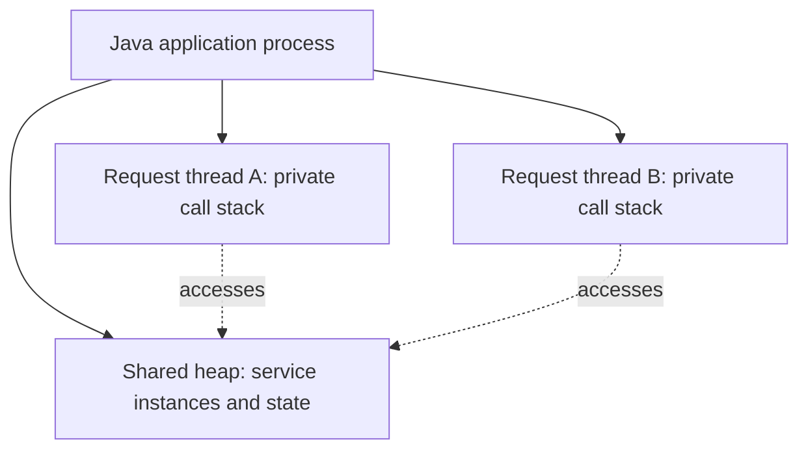
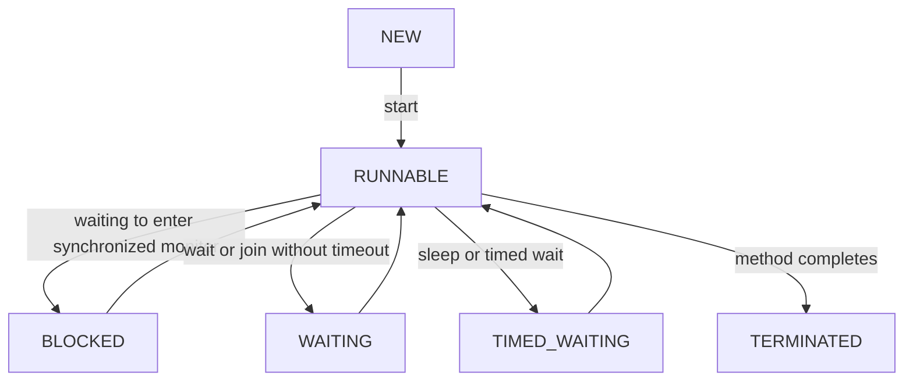
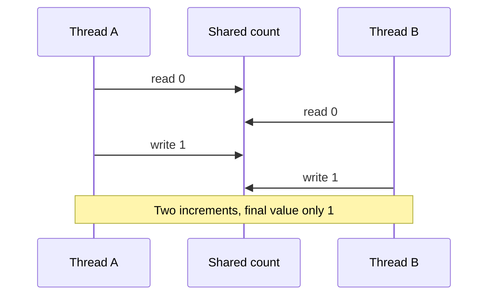
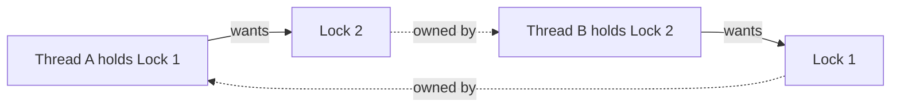

# Chapter 9 — Java Multithreading and Concurrency Fundamentals

> **Learning goal:** Explain threads, race conditions, synchronization, visibility and deadlocks clearly, and choose safe solutions for backend applications.

**Platform:** Java 21 · **Level:** Core → Senior Java interview · **Study approach:** Understand → code → diagram → explain → practice

## 1. Why concurrency matters

Consider an invoice application receiving many approval requests at once. Each HTTP request can be processed concurrently. If multiple requests change shared state without coordination, results may be incorrect even when each individual line of Java code looks valid.

**Concurrency** means managing tasks that can overlap in time; **parallelism** means executing work simultaneously on multiple processors. A concurrent program is not necessarily parallel.

## 2. Process versus thread

A process has its own address space and resources. Threads within a Java process share heap objects but each has its own execution stack. This makes communication easy, but shared mutable data requires care.



## 3. Creating a thread: Thread versus Runnable versus Callable

- `Thread` is an execution mechanism and can be started with `start()`.
- `Runnable` describes a task whose `run()` returns no result and declares no checked exceptions.
- `Callable<V>` describes a task whose `call()` returns a value and may throw a checked exception.

```java
public class ThreadDemo {
    public static void main(String[] args) throws InterruptedException {
        Runnable task = () -> System.out.println("Worker: " + Thread.currentThread().getName());
        Thread worker = new Thread(task, "invoice-worker");
        worker.start();
        worker.join();
        System.out.println("Completed");
    }
}
```

**Expected output** (worker line then completed):

```text
Worker: invoice-worker
Completed
```

Calling `run()` directly does **not** create a new thread. Calling `start()` starts a new execution, invoking `run()` on that thread. You cannot restart a terminated `Thread` object.

## 4. Thread lifecycle

Java's `Thread.State` defines `NEW`, `RUNNABLE`, `BLOCKED`, `WAITING`, `TIMED_WAITING` and `TERMINATED`. There is no separately exposed Java `RUNNING` state.



A thread reported as RUNNABLE may be executing or waiting for CPU scheduling. `sleep()` does not release an already-held intrinsic lock.

## 5. Race conditions and lost updates

`counter++` is not an indivisible operation: conceptually it reads, adds one and writes. Two threads may read the same old value and overwrite one another's increments.



The exact interleaving is nondeterministic. **Never assume a race will reproduce on every run.**

## 6. `synchronized` — mutual exclusion and visibility

```java
public class SynchronizedCounterDemo {
    static class Counter {
        private int value;
        synchronized void increment() { value++; }
        synchronized int get() { return value; }
    }

    public static void main(String[] args) throws InterruptedException {
        Counter counter = new Counter();
        Thread a = new Thread(() -> { for (int i = 0; i < 10_000; i++) counter.increment(); });
        Thread b = new Thread(() -> { for (int i = 0; i < 10_000; i++) counter.increment(); });
        a.start(); b.start(); a.join(); b.join();
        System.out.println(counter.get());
    }
}
```

**Expected output:** `20000`.

A synchronized instance method uses the instance's intrinsic monitor. Only one thread can own that monitor at a time. Monitor release/acquisition establishes a *happens-before* relationship that provides memory visibility. Synchronize on a private lock when a public object monitor could be acquired by unrelated code.

**Trade-off:** Lock contention can reduce throughput; never hold a lock during slow HTTP/database calls without a reason.

## 7. `volatile` versus `synchronized`

`volatile` supports **visibility and ordering** of reads/writes to a field; it does **not** make compound updates such as `count++` atomic. `synchronized` provides both mutual exclusion and happens-before guarantees.

```java
public class ShutdownFlagDemo {
    private static volatile boolean running = true;
    public static void main(String[] args) throws InterruptedException {
        Thread worker = new Thread(() -> {
            while (running) { Thread.onSpinWait(); }
            System.out.println("Stopped");
        });
        worker.start();
        running = false;
        worker.join();
    }
}
```

This is a **visibility demonstration only**, not an efficient production design: a busy-spin loop wastes CPU. Use interrupts, blocking queues or coordination primitives to stop real workers.

| Requirement | `volatile` | `synchronized` |
|---|---|---|
| See updated field value across threads | Yes | Yes, with consistent locking |
| Make `count++` atomic | No | Yes, if every access uses the same lock |
| Prevent concurrent entry to critical section | No | Yes |
| Useful for simple status flag | Yes | Possible, often unnecessary |

## 8. Atomic types — simple thread-safe counters

```java
import java.util.concurrent.atomic.AtomicInteger;

public class AtomicCounterDemo {
    public static void main(String[] args) throws InterruptedException {
        AtomicInteger count = new AtomicInteger();
        Thread a = new Thread(() -> { for (int i = 0; i < 10_000; i++) count.incrementAndGet(); });
        Thread b = new Thread(() -> { for (int i = 0; i < 10_000; i++) count.incrementAndGet(); });
        a.start(); b.start(); a.join(); b.join();
        System.out.println(count.get());
    }
}
```

**Expected output:** `20000`. Atomic types use atomic operations such as compare-and-set, where appropriate. `LongAdder` can reduce contention for high-frequency aggregate counters but is not a drop-in solution for all state invariants.

## 9. Locks and `ReentrantLock`

`ReentrantLock` gives explicit `lock`/`unlock`, interruptible acquisition, timed acquisition and optional fairness policies. Always unlock in `finally` after successfully acquiring it.

```java
import java.util.concurrent.locks.ReentrantLock;

class ApprovalGate {
    private final ReentrantLock lock = new ReentrantLock();
    void execute() {
        lock.lock();
        try {
            // Short critical section: update shared in-memory state
        } finally {
            lock.unlock();
        }
    }
}
```

`ReadWriteLock` may help read-heavy workloads, but measure carefully; it adds complexity and may not improve throughput.

## 10. Deadlocks — why they happen

A deadlock can occur when two threads each hold a resource the other needs and neither can proceed.



**Prevention strategies:**

1. Acquire multiple locks in a globally consistent order.
2. Minimize lock scope and avoid nested locks where feasible.
3. Use `tryLock(timeout, unit)` when recovery is designed and safe.
4. Avoid external calls while holding application locks.
5. Capture and analyze thread dumps using `jcmd <pid> Thread.print` or appropriate observability tools.

**Critical distinction:** A JVM monitor deadlock is different from a **database deadlock**. Java synchronization does not protect transactions running across multiple application instances.

## 11. `wait`, `notify` and `notifyAll`

These are `Object` monitor coordination methods and must be called while holding the object's monitor. `wait()` releases that monitor while waiting. Always check the condition in a **loop** because wakeups can be spurious and conditions can change before the waiting thread reacquires the lock.

```java
synchronized (lock) {
    while (!ready) {
        lock.wait();
    }
}
```

For new business applications, higher-level concurrency constructs—such as `BlockingQueue`, `CountDownLatch` or `Semaphore`—are usually clearer.

## 12. Thread interruption

Interruption is a **cooperative cancellation signal**, not a command that forcibly kills another thread. Blocking methods may throw `InterruptedException`; if you cannot propagate it, normally restore interrupt status after cleanup.

```java
try {
    Thread.sleep(1000);
} catch (InterruptedException ex) {
    Thread.currentThread().interrupt();
    return;
}
```

Do not swallow interruptions silently in server code.

## 13. Concurrent collections

- `ConcurrentHashMap`: Concurrent key-value operations; provides atomic compound APIs such as `compute` and `merge`.
- `CopyOnWriteArrayList`: Useful for frequently read, rarely changed collections; each modification copies an underlying array.
- `BlockingQueue`: Useful for bounded producer-consumer processing and backpressure.

```java
import java.util.concurrent.ArrayBlockingQueue;
import java.util.concurrent.BlockingQueue;

public class QueueDemo {
    public static void main(String[] args) throws InterruptedException {
        BlockingQueue<String> queue = new ArrayBlockingQueue<>(2);
        queue.put("INV-101");
        System.out.println(queue.take());
    }
}
```

**Output:** `INV-101`.

Do not treat thread-safe individual collection methods as proof that your multi-step business transaction is atomic.

## 14. Spring Boot: singleton beans and thread safety

Spring beans are often singleton-scoped: many requests can use **the same service instance** concurrently. Singleton scope **does not imply thread safety**.

```java
@Service
public class UnsafeInvoiceService {
    private int requestCount; // unsafe mutable shared state

    public void process() {
        requestCount++; // lost updates possible
    }
}
```

Use stateless services whenever practical. For metrics, choose thread-safe counters. For invoice approval correctness, rely on **database transactions, locking/versioning, constraints and idempotency**, not only a Java lock; locks inside one JVM do not synchronize multiple deployed instances.

## 15. Real production scenario: duplicate approvals

**Scenario:** Two HTTP requests try to approve the same invoice concurrently.

- Both may initially read `PENDING`.
- If both independently write `APPROVED` and trigger an email, duplicate side effects may occur.
- A local `synchronized` block is insufficient if the application runs on multiple nodes.
- Use database-level concurrency control (optimistic versioning or conditional update), transaction boundaries, and an idempotent notification/outbox mechanism where appropriate.

**Senior-level message:** Thread safety inside the JVM and consistency across distributed services are related but different problems.

## 16. Thread pools and virtual threads — preview

`ExecutorService` manages task execution and lifecycle, and a `Future` represents asynchronous computation results. Java 21 virtual threads allow very large numbers of blocking-style tasks with lower thread overhead, but do not make CPU work faster or remove downstream resource limits.

These topics deserve their own next chapter: executor configuration, queueing, cancellation, CompletableFuture, virtual-thread pinning and structured concurrency status in Java 21.

## 17. Interview questions and natural answers

**Q1. What is the difference between process and thread?**  
A process has its own resource environment; threads within a Java process share heap data while maintaining individual execution stacks. Sharing improves communication but requires synchronization for mutable state.

**Q2. Thread vs Runnable vs Callable?**  
Thread starts execution, Runnable describes a no-result task, and Callable returns a result and may throw checked exceptions. I normally submit task objects to an executor instead of creating many raw threads.

**Q3. Why should we call `start()` instead of `run()`?**  
`start()` creates a new execution thread; calling `run()` directly is an ordinary method call on the current thread.

**Q4. What is a race condition?**  
The result depends on interleaving of concurrent operations. A classic example is two threads performing `count++` and losing an update.

**Q5. `synchronized` vs `volatile`?**  
Volatile ensures appropriate visibility and ordering for a field; synchronized additionally provides exclusive access to a protected critical section. Volatile does not make `count++` atomic.

**Q6. How does `AtomicInteger` work?**  
It exposes thread-safe atomic operations such as increment and compare-and-set, avoiding an explicit monitor lock for simple counter operations.

**Q7. What is a deadlock?**  
A set of threads can no longer proceed because each waits for resources held by another. Prevention includes consistent lock order and reducing nested lock acquisitions.

**Q8. Difference between `sleep()` and `wait()`?**  
Sleep pauses a thread for a time but does not release locks it already owns. `wait()` coordinates on an object monitor and releases that monitor while waiting.

**Q9. Why is a `while` loop used with `wait()`?**  
Because wakeups can be spurious, and the condition may no longer be true when the thread reacquires its monitor.

**Q10. What is thread interruption?**  
It is a cooperative cancellation request. Correct code responds to it, propagates the interruption or restores interrupt status when unable to do so.

**Q11. What is a daemon thread?**  
A background thread whose existence alone does not keep the JVM alive. It is unsuitable for critical work that must always finish before process exit.

**Q12. Is ConcurrentHashMap completely atomic for every sequence of operations?**  
No. Its individual operations and specific compound APIs are thread-safe, but arbitrary `get`-then-`put` sequences are not automatically atomic.

**Q13. Why can a singleton Spring service be unsafe?**  
Multiple request threads can access its mutable instance fields at the same time. Stateless services are easier to keep thread-safe.

**Q14. Can `synchronized` solve duplicate approvals in a Kubernetes deployment?**  
No. An intrinsic lock coordinates only threads sharing that JVM object, not other application processes. Use database-level constraints, concurrency control and idempotency.

**Q15. When should I use `ReentrantLock`?**  
When I need explicit locking features such as timed, interruptible acquisition or conditions. I prefer simpler synchronization when that fully meets the requirement.

## 18. Quick revision and practice

**Remember:**

- Concurrency = overlapping tasks; parallelism = simultaneous execution.
- Shared mutable state needs carefully chosen coordination.
- `volatile` = visibility/ordering, not compound-operation atomicity.
- `synchronized` = monitor-based mutual exclusion and visibility.
- Atomic classes are useful for individual atomic state operations.
- Deadlocks can be prevented with consistent lock ordering.
- Java locks do not replace database transaction guarantees.

**Hands-on exercises:**

1. Run `SynchronizedCounterDemo` and change its method to unsynchronized. Explain why the result becomes unpredictable.
2. Replace synchronized increments with `AtomicInteger`.
3. Explain all six Java `Thread.State` values.
4. Write a safe producer-consumer demonstration using `ArrayBlockingQueue`.
5. Explain why a mutable singleton request counter is unsafe.
6. Design a cross-node duplicate-invoice-approval prevention approach.
7. Explain why `volatile int count` does not protect `count++`.
8. Draw and explain a two-lock deadlock and a consistent-lock-order fix.

### Further reading

- [Java SE 21 Thread API](https://docs.oracle.com/en/java/javase/21/docs/api/java.base/java/lang/Thread.html)
- [Java SE 21 concurrency package](https://docs.oracle.com/en/java/javase/21/docs/api/java.base/java/util/concurrent/package-summary.html)
- [Java Language Specification — Threads and Locks](https://docs.oracle.com/javase/specs/jls/se21/html/jls-17.html)

**Next:** Chapter 10 — ExecutorService, CompletableFuture and Java 21 Virtual Threads.
