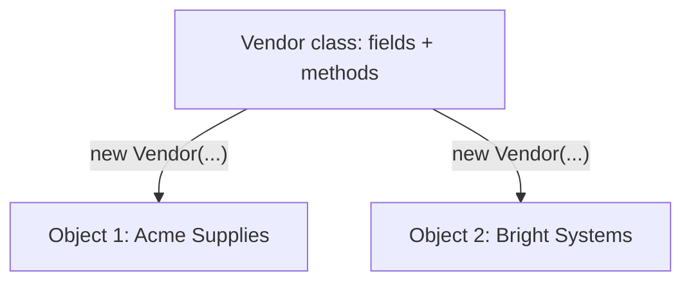
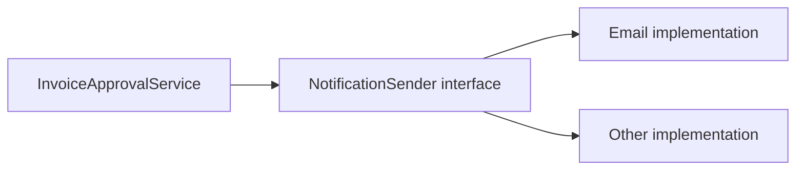
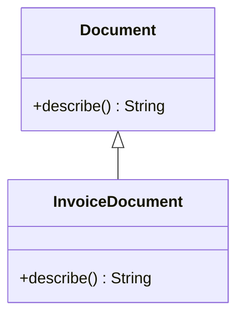
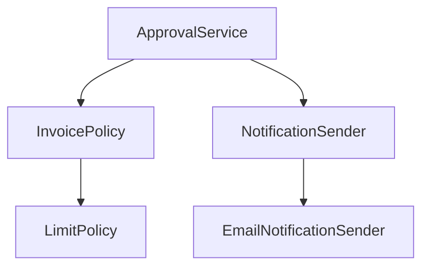

# Chapter 2 — Object-Oriented Programming (OOP) in Java

> **Learning goal:** Understand how to design Java classes that represent real business behavior, explain the four OOP pillars, and choose between inheritance, interfaces and composition.

**Java version:** 21 · **Level:** Fundamentals → senior interview · **Recommended study:** 60–90 minutes

## 1. Why do we use OOP?

Think of an invoice-tracking application. Every invoice has data (invoice ID, amount, status) and rules (approve, reject, calculate total). In procedural code, we might keep this data and these functions scattered across multiple places. OOP lets us group the related state and behavior into meaningful objects.

**OOP is a design approach, not a guarantee of good design.** A class with hundreds of unrelated methods is still difficult to maintain.

The four pillars are **encapsulation, inheritance, polymorphism and abstraction**. Composition is also a key object-design technique.

## 2. Class vs object

A **class** defines a type: its fields, constructors and methods. An **object** is an instance of that type.

```java
class Vendor {
    private final String name;

    Vendor(String name) {
        this.name = name;
    }

    String displayName() {
        return name;
    }
}

public class ClassObjectDemo {
    public static void main(String[] args) {
        Vendor vendor1 = new Vendor("Acme Supplies");
        Vendor vendor2 = new Vendor("Bright Systems");
        System.out.println(vendor1.displayName());
        System.out.println(vendor2.displayName());
    }
}
```

**Expected output:**

```text
Acme Supplies
Bright Systems
```

`vendor1` and `vendor2` refer to separate objects. `new Vendor(...)` constructs each instance.



**Interview point:** An object has identity, state and behavior; two objects may contain equal field values without being the same object.

## 3. Fields, methods, constructors and `this`

A **field** stores object or class state. A **method** defines behavior. A **constructor** initializes a new instance; it has the class name and no return type. `this` refers to the current instance.

```java
class PurchaseOrder {
    private final String poNumber;
    private int approvedInvoices;

    PurchaseOrder(String poNumber) {
        if (poNumber == null || poNumber.isBlank()) {
            throw new IllegalArgumentException("PO number is required");
        }
        this.poNumber = poNumber;
    }

    void recordApproval() {
        approvedInvoices++;
    }

    String summary() {
        return poNumber + ": " + approvedInvoices;
    }
}
```

A class can define overloaded constructors. If no constructor is declared, Java normally supplies a default no-argument constructor; declaring any constructor prevents that implicit constructor.

**Constructor chaining:**

```java
class Report {
    private final String type;
    private final int pageSize;

    Report(String type) {
        this(type, 50);
    }

    Report(String type, int pageSize) {
        this.type = type;
        this.pageSize = pageSize;
    }
}
```

`this(...)` delegates to another constructor in the same class; `super(...)` delegates to a superclass constructor. On Java 21, constructor invocation rules require such explicit calls to occur first in the constructor body.

## 4. Encapsulation — protect your business rules

**Encapsulation** means keeping an object's internal state and behavior together and controlling access to that state. It is more than simply adding private fields and getters/setters.

For example, an invoice should not be approved if it was already rejected. Instead of exposing a public `setStatus`, provide a meaningful operation.

```java
enum InvoiceStatus { DRAFT, APPROVED, REJECTED }

final class Invoice {
    private final String invoiceNumber;
    private InvoiceStatus status = InvoiceStatus.DRAFT;

    Invoice(String invoiceNumber) {
        if (invoiceNumber == null || invoiceNumber.isBlank()) {
            throw new IllegalArgumentException("Invoice number is required");
        }
        this.invoiceNumber = invoiceNumber;
    }

    void approve() {
        if (status != InvoiceStatus.DRAFT) {
            throw new IllegalStateException("Only draft invoices may be approved");
        }
        status = InvoiceStatus.APPROVED;
    }

    InvoiceStatus status() {
        return status;
    }
}
```

The object controls its own state transitions. **Practical value:** less accidental corruption, business invariants in one place, easier testing.

## 5. Abstraction — show what matters, hide how

**Abstraction** exposes a useful contract without forcing the caller to know the implementation.

An invoice service may notify approvers by email today and by another provider tomorrow. Callers only need the contract:

```java
interface NotificationSender {
    void send(String recipient, String message);
}

class EmailNotificationSender implements NotificationSender {
    @Override
    public void send(String recipient, String message) {
        System.out.println("Email to " + recipient + ": " + message);
    }
}
```



**Interface vs abstract class:**

| Interface | Abstract class |
|---|---|
| Defines a contract; may include default/static/private methods | Can share instance state and implementation |
| A class can implement multiple interfaces | A class extends only one direct superclass |
| Useful for capabilities or interchangeable implementations | Useful when related classes genuinely share an inherited base |

Interfaces can define constants, but not ordinary mutable instance fields. Neither approach should be chosen solely to make a diagram look object-oriented.

## 6. Inheritance — a genuine “is-a” relationship

A subclass inherits accessible behavior from a superclass and may override inherited instance methods.

```java
class Document {
    String describe() {
        return "Business document";
    }
}

class InvoiceDocument extends Document {
    @Override
    String describe() {
        return "Invoice document";
    }
}
```



Inheritance can reduce duplication, but using it just for code reuse can create tight coupling. Ask whether the subtype can genuinely substitute for the parent without breaking client expectations (Liskov Substitution Principle).

**Important:** Java classes support single class inheritance; multiple interfaces may be implemented.

## 7. Polymorphism — one contract, multiple implementations

**Runtime polymorphism** occurs when an overridden instance method is selected based on the actual object type, not just the reference type.

```java
Document document = new InvoiceDocument();
System.out.println(document.describe());
```

**Output:** `Invoice document`.

**Compile-time overloading** is different: Java selects the applicable overloaded method using compile-time types and overload-resolution rules.

```java
class Calculator {
    int add(int a, int b) { return a + b; }
    long add(long a, long b) { return a + b; }
}
```

| Overloading | Overriding |
|---|---|
| Same name, different parameter lists | Subclass provides an eligible replacement instance method |
| Usually decided at compile time | Dynamic dispatch at runtime |
| Return type alone cannot distinguish methods | Covariant return types are possible |
| Does not require inheritance | Requires an inherited overridable method |

**Tricky detail:** `static` methods are hidden, not overridden. `private` methods are not overridden, and `final` methods cannot be overridden.

## 8. Composition vs inheritance — senior-level design choice

**Composition:** Build an object using collaborating objects. This often makes dependencies and change boundaries clearer.

Suppose invoice approval needs a validation policy and a notification sender:

```java
interface InvoicePolicy {
    boolean canApprove(int amount);
}

class LimitPolicy implements InvoicePolicy {
    @Override
    public boolean canApprove(int amount) {
        return amount <= 100_000;
    }
}

class ApprovalService {
    private final InvoicePolicy policy;
    private final NotificationSender sender;

    ApprovalService(InvoicePolicy policy, NotificationSender sender) {
        this.policy = policy;
        this.sender = sender;
    }

    void approve(int amount, String approverEmail) {
        if (!policy.canApprove(amount)) {
            throw new IllegalArgumentException("Approval limit exceeded");
        }
        sender.send(approverEmail, "Invoice approved");
    }
}
```

This is **constructor dependency injection** without needing Spring. Spring can manage implementations and inject them later.



**Rule of thumb:** Prefer composition for *has-a/uses-a* relationships. Use inheritance for carefully modeled *is-a* relationships where substitutability holds.

## 9. Access modifiers and the `final` keyword

| Modifier | Same class | Same package | Subclass in another package | Unrelated class in another package |
|---|---|---|---|---|
| `private` | Yes | No | No | No |
| package-private (no modifier) | Yes | Yes | No | No |
| `protected` | Yes | Yes | Restricted subclass access | No |
| `public` | Yes | Yes | Yes | Yes |

`protected` across packages has additional Java access rules: simply having a subclass does not make every protected access legal.

- `final` variable: cannot be reassigned once assigned (it does not make the referenced object immutable).
- `final` method: cannot be overridden.
- `final` class: cannot be subclassed.
- `static`: belongs to the class rather than one instance; static methods do not use `this`.

## 10. Object identity, equality and `hashCode`

The `==` operator compares object reference identity; `equals()` is a method that may define logical equality.

```java
String a = new String("PO-100");
String b = new String("PO-100");
System.out.println(a == b);      // false
System.out.println(a.equals(b)); // true
```

When overriding `equals`, override `hashCode` consistently. **Equal objects must have equal hash codes**, but unequal objects may share a hash code.

A Java 21 `record` can be useful for immutable-style data carriers:

```java
record VendorKey(String vendorCode) {
    VendorKey {
        if (vendorCode == null || vendorCode.isBlank()) {
            throw new IllegalArgumentException("Vendor code required");
        }
    }
}
```

Records automatically provide component accessors, value-based `equals`/`hashCode` and `toString`, but **are shallowly immutable**: mutable components can still refer to mutable objects.

## 11. Where OOP appears in a Spring Boot application

| Layer | OOP technique | Example |
|---|---|---|
| REST controller | Abstraction | Depend on a service contract |
| Business service | Encapsulation | Validate state transitions |
| Service implementation | Polymorphism | Swap notification implementations |
| Domain object | Invariants | Prevent invalid status changes |
| Testing | Composition / DI | Supply fake or mocked collaborators |

Avoid creating an interface for every single class without a clear need. Abstractions should make testing, replacement, modularity or business modeling easier.

## 12. Common interview mistakes

1. Saying encapsulation means “all fields must have getters and setters.” Exposing every setter can weaken encapsulation.
2. Saying abstraction and encapsulation are identical. Abstraction hides implementation details; encapsulation controls internal state and access.
3. Saying overloading and overriding are the same. They differ in method selection and inheritance.
4. Saying Java supports multiple class inheritance. It supports multiple interface implementation, not multiple direct superclasses.
5. Saying `final` reference means the referenced object cannot change.
6. Overusing inheritance when a collaborating object would be simpler.
7. Claiming constructor methods are overridden. Constructors are not inherited and cannot be overridden.

## 13. Interview questions with natural answers

**Q1. What are the four pillars of OOP?**

Encapsulation, inheritance, polymorphism and abstraction. In a business application, I use encapsulation to protect state, abstraction to define contracts, polymorphism for interchangeable implementations, and inheritance only when there is a valid is-a relationship.

**Q2. What is the difference between a class and an object?**

A class defines the structure and behavior of a type. An object is an instance of that class with its own state and identity.

**Q3. What is encapsulation? Give a project example.**

Encapsulation means controlling access to an object's data and enforcing rules through its methods. For example, an invoice can expose `approve()` instead of a public status setter, so it can reject invalid transitions.

**Q4. Abstraction vs encapsulation?**

Abstraction tells a client *what can be done*, for example `NotificationSender.send()`. Encapsulation controls *how internal state is protected*, for example preventing invalid invoice statuses.

**Q5. Overloading vs overriding?**

Overloading uses the same method name with different parameters and is resolved using compile-time rules. Overriding replaces eligible inherited behavior in a subclass and is dispatched based on the runtime object.

**Q6. Why prefer composition over inheritance in many services?**

Composition reduces tight coupling. A service can accept interchangeable policies or notification implementations through interfaces rather than inheriting behavior it may not truly need.

**Q7. Can you override a static or private method?**

No. Static methods can be hidden in a subclass, and private methods are not inherited for overriding. A final method cannot be overridden either.

**Q8. Can constructors be overridden or inherited?**

No. Constructors are not inherited and cannot be overridden, but they can be overloaded and chained using `this(...)` or `super(...)`.

**Q9. Is `final` the same as immutable?**

No. A final reference cannot be reassigned, but the referenced object may still be mutable. Immutability requires protecting the actual object state.

**Q10. What is the role of interfaces in Spring Boot?**

They help describe contracts and allow implementations to be injected. This can support testing and replacement, although adding an interface for every class is not mandatory.

**Q11. Why do `equals()` and `hashCode()` matter?**

They control logical equality and hash-based lookup behavior. If equal objects return different hash codes, collections such as HashMap and HashSet may behave incorrectly.

**Q12. How does OOP improve testability?**

When classes have narrow responsibilities and receive collaborators via constructors, tests can supply controlled implementations, making behavior easier to verify independently.

## 14. Practical coding exercise — one complete program

Save as **`OopDemo.java`**. This example combines encapsulation, abstraction, polymorphism and composition.

```java
public class OopDemo {
    interface Notifier {
        void send(String message);
    }

    static class ConsoleNotifier implements Notifier {
        @Override
        public void send(String message) {
            System.out.println("Notification: " + message);
        }
    }

    static final class Invoice {
        private final String number;
        private boolean approved;

        Invoice(String number) {
            if (number == null || number.isBlank()) {
                throw new IllegalArgumentException("Invoice number required");
            }
            this.number = number;
        }

        void approve() {
            if (approved) {
                throw new IllegalStateException("Already approved");
            }
            approved = true;
        }

        String number() { return number; }
    }

    static final class InvoiceApprovalService {
        private final Notifier notifier;

        InvoiceApprovalService(Notifier notifier) {
            this.notifier = notifier;
        }

        void approve(Invoice invoice) {
            invoice.approve();
            notifier.send(invoice.number() + " approved");
        }
    }

    public static void main(String[] args) {
        Invoice invoice = new Invoice("INV-101");
        InvoiceApprovalService service =
                new InvoiceApprovalService(new ConsoleNotifier());
        service.approve(invoice);
    }
}
```

**Run:**

```bash
javac OopDemo.java
java OopDemo
```

**Expected output:**

```text
Notification: INV-101 approved
```

**Try a second `service.approve(invoice)` call.** It should raise `IllegalStateException`, demonstrating a business invariant enforced through encapsulation.

## 15. Quick revision checklist

- Class = blueprint; object = instance.
- Constructor = initialization; not inherited/overridden.
- Encapsulation = protect state and rules.
- Abstraction = expose a useful contract.
- Inheritance = valid is-a relationship.
- Polymorphism = different implementations behind a shared type.
- Overloading = different parameter lists; overriding = runtime dispatched instance behavior.
- Composition = collaborate with objects through fields/dependencies.
- `final` reference ≠ immutable object.
- `equals()` and `hashCode()` must remain consistent.

## 16. Self-test before the next chapter

1. Explain all four OOP pillars without reading the notes.
2. Give one real example each of encapsulation and polymorphism.
3. Run `OopDemo.java` and explain why a second approval fails.
4. Explain when you would use an interface rather than an abstract class.
5. Design a `PaymentProcessor` contract with two implementations.
6. Explain why composition can be safer than inheritance in a Spring Boot service.

**Next suggested chapter:** Strings, String Pool, `StringBuilder`, immutability and effective value objects.

**Further reading:** [Java SE 21 Language Specification](https://docs.oracle.com/javase/specs/jls/se21/html/index.html) and [Oracle Java Tutorials — Classes and Objects](https://docs.oracle.com/javase/tutorial/java/javaOO/).
