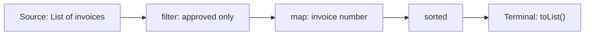
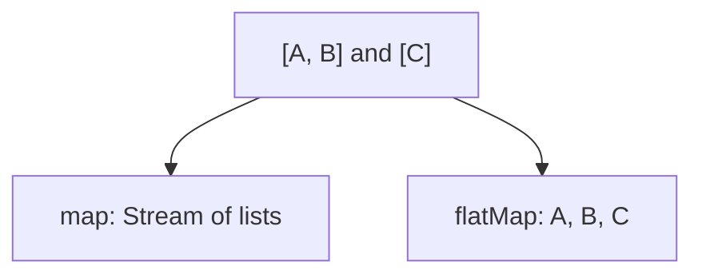

# Chapter 6 — Lambda Expressions, Streams and Functional Programming

> **Goal:** Understand *how* Java Streams work, not just memorize `filter()` and `map()`. Use them for real backend problems and explain trade-offs in interviews.

**Target:** Java 21 · **Experience:** Fundamentals → Senior Backend · **Study time:** 60–90 minutes

## 1. Why were Lambdas and Streams introduced?

Imagine we have 10,000 invoice objects and need to find approved invoices, extract their IDs and sort them. A loop works, but Streams let us describe the *data transformation pipeline* instead of every iteration step.

**Important:** Streams are an alternative way to process data, not a replacement for all loops. Clear loops are sometimes more readable.

## 2. Functional interfaces

A **functional interface** has exactly one abstract method (methods inherited from `Object` do not count). It may also have `default` and `static` methods.

```java
@FunctionalInterface
interface AmountValidator {
    boolean isValid(int amount);
}

public class LambdaDemo {
    public static void main(String[] args) {
        AmountValidator positive = amount -> amount > 0;
        System.out.println(positive.isValid(500));
        System.out.println(positive.isValid(-10));
    }
}
```

**Output:**

```text
true
false
```

A lambda supplies the behavior of the single abstract method. Lambdas can capture local variables only when those variables are **final or effectively final**.

### Built-in functional interfaces

| Interface | Main abstract method | Typical use |
|---|---|---|
| `Predicate<T>` | `boolean test(T)` | Filtering |
| `Function<T,R>` | `R apply(T)` | Transforming |
| `Consumer<T>` | `void accept(T)` | Performing a side effect |
| `Supplier<T>` | `T get()` | Producing a value |
| `UnaryOperator<T>` | `T apply(T)` | Transforming same type |
| `BinaryOperator<T>` | `T apply(T,T)` | Combining two values |

Use primitive-specialized interfaces, such as `IntPredicate`, when avoiding boxing matters.

## 3. Lambda vs anonymous class

```java
Runnable withLambda = () -> System.out.println("Running");
Runnable anonymous = new Runnable() {
    @Override
    public void run() {
        System.out.println("Running");
    }
};
```

Both implement `Runnable`, but a lambda is not simply syntactic sugar for an anonymous inner class. In a lambda, `this` refers to the enclosing instance (where applicable), while an anonymous class introduces its own `this`. Lambda implementation details are JVM-dependent and commonly use `invokedynamic`.

## 4. Method references

Method references make an existing method usable as a function.

```java
List<String> ids = List.of("INV-1", "INV-2");
ids.forEach(System.out::println);
```

Common forms: `ClassName::staticMethod`, `instance::method`, `ClassName::instanceMethod`, `ClassName::new`.

## 5. Stream lifecycle — source, intermediate, terminal

A Stream is a **sequence of elements supporting aggregate operations**. It does not store elements by itself.



- **Source:** A `List`, array, generated sequence, file lines, etc.
- **Intermediate operations:** `filter`, `map`, `flatMap`, `sorted`, `distinct`, `limit`, `peek`. Most are *lazy*.
- **Terminal operation:** `toList`, `collect`, `count`, `reduce`, `forEach`, `findFirst`, etc. Starts traversal.

A Stream **cannot be reused** after a terminal operation.

### End-to-end Java example

```java
import java.util.List;

public class InvoiceStreamDemo {
    record Invoice(String number, int amount, boolean approved) {}

    public static void main(String[] args) {
        List<Invoice> invoices = List.of(
            new Invoice("INV-101", 9000, true),
            new Invoice("INV-102", 4000, false),
            new Invoice("INV-103", 6000, true)
        );

        List<String> approved = invoices.stream()
            .filter(Invoice::approved)
            .filter(i -> i.amount() >= 6000)
            .map(Invoice::number)
            .sorted()
            .toList();

        System.out.println(approved);
    }
}
```

**Output:** `[INV-101, INV-103]`

`Stream.toList()` (Java 16+) returns an unmodifiable List. Do not assume it behaves exactly like `Collectors.toList()`.

## 6. Why intermediate operations are called lazy

```java
List<Integer> numbers = List.of(1, 2, 3);

var pipeline = numbers.stream()
    .filter(n -> {
        System.out.println("Checking " + n);
        return n > 1;
    });

System.out.println("Before terminal");
System.out.println(pipeline.count());
```

The predicate isn't evaluated when defining the pipeline. The terminal operation triggers processing, **but** a Stream implementation can optimize execution and may skip evaluation of some behavioral parameters if the result is provably unchanged. Never rely on `peek` or `filter` for mandatory side effects.

## 7. `map()` versus `flatMap()`

**`map`:** One input element becomes one output element (which may itself be a collection).

**`flatMap`:** One input element becomes a stream of zero or more output elements, and the nested streams are flattened.



```java
import java.util.List;

public class FlatMapDemo {
    public static void main(String[] args) {
        List<List<String>> departments = List.of(
            List.of("Java", "SQL"),
            List.of("Kafka")
        );
        System.out.println(departments.stream().map(List::size).toList());
        System.out.println(departments.stream().flatMap(List::stream).toList());
    }
}
```

**Output:**

```text
[2, 1]
[Java, SQL, Kafka]
```

**Real use:** Extract all invoice line items from a List of invoices, where each invoice has multiple lines.

## 8. `filter`, `distinct`, `sorted`, `skip`, `limit`

```java
List<Integer> values = List.of(5, 1, 3, 5, 2, 3);
System.out.println(values.stream()
    .distinct().sorted().skip(1).limit(3).toList());
```

**Output:** `[2, 3, 5]`

`distinct()` uses equality; for arbitrary objects its behavior depends on `equals/hashCode`. Stateful operations such as `sorted` and `distinct` can increase memory/cost, especially on parallel streams.

## 9. Finding duplicates using Streams

A simple interview pattern:

```java
import java.util.List;
import java.util.Set;
import java.util.HashSet;

public class DuplicateDemo {
    public static void main(String[] args) {
        List<Integer> numbers = List.of(1, 2, 3, 2, 4, 1);
        Set<Integer> seen = new HashSet<>();
        List<Integer> duplicates = numbers.stream()
            .filter(n -> !seen.add(n))
            .distinct()
            .toList();
        System.out.println(duplicates);
    }
}
```

**Output:** `[2, 1]`

This is convenient for a **sequential** stream, but it uses mutable external state and is **unsafe in a parallel stream**. Prefer grouping and counting when you need a collector-based approach.

### Collector-based duplicate detection

```java
import java.util.function.Function;
import java.util.stream.Collectors;

var counts = numbers.stream().collect(
    Collectors.groupingBy(Function.identity(), Collectors.counting())
);
System.out.println(counts.entrySet().stream()
    .filter(e -> e.getValue() > 1)
    .map(java.util.Map.Entry::getKey)
    .sorted()
    .toList());
```

**Output:** `[1, 2]`

## 10. Collectors — group, count, summarize

In an invoice dashboard, we often group records by status or department.

```java
import java.util.List;
import java.util.Map;
import java.util.stream.Collectors;

public class GroupingDemo {
    record Invoice(String status, int amount) {}

    public static void main(String[] args) {
        var invoices = List.of(
            new Invoice("APPROVED", 5000),
            new Invoice("PENDING", 2000),
            new Invoice("APPROVED", 3000)
        );

        Map<String, Long> counts = invoices.stream()
            .collect(Collectors.groupingBy(
                Invoice::status, Collectors.counting()));

        Map<String, Integer> totals = invoices.stream()
            .collect(Collectors.groupingBy(
                Invoice::status, Collectors.summingInt(Invoice::amount)));

        System.out.println(counts.get("APPROVED"));
        System.out.println(totals.get("APPROVED"));
    }
}
```

**Output:**

```text
2
8000
```

Other useful collectors: `mapping`, `filtering`, `partitioningBy`, `joining`, `toMap`, `summarizingInt`.

**`toMap` trap:** Duplicate keys can throw `IllegalStateException` unless you supply a merge function.

```java
Map<String, Integer> amountByStatus = invoices.stream()
    .collect(Collectors.toMap(
        Invoice::status,
        Invoice::amount,
        Integer::sum
    ));
```

## 11. `reduce` versus `collect`

- **`reduce`** combines elements into a value using an associative reduction function.
- **`collect`** performs mutable aggregation using a collector (or supplier/accumulator/combiner).

```java
int sum = List.of(100, 200, 300).stream()
    .reduce(0, Integer::sum); // 600
```

For sums of primitive numbers, `mapToInt(...).sum()` is often clearer. Avoid mutating shared external state in reduction functions.

## 12. Optional — express a possibly missing result

```java
import java.util.Optional;

Optional<String> poNumber = Optional.of("PO-101");
System.out.println(poNumber.orElse("UNKNOWN"));
System.out.println(Optional.<String>empty().orElse("UNKNOWN"));
```

**Output:**

```text
PO-101
UNKNOWN
```

Use `Optional` primarily as a return type where absence is normal. Avoid `optional.get()` without checking presence.

**Important distinction:**

- `orElse(expensiveDefault())` evaluates its argument eagerly.
- `orElseGet(() -> expensiveDefault())` evaluates the supplier only when empty.

`Optional` is not designed as a blanket replacement for every nullable field, JPA entity attribute or method parameter.

## 13. Parallel Streams — when not to use them

Calling `parallelStream()` may split processing across threads, often using the common ForkJoinPool. But parallelism introduces overhead, contention and ordering complications.

**Avoid parallel streams by default** for Spring Boot request handling, DB calls, network I/O, blocking tasks, or tiny collections. Parallel streams may help *measured* CPU-heavy, independent, sufficiently large workloads.

Bad idea:

```java
// Do not assume this is faster or safe for production:
invoiceIds.parallelStream().forEach(id -> remoteService.call(id));
```

Prefer controlled concurrency with appropriate executors and explicit limits for blocking calls. Java 21 virtual threads may be useful for many blocking I/O tasks, but that is a separate topic.

## 14. Streams and JPA: production performance

**Scenario:** You fetch 200,000 database rows and run `.stream().filter(...)` to implement search.

This can waste heap memory, network bandwidth and serialization work.

**Better:** Push predicates, joins, pagination and sort into SQL/JPA wherever appropriate; use Streams for **in-memory transformations of bounded results**. Also watch out for lazy-loading N+1 queries inside `.map()` operations.

Streams do **not** automatically optimize database queries.

## 15. Common mistakes

1. Treating Streams as faster than loops in every case.
2. Reusing a Stream after a terminal operation.
3. Using `peek()` for essential business side effects.
4. Using mutable shared state with parallel streams.
5. Assuming `.toList()` always returns a mutable ArrayList.
6. Calling `.get()` on an empty Optional.
7. Using `parallelStream()` for blocking HTTP/database calls without capacity planning.
8. Using Streams to filter millions of database rows instead of filtering at the database.
9. Assuming `Collectors.toMap` silently handles duplicate keys.
10. Assuming all pipeline functions run exactly once for each element.

## 16. Interview questions and natural answers

**Q1. What is a functional interface?**  
An interface with one abstract method. Lambdas and method references can provide its implementation. Common examples include Predicate, Function, Consumer and Supplier.

**Q2. Lambda vs anonymous class?**  
Both can express behavior, but their semantics differ: an anonymous class creates its own `this`, while lambda `this` refers to the enclosing instance. A lambda is not guaranteed to become a separate anonymous-class object.

**Q3. What is a Java Stream?**  
It is a pipeline for processing a sequence of elements through transformations and a terminal operation. It is not a collection or a storage structure.

**Q4. What is lazy evaluation?**  
Most intermediate Stream operations build a pipeline without processing elements immediately. A terminal operation normally triggers traversal, subject to allowed optimizations.

**Q5. `map()` vs `flatMap()`?**  
Map transforms each element into one result; flatMap transforms elements into nested streams and flattens them into one stream.

**Q6. `filter()` vs `map()`?**  
Filter decides whether to keep an element; map transforms a retained element into another value.

**Q7. `collect()` vs `reduce()`?**  
Reduce is for combining values, typically into one result. Collect is commonly used for mutable accumulation such as lists, maps and grouped results.

**Q8. How do you find duplicate items with Streams?**  
Group by value, count occurrences, then keep entries whose count is greater than one. A sequential HashSet approach is shorter, but it uses mutable state and must not be applied carelessly in parallel.

**Q9. Why avoid side effects in Stream operations?**  
Side effects make pipelines harder to reason about and can break parallel execution. Some optimizations may skip invocation of behavioral parameters when they are not needed.

**Q10. `findFirst()` vs `findAny()`?**  
FindFirst respects encounter order when one exists; findAny may return any element and can be more flexible for parallel execution.

**Q11. What happens with duplicate keys in `Collectors.toMap`?**  
The standard two-argument collector throws an exception. Supply an explicit merge function when duplicate keys are expected.

**Q12. `Optional.orElse` vs `orElseGet`?**  
OrElse computes its fallback argument eagerly; orElseGet calls the supplier only when the Optional is empty.

**Q13. Are parallel Streams always faster?**  
No. Splitting, merging, memory contention and blocking I/O can make them slower. Benchmark realistic workloads before using them.

**Q14. How would you use Streams in Spring Boot?**  
For bounded in-memory transformations, DTO mapping, grouping and summarization, while pushing major filtering and pagination to the database.

**Q15. What is the difference between `Stream.toList()` and `Collectors.toList()`?**  
Stream.toList produces an unmodifiable List. Collectors.toList does not promise a particular list type or mutability; use toCollection(ArrayList::new) when a mutable ArrayList is required.

## 17. Coding exercises

1. Get all invoice numbers whose amount is above 10,000, sorted.
2. Find duplicate vendor codes without parallel-unsafe shared state.
3. Group invoices by status and calculate totals.
4. Flatten nested purchase-order line lists with flatMap.
5. Convert a List of invoices to a Map, handling duplicate keys.
6. Explain why `Optional.orElseGet` avoids unnecessary fallback work.
7. Compare an SQL-side filter with an in-memory Stream filter.
8. Refactor one Stream into a for-loop and explain which is clearer.

## 18. Quick revision

- Lambda = function-like implementation for a functional interface.
- Method reference = concise reference to an existing method.
- Stream = data-processing pipeline, not storage.
- Intermediate operations = generally lazy; terminal starts evaluation.
- `map` transforms; `flatMap` flattens.
- `collect` aggregates; `reduce` combines.
- `Optional` models an absent return value.
- Parallelism must be measured and controlled.
- Prefer SQL for large database filtering; Streams for bounded in-memory processing.

**Next proposed chapter:** Exception handling and custom exceptions, followed by concurrency, CompletableFuture and JVM deep dives.

### References

- [Java SE 21 Stream API](https://docs.oracle.com/en/java/javase/21/docs/api/java.base/java/util/stream/Stream.html)
- [Java SE 21 Optional API](https://docs.oracle.com/en/java/javase/21/docs/api/java.base/java/util/Optional.html)
- [Java SE 21 Collectors API](https://docs.oracle.com/en/java/javase/21/docs/api/java.base/java/util/stream/Collectors.html)
