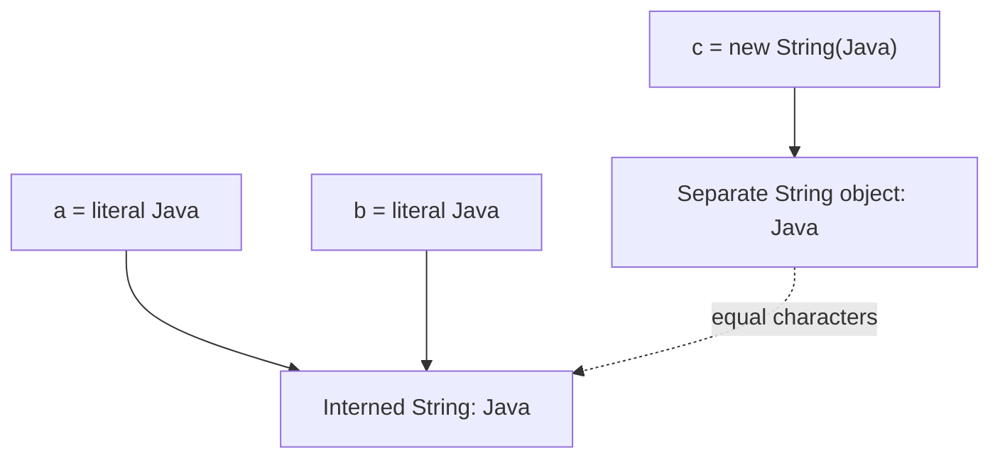

# Chapter 3 — Strings, String Pool and Immutability in Java

> **Learning goal:** Understand how Java stores and compares strings, why immutability matters, and how to write safe immutable value objects in backend applications.

**Java version:** 21 · **Level:** Fundamentals to senior interview · **Study time:** 60–90 minutes

## 1. Start with a real problem

Suppose your invoice application stores PO numbers such as `PO-2026-001`. You compare incoming PO numbers with saved values, build reports containing thousands of rows, and use PO numbers as map keys. Choosing the wrong comparison or building strings inefficiently can create bugs or performance problems.

Java's `String` type is central to all three tasks.

## 2. What is a String?

`String` is a `final` class in `java.lang`. A string represents a sequence of UTF-16 code units. A `String` object is **immutable**: its character content cannot be changed after creation.

```java
String poNumber = "PO-2026-001";
String updated = poNumber.concat("-A");
System.out.println(poNumber); // PO-2026-001
System.out.println(updated);  // PO-2026-001-A
```

`concat()` returns another string when content is appended. The original object remains unchanged.

**Important distinction:** The variable `poNumber` can be reassigned unless it is `final`; reassigning a variable does not mutate the String object.

## 3. How the String Pool works

The JVM maintains an **intern pool** so selected strings with equal content can share a canonical String object. String literals and constant string expressions are interned. The actual implementation of the pool is JVM-specific.

```java
String a = "Java";
String b = "Java";
String c = new String("Java");

System.out.println(a == b);      // true
System.out.println(a == c);      // false
System.out.println(a.equals(c)); // true
```



`new String("Java")` creates a distinct String object, even though its content matches the literal. Avoid using the pool as an application cache strategy.

### What does `intern()` do?

```java
String copy = new String("Java");
String canonical = copy.intern();
System.out.println(canonical == "Java"); // true
```

`intern()` returns the canonical pooled representative for an equal string. It can add memory and lookup overhead, so do not call it everywhere for speed.

## 4. `==` versus `equals()`

- `==` compares **reference identity** when operands are objects.
- `equals()` on `String` compares **character content**.

```java
String requestPo = new String("PO-101");
String dbPo = "PO-101";

System.out.println(requestPo == dbPo);      // false
System.out.println(requestPo.equals(dbPo)); // true
```

For a potentially `null` value:

```java
String requestPo = null;
boolean match = "PO-101".equals(requestPo); // false; no NPE
```

**Production rule:** Compare user-input identifiers with `equals()` (or an explicitly documented case-insensitive/canonicalization rule), not `==`.

## 5. Compile-time constant expressions: an interview trap

```java
String a = "Java21";
String b = "Java" + "21";
String version = "21";
String c = "Java" + version;

System.out.println(a == b); // true: compile-time constant
System.out.println(a == c); // false: runtime concatenation
```

A compiler may fold constant expressions. Do not use `==` to compare String content just because it appears to work in one test.

## 6. Why is String immutable?

Immutability is useful for:

1. **Predictable sharing:** Many variables can refer to the same string without one modifying its contents.
2. **Reliable map keys:** A String's content does not change after insertion into a hash-based collection.
3. **Thread safety of the value:** A String's contents can be shared without coordinating mutation of that String.
4. **Safe API boundaries:** A method cannot modify a caller's String object behind its back.
5. **Pooling:** Canonical strings can be shared because their contents stay stable.

**Nuance:** Immutability does not automatically make an entire application, surrounding collection, or reference assignment thread-safe. Sensitive data in Strings can also remain in memory until reclaimed; use appropriate handling for secrets.

## 7. `String` vs `StringBuilder` vs `StringBuffer`

| Feature | String | StringBuilder | StringBuffer |
|---|---|---|---|
| Mutable contents | No | Yes | Yes |
| Synchronizes individual operations | Not applicable | No | Yes |
| Typical use | Identifiers, values and API data | Building text within a single thread | Shared mutable text only when its synchronization model is appropriate |
| Common recommendation | Default for ordinary text | Repeated appends in loops | Rarely needed in new code |

`StringBuffer` synchronizes its methods, but an entire sequence of operations is not automatically atomic. Thread safety must be evaluated at the operation level.

### Example: generating a CSV row

```java
StringBuilder row = new StringBuilder();
row.append("PO-101").append(',');
row.append("INV-901").append(',');
row.append(12500);
System.out.println(row);
```

**Output:** `PO-101,INV-901,12500`

When assembling many lines, a builder avoids manually creating a new immutable String for every appended fragment. Modern Java compilers already optimize many simple `+` expressions, so measure rather than rewriting every concatenation.

## 8. The cost of repeated String concatenation

```java
String result = "";
for (int i = 0; i < 10_000; i++) {
    result += i; // repeated immutable concatenations
}
```

In a loop, this can create significant allocation and copying. Prefer:

```java
StringBuilder result = new StringBuilder();
for (int i = 0; i < 10_000; i++) {
    result.append(i);
}
String report = result.toString();
```

For joining a collection of values, `String.join()` or collectors can be more readable.

## 9. How to create an immutable class

A well-designed immutable class normally:

- prevents subclassing that could expose different mutability (often using `final`);
- keeps fields `private final`;
- validates constructor inputs;
- provides no mutating methods;
- copies mutable inputs and does not expose mutable internal state.

```java
import java.util.ArrayList;
import java.util.List;

public final class InvoiceSnapshot {
    private final String invoiceNumber;
    private final List<String> approvalLevels;

    public InvoiceSnapshot(String invoiceNumber, List<String> approvalLevels) {
        if (invoiceNumber == null || invoiceNumber.isBlank()) {
            throw new IllegalArgumentException("Invoice number required");
        }
        this.invoiceNumber = invoiceNumber;
        this.approvalLevels = List.copyOf(approvalLevels);
    }

    public String invoiceNumber() {
        return invoiceNumber;
    }

    public List<String> approvalLevels() {
        return approvalLevels; // unmodifiable List of immutable String values
    }
}
```

`List.copyOf` creates an unmodifiable list and rejects null elements. For this example, `String` elements are themselves immutable. For mutable nested elements, a **deep copy** (or immutable replacements) is still necessary.

### Why `final` fields alone are insufficient

```java
final List<String> levels = new ArrayList<>();
levels.add("L1"); // legal: object changes; reference does not
```

**Remember:** `final` prevents reassignment of a variable or field after initialization; it does not freeze the referenced object.

## 10. Java records: useful but only shallowly immutable

```java
record VendorCode(String value) {
    VendorCode {
        if (value == null || value.isBlank()) {
            throw new IllegalArgumentException("Vendor code required");
        }
    }
}
```

Records automatically generate accessors, value-based `equals`, `hashCode`, and `toString`. They are excellent for simple value carriers. But a record containing a `List` can still reference a mutable list unless you defensively copy it.

## 11. Unicode: `length()` is not always a character count

Java strings hold UTF-16 code units, so a Unicode code point outside the Basic Multilingual Plane can occupy two units.

```java
String text = "😀";
System.out.println(text.length());                         // 2
System.out.println(text.codePointCount(0, text.length())); // 1
```

Even code-point count is not always the number of user-perceived characters (grapheme clusters). This matters for multilingual validation, truncation and UI limits.

## 12. Common String methods and safe usage

| Method | Example | Note |
|---|---|---|
| `isBlank()` | `"  ".isBlank()` | True for only whitespace |
| `strip()` | `" x ".strip()` | Unicode-aware whitespace handling |
| `substring()` | `"ABC".substring(1)` | Returns `"BC"` |
| `contains()` | `"invoice".contains("voice")` | Case-sensitive |
| `replace()` | `"A-B".replace("-", "_")` | Literal replacement |
| `split()` | `"A,B".split(",")` | Separator is a regular expression |

Avoid using a case conversion without thinking about locale-sensitive behavior. For protocol-style identifiers, document the normalization rule.

## 13. Real Spring Boot example: PO validation

```java
public boolean samePurchaseOrder(String requestPo, String storedPo) {
    if (requestPo == null || storedPo == null) {
        return false;
    }
    return requestPo.strip().equals(storedPo.strip());
}
```

This is only an example: **trimming may or may not be permitted** for your business identifiers. A production system must define whether whitespace and case differences are meaningful, then validate consistently before writing to the database.

For financial amounts, use `BigDecimal`, not String arithmetic. For passwords and tokens, use secure, domain-appropriate comparison and handling rather than assuming ordinary String equality solves timing or secret-management concerns.

## 14. Common interview mistakes

- Saying `String` is a primitive. It is an object.
- Saying `==` compares String text. It compares object identity.
- Saying String Pool means every equal String object is the same object. Only references to the canonical pooled value are shared.
- Saying `StringBuilder` is thread-safe. It does not synchronize its methods.
- Saying `StringBuffer` makes any compound operation automatically atomic.
- Saying a class is immutable because its fields are `final`, while it exposes a mutable collection.
- Saying Java records are deeply immutable by default.
- Saying `String.length()` always gives the number of visible characters.

## 15. Interview questions — natural answers

### Q1. Why is String immutable in Java?

String contents cannot be changed after object creation. That makes sharing predictable, supports canonical pooling, makes String values stable map keys, and avoids concurrent mutation of the content. It does not make all surrounding code thread-safe.

### Q2. `==` versus `equals()` for Strings?

`==` checks whether two references point to the same object. `equals()` checks whether the character content is equal. For business identifiers, I normally use `equals()`.

### Q3. What is String Pool?

It is the JVM's pool of canonical interned strings. Literals with the same content generally refer to the same pooled object, while `new String(...)` creates a distinct object.

### Q4. How does `intern()` work?

It returns the canonical String for equal content. I would not call it routinely unless a measured use case justified the overhead and memory implications.

### Q5. String versus StringBuilder versus StringBuffer?

String is immutable. StringBuilder is mutable and typically useful for repeated concatenation in a single thread. StringBuffer is mutable and synchronizes individual methods, but it is not a substitute for designing correct concurrency.

### Q6. Why use StringBuilder inside a loop?

Repeated concatenation can allocate and copy many intermediate Strings. StringBuilder keeps a reusable mutable buffer and produces the final String when needed.

### Q7. How do you make a custom class immutable?

I use controlled construction, private final fields, no state-mutating methods, and defensive copies of mutable inputs or outputs. I verify nested mutable objects too.

### Q8. Does `final` make an object immutable?

No. `final` prevents reassignment of the reference but does not prevent mutation of the referenced object.

### Q9. Is a record immutable?

A record's component fields are final and its generated API is value-oriented, but if a component refers to a mutable object it is only shallowly immutable. Defensive copying may be necessary.

### Q10. Why is String a good HashMap key?

Its content does not change, and it implements content-based `equals()` and `hashCode()`. Those properties help keep hash lookup stable after insertion.

### Q11. What happens with `"Java" + "21"`?

It is a compile-time constant expression, so it can refer to the same interned literal as `"Java21"`. Runtime concatenation is different; always use `equals()` for text comparison.

### Q12. What is one Unicode issue in Java Strings?

`length()` counts UTF-16 code units, not necessarily Unicode code points or visual characters. Validation and truncation should account for that distinction.

## 16. Coding exercise: safe invoice key

Save as `StringLab.java`:

```java
public class StringLab {
    public static void main(String[] args) {
        String first = "INV-101";
        String second = new String("INV-101");
        System.out.println(first == second);      // false
        System.out.println(first.equals(second)); // true

        StringBuilder report = new StringBuilder("Invoices: ");
        for (int i = 1; i <= 3; i++) {
            if (i > 1) report.append(", ");
            report.append("INV-").append(i);
        }
        System.out.println(report);
    }
}
```

Compile and run:

```bash
javac StringLab.java
java StringLab
```

Expected output:

```text
false
true
Invoices: INV-1, INV-2, INV-3
```

## 17. Quick revision and self-test

**Remember:** String immutable; `==` identity; `equals()` content; literal pooling; `intern()` canonical; Builder mutable/non-synchronized; Buffer mutable/synchronized methods; deep immutability requires defensive copies.

Try these before moving to the next topic:

1. Predict the output of the pooled-vs-new String example.
2. Explain why `HashMap<String, ...>` benefits from immutable keys.
3. Write a `PurchaseOrderId` value object with validation.
4. Explain why returning a mutable `List` from a supposedly immutable class is dangerous.
5. Run `StringLab.java` and change its loop to create 10,000 invoice identifiers.
6. Explain `length()` versus `codePointCount()` without looking at the notes.

**Next suggested chapter:** Collections Framework — List, Set, Map, iteration and complexity.

**Reference:** [Java SE 21 String API](https://docs.oracle.com/en/java/javase/21/docs/api/java.base/java/lang/String.html), [StringBuilder API](https://docs.oracle.com/en/java/javase/21/docs/api/java.base/java/lang/StringBuilder.html).
