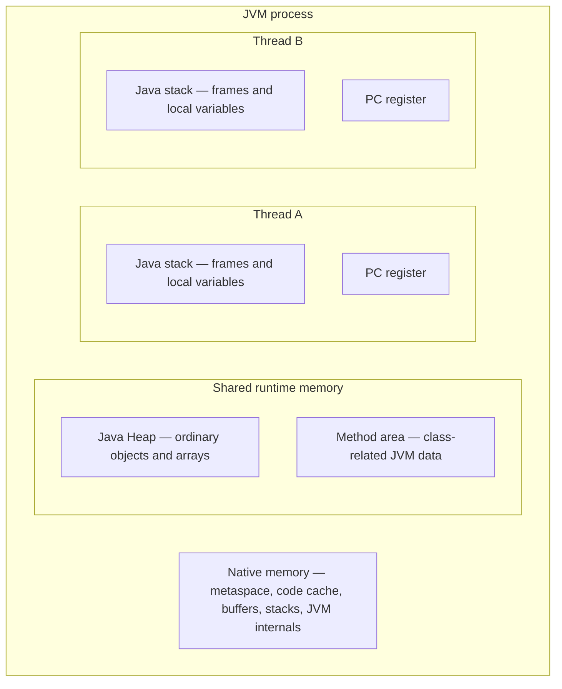
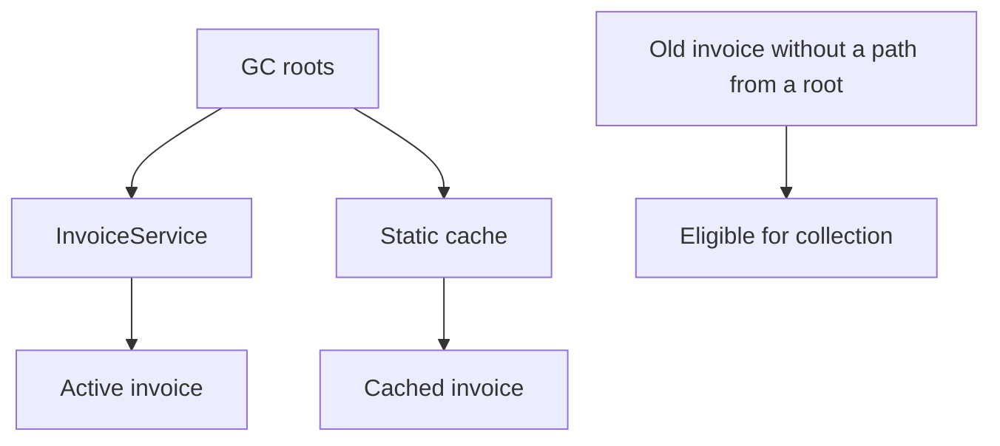
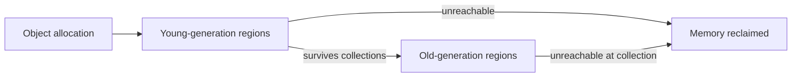
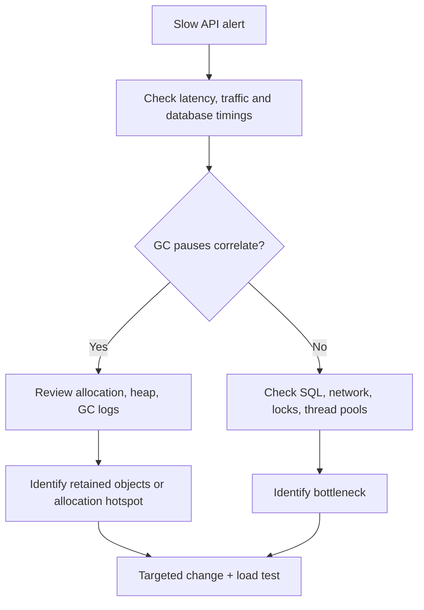

# Chapter 11 — JVM Memory, Garbage Collection and Production Diagnostics

> **Learning objective:** Understand where Java uses memory, how garbage collection works, and how to investigate real Spring Boot performance incidents without guessing.

**Target:** Senior Java Developer · **Java:** 21 (HotSpot-oriented examples) · **Study time:** 75–100 minutes

## 1. Why this topic matters

Your invoice application works in UAT, but the production server slows down after six hours. Users see timeouts, heap usage grows, and the JVM occasionally pauses. What should you check first?

You need to distinguish **memory allocation**, **reachable objects**, **garbage-collection pauses**, **thread contention**, and **database latency**. Simply increasing `-Xmx` may hide symptoms or worsen the problem.

## 2. JVM memory areas



**Distinguish the specification from HotSpot:** The JVM specification defines the *method area* logically. HotSpot commonly stores class metadata in **Metaspace**, which uses native memory. The diagram is conceptual, not a physical map of every allocation.

| Area | Purpose | Common issue |
|---|---|---|
| Heap | Usually holds Java objects/arrays | `OutOfMemoryError: Java heap space` |
| Thread stack | Stack frames for method execution | `StackOverflowError` from excessive recursion |
| Metaspace (HotSpot) | Class metadata in native memory | `OutOfMemoryError: Metaspace` |
| Code cache | JIT-compiled machine code | Compiler/code-cache pressure |
| Direct buffers | Off-heap NIO memory | Direct buffer memory exhaustion |
| Native/process memory | JVM internals, stacks and native libraries | OS/container memory limit or native OOM |

**Important nuance:** A reference declared inside a method is part of the method's *logical* local-variable frame. JIT optimization may change the physical storage, and escape analysis may remove allocations. Do not say “every primitive is on the stack and every object is always on the heap.”

## 3. Heap vs stack with a Java example

```java
public class HeapStackDemo {
    static class Invoice {
        private final int amount;
        Invoice(int amount) { this.amount = amount; }
        int amount() { return amount; }
    }

    public static void main(String[] args) {
        int quantity = 2;
        Invoice invoice = new Invoice(500);
        System.out.println(quantity * invoice.amount());
    }
}
```

**Expected output:** `1000`.

Conceptually, the `main` method has local variables `quantity` and `invoice`; an `Invoice` object is created and normally allocated in the heap. Only one of those values contains an object reference.

## 4. Garbage collection: what does it actually do?

Garbage collection (GC) identifies memory that the application no longer needs because its objects are **not reachable** from the relevant GC roots, and reclaims that memory.

Typical root categories include active thread-stack references, static-field references through loaded classes and certain JVM/native references.



**Critical point:** A logically useless object that remains reachable through a static collection is **not garbage**.

GC timing is not guaranteed. `System.gc()` only requests collection and must not be relied upon as a solution to a leak.

## 5. Generational collection: young and old objects

Many collectors exploit the observation that numerous objects become unreachable quickly. A common generational mental model has:

- **Young generation:** Short-lived allocations, where frequent collections are often efficient.
- **Old generation:** Objects that have survived long enough or are otherwise placed there.
- **Promotion:** Live objects may move to an older region/generation.



**Do not overgeneralize:** The precise regions, evacuation rules and whether a collector uses generations depend on the active GC implementation and configuration. This is an explanatory model, not a universal fixed heap layout.

## 6. Java 21 garbage collectors

| Collector | Broad optimization goal | Notes |
|---|---|---|
| Serial GC | Small/simple workloads | Primarily single-threaded collection work |
| Parallel GC | High throughput | May have longer stop-the-world pauses |
| G1 GC | Balanced throughput and predictable pause goals | Default in typical server-class HotSpot Java 21 configurations |
| ZGC | Very low pause times | Java 21 supports generational ZGC as an option; do not assume it is enabled |
| Shenandoah | Low-pause collection | Availability depends on JDK distribution/build |

**Interview framing:** Choose a collector using measured latency, throughput, heap requirements, CPU cost and your JDK distribution. There is no universally “best” garbage collector.

## 7. Stop-the-world pauses and performance

Some JVM operations temporarily suspend application threads, including GC phases depending on the collector. These pauses can increase request latency.

Suppose API latency spikes to 3 seconds every few minutes. Check whether GC pause timestamps correlate with the spikes, but also inspect database waits, locks, network calls and CPU saturation.

**Avoid a false diagnosis:** High heap usage does not automatically mean a memory leak. Caches and collector policies can keep the committed heap high; investigate **live occupancy after collection** and growth over time.

## 8. Common OutOfMemoryError categories

| Symptom/message | Investigate |
|---|---|
| `Java heap space` | Object retention, allocation spikes, heap sizing, large queries |
| `GC overhead limit exceeded` | Excessive GC effort with little recovery (where implemented/enabled) |
| `Metaspace` | Class-loader leaks, generated classes, metadata limits |
| `Direct buffer memory` | NIO direct memory, buffer lifecycle and limits |
| `unable to create native thread` | OS/process limits, thread count, available native memory |
| Container killed (OOMKilled) | Total process memory versus container limit; may occur without Java heap OOME |

These are different failure modes. A container can be OOM-killed even when Java heap usage is below `-Xmx`.

## 9. Deliberate object retention example

```java
import java.util.ArrayList;
import java.util.List;

public class RetentionDemo {
    private static final List<byte[]> retained = new ArrayList<>();

    public static void main(String[] args) {
        for (int i = 0; i < 5; i++) {
            retained.add(new byte[1024 * 1024]);
        }
        System.out.println("Retained arrays: " + retained.size());
    }
}
```

**Expected output:** `Retained arrays: 5`.

The static list holds references to five arrays. This is intentional retention, not proof of a production leak. In a long-running app, a cache with no bounds or eviction policy can create similar symptoms.

**Better cache design:** Define maximum size, expiry/eviction, ownership, operational metrics and concurrency behavior.

## 10. Memory leaks despite GC

Typical sources include:

- Static maps/lists that continuously grow.
- Unbounded queues and request buffers.
- Event listeners registered without removal.
- `ThreadLocal` values not removed when appropriate, especially with reusable threads.
- Class loaders retained by plugins or dynamic deployment infrastructure.
- Large Hibernate/JPA persistence contexts holding many entities.

**JPA scenario:** Loading 250,000 entities into one transaction may use extensive heap. Consider bounded pagination/batching, projections and careful persistence-context management.

## 11. Useful Java 21 diagnostic commands

These commands require the **JDK**, and some require attaching to a supported, authorized JVM process.

```bash
java -version
jcmd -l
jcmd <PID> VM.flags
jcmd <PID> GC.heap_info
jcmd <PID> Thread.print
jcmd <PID> GC.class_histogram
```

Here `<PID>` is a placeholder: **replace it with the real process ID**. For example, if `jcmd -l` shows process `14200`, run `jcmd 14200 GC.heap_info`.

A class histogram counts objects by class; it does **not** by itself identify why objects are retained. A heap dump and dominator/reference-path analysis may be needed.

For GC logging at JVM startup:

```bash
java -Xlog:gc*:file=gc.log:time,uptime,level,tags -jar app.jar
```

**Safety warning:** Heap dumps, thread dumps and JVM arguments may reveal credentials, personal information and business data. Capture, store and share only with authorization.

## 12. JVM options worth knowing

```bash
java -Xms512m -Xmx1024m -jar app.jar
```

- `-Xms`: Initial heap size.
- `-Xmx`: Maximum Java heap size.
- `-XX:MaxMetaspaceSize=...`: Optional cap on Metaspace growth.
- `-XX:+HeapDumpOnOutOfMemoryError`: Request a heap dump on qualifying OOM errors.
- `-XX:HeapDumpPath=...`: Configure the output destination.

**Important:** Heap size is **not** the same as total process/container memory. Leave room for stacks, Metaspace, JIT code cache, direct buffers and other native allocations.

For production, verify the actual options and JDK behavior rather than copying sample values blindly.

## 13. Thread dumps vs heap dumps vs GC logs

| Diagnostic | Best for |
|---|---|
| Thread dump | Deadlock, blocked threads, slow requests, lock contention |
| Heap dump | Retained objects, reference paths, dominant memory consumers |
| GC log | Collection frequency, pauses, allocation/occupancy patterns |
| JFR recording | CPU, allocation, locks, threads and other runtime events |
| Application traces | Request-level cross-service timings |
| Database EXPLAIN/metrics | Slow SQL, indexes, lock waits, pool pressure |

Java Flight Recorder (JFR) is built into the JDK and is useful for production diagnostics when appropriately configured.

## 14. A step-by-step Spring Boot incident investigation

**Scenario:** Invoice report API latency climbs from 400 ms to 8 seconds after a nightly batch.

1. **Confirm scope:** Which endpoint, environment and time window? Was traffic or batch volume unusual?
2. **Correlate signals:** Look at p95/p99 response times, CPU, heap, GC pause time, thread count and database latency.
3. **Inspect application behavior:** Look for loading all invoice rows, N+1 queries, oversized Excel exports or unbounded in-memory buffers.
4. **Check runtime evidence:** Review GC logs; capture an authorized thread dump or JFR recording if the issue persists.
5. **Find root cause:** A slow query is not a JVM leak; a growing static map is not fixed by adding threads.
6. **Apply a targeted fix:** Pagination, streaming, cache bounds, query optimization or justified JVM tuning.
7. **Verify:** Repeat a representative load test, compare before/after metrics and monitor regression.



## 15. `StackOverflowError` example

```java
public class RecursionDemo {
    static int countdown(int n) {
        if (n == 0) return 0;
        return 1 + countdown(n - 1);
    }

    public static void main(String[] args) {
        System.out.println(countdown(5));
    }
}
```

**Expected output:** `5`.

This is safe for the sample, but extremely deep recursion can exhaust a thread stack. It illustrates why recursion needs a correct base condition and bounded depth; **do not run deliberately unbounded recursion on a production server**.

## 16. Interview questions with natural answers

**Q1. What is the difference between heap and stack memory?**  
Heap is generally used for objects and shared across threads. Every Java thread has its own call stack. The runtime can optimize physical allocation, so I treat this as a conceptual distinction.

**Q2. What is garbage collection?**  
It automatically reclaims memory occupied by objects that are no longer reachable from GC roots. It does not guarantee immediate cleanup.

**Q3. Why can Java applications have memory leaks?**  
An application can retain objects it no longer needs in static collections, caches, listeners or thread-local state. The GC cannot reclaim those objects while they remain reachable.

**Q4. What is a GC root?**  
A starting reference used to determine object reachability, such as references from active stacks or static fields associated with loaded classes.

**Q5. What is the difference between young and old generations?**  
Generational collectors often collect short-lived objects efficiently in young regions, while longer-lived objects may be promoted to old regions. The exact behavior depends on the collector.

**Q6. What is a stop-the-world pause?**  
A period when application threads are paused for a JVM operation such as certain GC phases. It can affect request latency.

**Q7. Which GC would you choose?**  
I would start from workload goals and supported JDK defaults, then compare pause times, throughput, CPU and heap usage under representative load rather than select a collector by name.

**Q8. How do you identify a Java memory leak?**  
I look for continuously increasing live heap usage, compare GC behavior, inspect class histograms or heap dumps, and trace retained objects to their reference owners.

**Q9. Is high heap usage always a memory leak?**  
No. Healthy caches and GC policies can keep heap usage high. Sustained growth in live retained objects and inability to reclaim memory is more meaningful.

**Q10. `-Xms` versus `-Xmx`?**  
`-Xms` sets initial heap size and `-Xmx` sets the maximum heap size. Neither defines the JVM's total native plus heap memory.

**Q11. How is Metaspace different from the heap?**  
In HotSpot, Metaspace typically stores class metadata in native memory; the Java heap ordinarily holds application objects.

**Q12. How do you investigate a slow Spring Boot API?**  
I first correlate request latency with database timing, CPU, GC, threads and external dependencies. Then I use targeted evidence such as logs, traces, thread dumps or JFR to identify the bottleneck.

**Q13. What is the difference between thread dump and heap dump?**  
A thread dump reveals execution and lock states. A heap dump captures object graphs and is used for retained-memory analysis.

**Q14. Can increasing heap size fix OutOfMemoryError?**  
Sometimes heap sizing is inadequate, but if objects are retained indefinitely, increasing the heap only delays failure. The error type and cause must be identified first.

**Q15. How can database operations cause Java memory pressure?**  
Large unpaginated queries, excessive entity hydration and unbounded result accumulation can allocate many Java objects, creating heap pressure and GC overhead.

**Q16. What is Java Flight Recorder?**  
JFR is a JDK facility for recording low-overhead runtime diagnostic events such as allocations, CPU samples and thread activity for performance analysis.

## 17. Coding and operational exercises

1. Run `java -version` and identify your installed JDK.
2. Compile/run `HeapStackDemo` and explain the local variables versus object reference.
3. Run `RetentionDemo` and explain why the arrays stay reachable.
4. Use `jcmd -l` to list your Java processes.
5. Explain when a thread dump is more useful than a heap dump.
6. Draw a path from a GC root to a retained object.
7. Explain a case where `-Xmx` is too large for a container.
8. Design a bounded cache for vendor lookups.
9. Investigate a hypothetical p99 latency spike: list five metrics you would correlate.
10. Compare throughput and latency priorities when choosing a garbage collector.

## 18. One-minute revision

- Heap: most objects; stack: thread-local execution frames.
- Metaspace is a HotSpot implementation detail for class metadata.
- Reachable objects are not garbage, even if business logic no longer needs them.
- GC pause time can affect latency; correlation is necessary.
- Heap usage alone does not prove a leak.
- Thread dumps diagnose running/blocked threads; heap dumps diagnose retained objects.
- `-Xmx` is not total process memory.
- Measure first; tune/fix only after identifying the actual bottleneck.

**Next topic:** Java 17/21 modern language features, followed by Spring Boot internals and distributed backend design.

### References

- [Java Virtual Machine Specification, Java SE 21](https://docs.oracle.com/javase/specs/jvms/se21/html/index.html)
- [Java 21 Tools Reference](https://docs.oracle.com/en/java/javase/21/docs/specs/man/index.html)
- [Java 21 Garbage-First GC Tuning Guide](https://docs.oracle.com/en/java/javase/21/gctuning/garbage-first-garbage-collector-tuning.html)
- [Java Flight Recorder documentation](https://docs.oracle.com/en/java/javase/21/jfapi/using-jfr-api.html)
