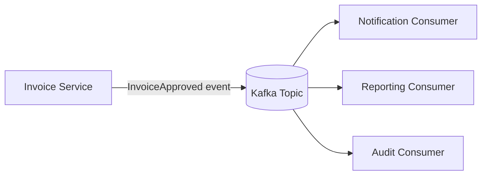
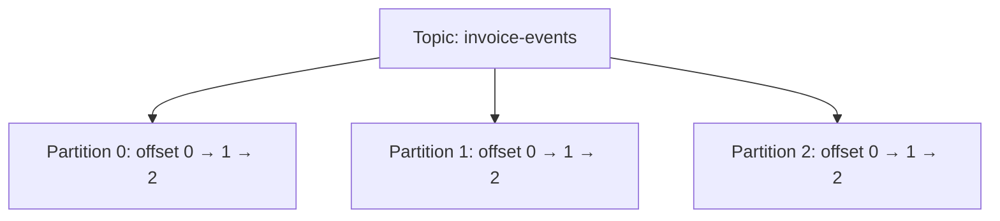
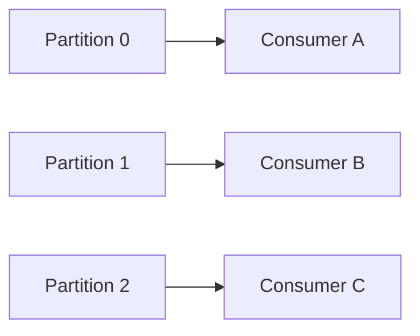
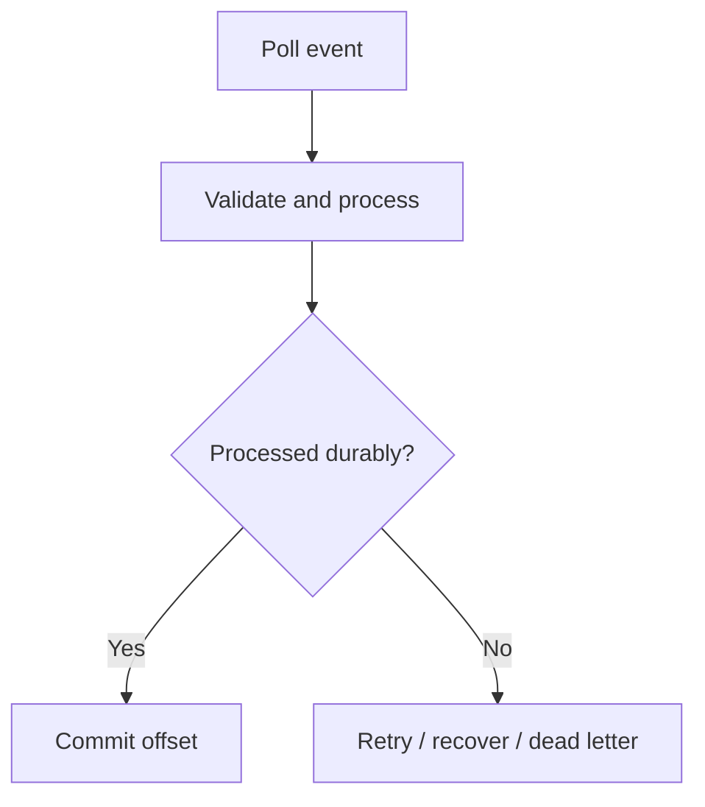
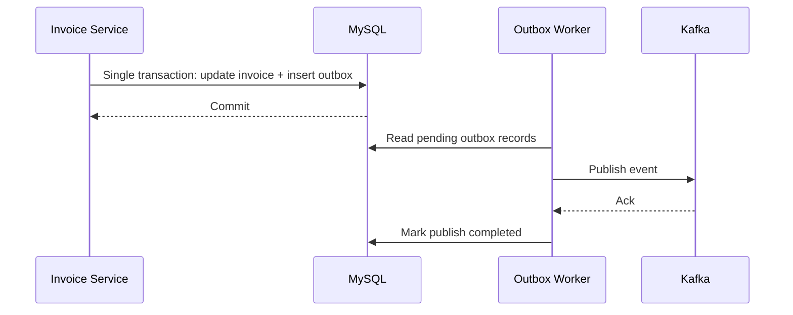

# Chapter 19 — Apache Kafka and Event-Driven Architecture

> **Goal:** Understand Kafka's architecture, reliability guarantees, integration with Spring Boot, and production failure handling. The examples are for learning, not a claim of prior professional Kafka experience.

**Stack:** Java 21 · Spring Boot 3.x · Spring for Apache Kafka · Kafka brokers · MySQL

## 1. Why Kafka?

Suppose the Invoice Service approves an invoice. It must also notify the owner, update reporting and write to audit systems. Calling every downstream service synchronously increases coupling. Kafka lets the Invoice Service publish an event that independent consumers can process later.

Kafka is a **distributed event-streaming platform** with durable, partitioned logs. It is not just a traditional task queue. Events can be retained and replayed according to topic retention policies.



**Trade-off:** You gain decoupling and replay, but must manage eventual consistency, consumer lag, schema evolution, duplicates and infrastructure.

## 2. Core components

| Component | Meaning |
|---|---|
| Broker | Kafka server storing topic partitions and serving reads/writes |
| Cluster | Multiple cooperating brokers |
| Topic | Named stream/category of records |
| Partition | Ordered append-only log within a topic |
| Offset | Position identifying a record within one partition |
| Producer | Publishes records to a topic |
| Consumer | Reads records and tracks its processing position |
| Consumer group | Consumers cooperating to divide partitions for one logical application |
| Replication | Copies partitions across brokers to support availability |

## 3. Topics, partitions and ordering



Kafka guarantees the **order of records within a partition**, not across an entire multi-partition topic. For per-invoice ordering, produce records using the same invoice ID as the partition key, while keeping partition count and partitioning changes in mind.

Offsets are **per partition**. Offset 10 in partition 0 has no ordering relationship with offset 10 in partition 1.

## 4. Producer behavior and acknowledgments

A producer serializes records, chooses a partition, batches data and sends requests to brokers.

- `acks=0`: Producer does not wait for acknowledgment; weakest confirmation.
- `acks=1`: Leader acknowledgment; some failures can still lose data.
- `acks=all`: Wait for the configured in-sync replica requirement; strongest of these configurations when paired with replication and suitable `min.insync.replicas`.
- Idempotent producer: Helps prevent certain duplicate writes caused by producer retries under its supported guarantees.

**Important:** `acks=all` does not by itself guarantee an end-to-end business operation is exactly once; neither does Kafka producer idempotence solve duplicate HTTP approvals.

## 5. Consumer groups and scaling



Within a **single consumer group**, each partition is normally assigned to at most one consumer at a time. Separate consumer groups can independently read the same topic. Adding more consumers than partitions does not create additional active partition assignments.

**Example:** Notification and Reporting should typically use different group IDs, so each receives the events independently.

## 6. Offsets, commits and rebalances

Reading a record does **not** mean the business work has succeeded. A consumer's committed offset tells Kafka where the group should resume. If offsets are committed before processing, a crash can lose business work. If processing succeeds and the commit fails, the record may be processed again.



A **rebalance** redistributes partitions when consumers join/leave or membership changes. In-flight work and offset management need careful handling during rebalances.

## 7. Delivery semantics

| Semantics | Typical consequence |
|---|---|
| At-most-once | Records can be lost, but duplicates are minimized |
| At-least-once | Retrying prevents some losses, but duplicates are possible |
| Exactly-once in Kafka workflows | Kafka transactions/idempotence can coordinate specific Kafka read-process-write flows; external database/email side effects need separate design |

**Production recommendation:** Design consumers to be **idempotent** even when using Kafka's transaction features.

## 8. Spring Kafka producer example

This example assumes Spring Boot Kafka dependency, working broker connection, and configured serializers.

```java
@Service
public class InvoiceEventPublisher {
    private final KafkaTemplate<String, InvoiceApprovedEvent> kafka;

    public InvoiceEventPublisher(KafkaTemplate<String, InvoiceApprovedEvent> kafka) {
        this.kafka = kafka;
    }

    public CompletableFuture<SendResult<String, InvoiceApprovedEvent>> publish(
            InvoiceApprovedEvent event) {
        return kafka.send("invoice-events", event.invoiceId(), event);
    }
}

public record InvoiceApprovedEvent(String eventId, String invoiceId,
                                   String approvedBy, Instant occurredAt) {}
```

Required imports include `org.springframework.kafka.core.KafkaTemplate`, `org.springframework.kafka.support.SendResult`, and Java `Instant`/`CompletableFuture`. Verify serialization compatibility across producers and consumers. Use a globally unique `eventId` for deduplication.

## 9. Spring Kafka consumer example

```java
@Component
public class InvoiceApprovedListener {
    private final NotificationService notifications;

    public InvoiceApprovedListener(NotificationService notifications) {
        this.notifications = notifications;
    }

    @KafkaListener(topics = "invoice-events", groupId = "notification-service")
    public void onApproved(InvoiceApprovedEvent event) {
        notifications.sendApprovalNotice(event.invoiceId());
    }
}
```

**Not a complete reliable consumer:** This illustrative handler does not yet implement deduplication, retry policy, error handling or safe offset control. Email is an external side effect and may be repeated after crashes unless specifically protected.

## 10. Consumer idempotency with a database

Use a unique `event_id` in a `processed_event` table. In one local database transaction, record the event ID and update the consumer's local business state. A duplicate-key conflict indicates previous processing.

```sql
CREATE TABLE processed_event (
    consumer_name VARCHAR(100) NOT NULL,
    event_id VARCHAR(100) NOT NULL,
    processed_at TIMESTAMP NOT NULL DEFAULT CURRENT_TIMESTAMP,
    PRIMARY KEY (consumer_name, event_id)
);
```

**Caution:** If email is sent before recording the event, a crash can produce duplicate emails. For reliable external delivery, use the consumer's own **outbox** or an idempotent external provider where possible.

## 11. Database changes + Kafka: transactional outbox

If a database transaction commits an invoice approval but the Kafka send fails, the event may be missing. If Kafka succeeds but the database rolls back, consumers may see a false approval. A **transactional outbox** persists the approval and an outbox row in the same database transaction; a separate publisher sends the event and retries as required.



The outbox publisher may send duplicates. Consumers must deduplicate. The outbox does not magically guarantee exactly-once external delivery.

## 12. Retry and dead-letter topics

Errors fall into two categories:

- **Transient:** Brief database/network outage; bounded retries with backoff may work.
- **Non-retryable:** Invalid schema, unsupported event version or invalid domain data; repeated immediate retries only block progress.

A **dead-letter topic (DLT)** stores failed records after the configured handling policy. Include enough context for diagnosis while avoiding secrets and sensitive payload leakage. Define replay tooling, ownership and alert thresholds. DLT publication itself can fail and needs handling.

In Spring Kafka, common building blocks include `DefaultErrorHandler`, backoff policies and `DeadLetterPublishingRecoverer`. Exact behavior depends on listener container acknowledgment configuration and framework version.

## 13. Consumer lag and backpressure

**Consumer lag** estimates how far a consumer group is behind the log's end. Persistent growth can indicate inadequate processing capacity, slow downstream dependencies, rebalance churn, poisoned events or a partition hot spot.

Useful signals: lag by partition, processing latency, failed records, retries, consumer assignment changes, broker disk/network health and end-to-end event age.

**Do not scale consumers blindly:** If the topic has three partitions, adding ten consumers to one group does not provide ten-way concurrent partition processing.

## 14. Event schemas and compatibility

An event contract should include event ID, type, version, aggregate/business key, occurrence time and payload. JSON is simple to inspect; Avro/Protobuf and schema registries can support stronger schema governance.

For evolution, favor additive changes with optional/defaulted fields when compatible and verify both **backward** and **forward** consumer expectations. Avoid making downstream consumers depend on internal entity structures.

## 15. Security and operations

Kafka production security commonly includes TLS transport protection, SASL authentication and ACL-based authorization. Protect broker credentials and certificates. Configure retention, replication, `min.insync.replicas`, disk capacity, network limits and observability based on availability goals.

Kafka is not an unlimited free message store: retention and compaction policies determine what is available for replay.

## 16. Interview scenario: duplicate invoice-approved notifications

**Problem:** User receives two emails for one approval.

Investigation: verify whether the API approved twice, publisher resent the same event, consumer retried after email succeeded, or separate consumer groups both triggered email.

Resolution: first protect the approval with an idempotency key/state constraint; make events uniquely identifiable; deduplicate consumer business effects; use durable notification-outbox state and idempotent delivery when supported.

## 17. Interview scenario: ordering bug

**Problem:** `InvoiceRejected` is processed before `InvoiceSubmitted`.

Possible causes: records used different keys/partitions, event processing is asynchronous, multiple topics are involved, or consumers applied conflicting updates without version checks.

Mitigation: use a stable aggregate key for partitioning, include aggregate version and reject stale state transitions. Ordering across unrelated partitions is not guaranteed.

## 18. Interview questions with natural answers

**Q1. What is Kafka?** A distributed event-streaming platform that stores records in durable partitioned logs and lets independent consumer groups read them.

**Q2. Topic vs partition?** A topic is a named record stream, while partitions divide that stream into individually ordered logs for storage and parallelism.

**Q3. What is an offset?** A record position within one partition, not a unique global identifier across a topic.

**Q4. How is ordering guaranteed?** Within each partition. Using the same key normally routes related events to a consistent partition under a stable partitioning configuration.

**Q5. Why consumer groups?** To distribute partition ownership across consumers for one logical processing application.

**Q6. Can consumers outnumber partitions?** Yes, but additional consumers typically remain idle for partition assignment within that group.

**Q7. What is a rebalance?** Reassignment of partitions among group members after membership or assignment changes.

**Q8. `acks=all` vs `acks=1`?** All waits for sufficient in-sync replica acknowledgments under configuration; one waits for leader acknowledgment. Neither replaces end-to-end idempotency.

**Q9. What is at-least-once processing?** Processing may repeat after failures, so the business operation must tolerate duplicates.

**Q10. Does Kafka guarantee exactly-once database/email updates?** No. Kafka transactions cover supported Kafka workflows; external side effects require their own consistency and deduplication design.

**Q11. What is consumer lag?** The gap between the latest available log position and the group's progress, useful for monitoring processing delay.

**Q12. What is a DLT?** A topic holding records that could not be processed successfully after the configured failure policy.

**Q13. What is a transactional outbox?** It stores a business update and an event record atomically in one local database transaction for later publication.

**Q14. How do you avoid duplicate messages?** You may not prevent all duplicate deliveries; use event IDs and idempotent consumer processing to avoid duplicate effects.

**Q15. Kafka vs RabbitMQ?** Kafka emphasizes durable replayable partitioned logs and multiple independent consumers; RabbitMQ is often used for flexible message routing/queues. Choose based on delivery and workload needs, not popularity.

**Q16. How would you integrate Kafka with Spring Boot?** With Spring Kafka's `KafkaTemplate`, listener containers, serializers, error handlers and operational monitoring.

**Q17. How would you diagnose growing lag?** Check partition count, consumer processing time, downstream bottlenecks, errors, rebalances and broker health.

**Q18. How do you ensure related invoice events are processed in order?** Partition by stable invoice identifier, avoid assumptions about cross-partition ordering and add state/version checks.

## 19. Hands-on practice

1. Draw a 3-partition topic and assign three consumers in one group.
2. Explain what happens if a fourth consumer joins the group.
3. Create a Spring Boot producer with a stable invoice ID key.
4. Create two consumer groups: reporting and notification.
5. Add `eventId` and `aggregateVersion` to the event schema.
6. Design SQL uniqueness for processed events.
7. Design a database outbox transaction for invoice approval.
8. Model transient versus non-retryable errors and a DLT.
9. Explain why email may be duplicated after a consumer crash.
10. Explain Kafka ordering and offsets aloud in 60 seconds.

## 20. Quick revision

- **Broker** stores partitions; **topic** names a stream.
- **Partition** is the ordering and parallelism unit.
- **Offset** is local to a partition.
- **Consumer group** shares partitions among members.
- **At-least-once** means duplicates can happen.
- **Idempotency** protects business effects.
- **Outbox** makes DB change and publish intent durable together.
- **Lag** helps detect consumer throughput issues.
- **DLT** handles records that cannot be processed normally.
- **Schema evolution** and observability are production requirements.

**Next chapter:** Database SQL Query Optimization and Transaction Isolation, or a Kafka hands-on mini-project before moving on.

### References

- [Apache Kafka documentation](https://kafka.apache.org/documentation/)
- [Spring for Apache Kafka reference](https://docs.spring.io/spring-kafka/reference/)
- [Confluent documentation — delivery semantics](https://docs.confluent.io/kafka/design/delivery-semantics.html)
