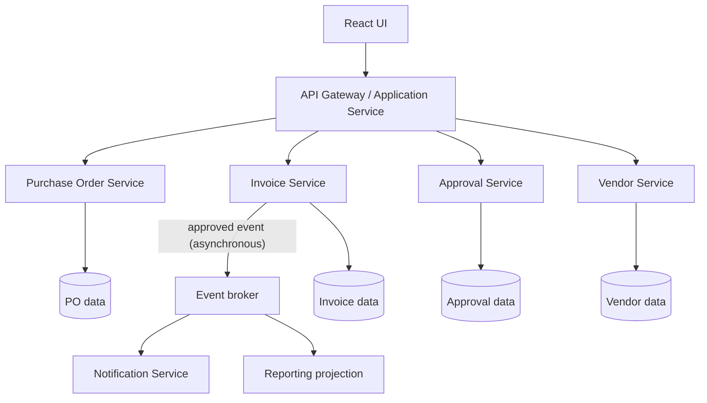
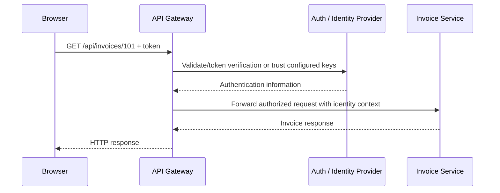
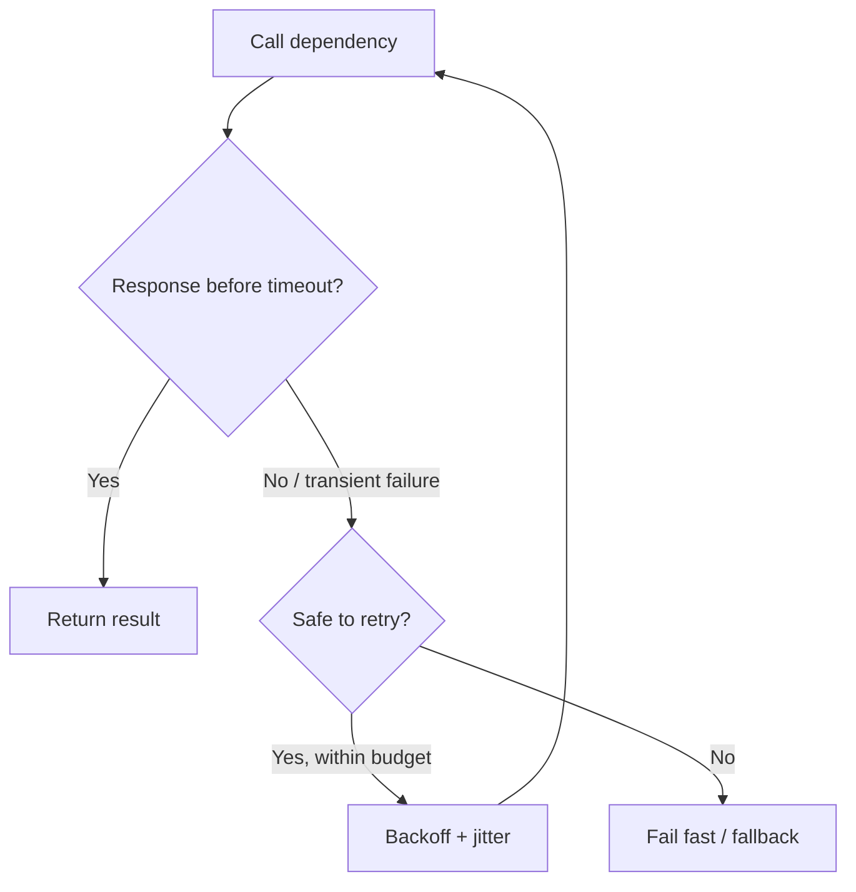
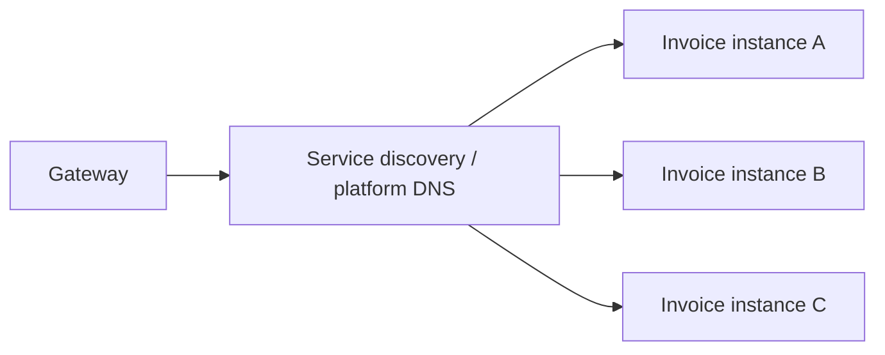
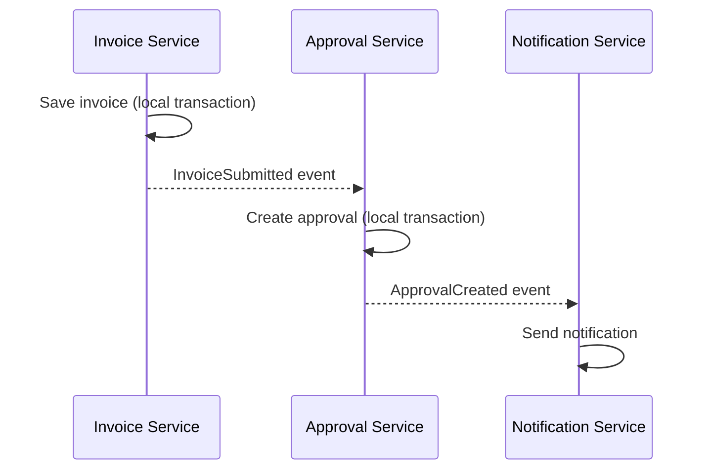
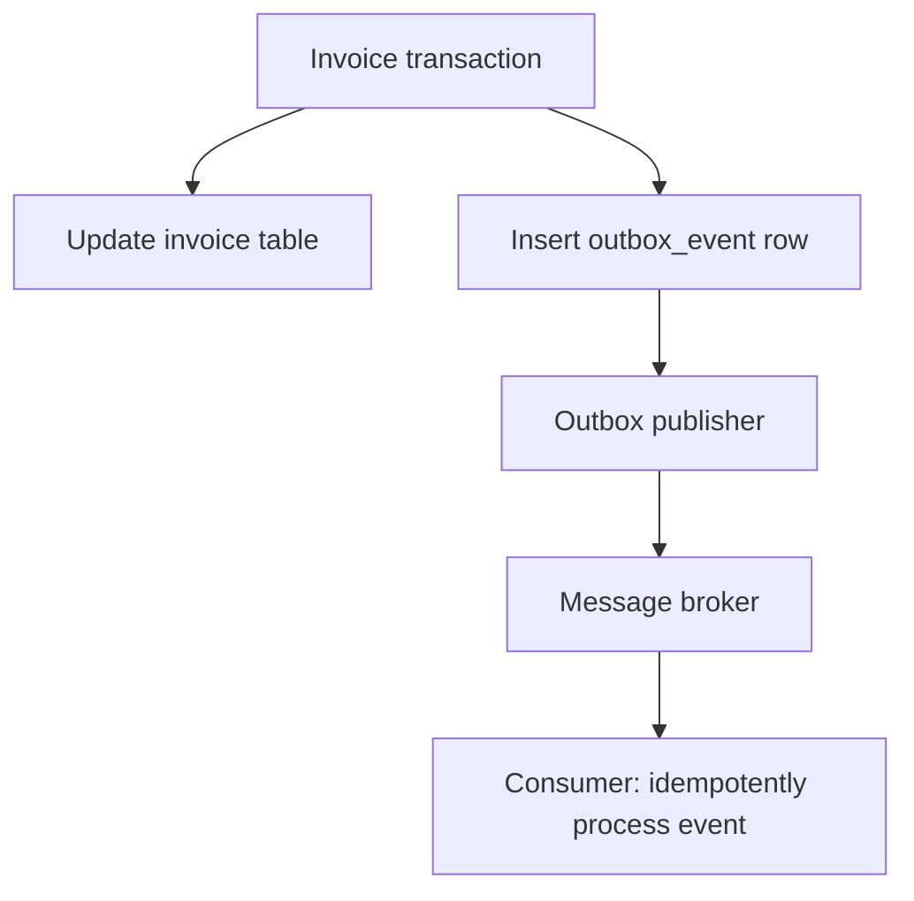
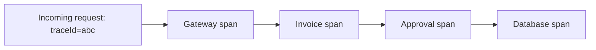

# Chapter 17 — Microservices Architecture and API Gateway Design

> **Learning objective:** Design service boundaries, understand interservice communication, and explain the resilience, security, consistency and observability trade-offs of distributed Java applications.

**Audience:** Senior Java Developer / Backend Engineer · **Stack:** Java 21, Spring Boot, HTTP APIs, relational databases · **Study:** 75–100 minutes

## 1. Why do we use microservices?

Consider an invoice-tracking application with Vendors, Purchase Orders, Invoices, Approvals, Notifications and Reporting. All features might initially run in one deployable application. As the organization grows, the teams may need to release different functions independently.

A **microservice** is a service organized around a business capability with a clear API contract, defined data ownership and the ability to deploy independently. Microservices do not automatically make applications simpler or faster: they move complexity into the network, deployment, security, data consistency and operations.

### Monolith vs modular monolith vs microservices

| Architecture | Deployment | Internal modules | Main trade-off |
|---|---|---|---|
| Monolith | Usually one application | May be tightly coupled | Simple operations but difficult independent changes when poorly modularized |
| Modular monolith | One application | Strong code/module boundaries | Easier transactions, fewer network hops; releases still coordinated |
| Microservices | Multiple independent services | Separate deployable boundaries | Independent releases/scaling; distributed-systems complexity |

**Senior-level decision:** Start with business boundaries, team ownership, availability needs and release constraints. Do not split services just because there are many tables.

## 2. Example architecture — Invoice Tracking



Each database cylinder represents **logical data ownership**, not necessarily a separate physical database server. Teams may share infrastructure while avoiding direct cross-service writes to each other's tables.

**Example lifecycle:** Invoice Service validates a submitted invoice and requests or starts an approval. After approval is recorded consistently, an event can trigger notification and reporting updates.

## 3. How to identify service boundaries

Think in **business capabilities** and **bounded contexts**:

- Vendor Service: vendor lifecycle and master data.
- Purchase Order Service: PO lines, owners and payment terms.
- Invoice Service: invoice records and validations.
- Approval Service: routing, approver decisions and workflow state.
- Notification Service: email or other outbound messages.
- Reporting Service: read-optimized views or projections.

Questions to ask: Who owns the rules? Which operations must be atomic? Which data changes together? Who deploys the functionality? Is an independent failure boundary valuable?

**Warning:** Creating one service per CRUD table is usually a *distributed monolith*, not good microservices design.

## 4. API Gateway — role and limits

A gateway provides an externally reachable entry point and routes requests to internal services. It can centralize common cross-cutting responsibilities.



**Common responsibilities:** TLS termination, routing, authentication/token validation, coarse-grained authorization, rate limiting, request size limits, correlation IDs and observability.

**What not to centralize:** Every domain validation, invoice approval rule or business transaction. Fine-grained authorization must still be enforced by backend services when needed.

**Security caution:** A gateway is not a complete trust boundary. Internal APIs need network controls, identity validation and authorization appropriate to their threat model.

## 5. Example routing with Spring Cloud Gateway

A simplified conceptual configuration for a **reactive** Spring Cloud Gateway deployment:

```yaml
spring:
  cloud:
    gateway:
      routes:
        - id: invoice-service
          uri: http://localhost:8082
          predicates:
            - Path=/api/invoices/**
        - id: vendor-service
          uri: http://localhost:8083
          predicates:
            - Path=/api/vendors/**
```

This illustrates routing, **not a complete production gateway**. Exact dependency and property names depend on the Spring Cloud release and gateway server variant. Configure compatible Spring Boot/Spring Cloud versions, route filters, security, error handling and trusted service discovery.

An API Gateway written as a normal Spring Boot application is also possible; choosing a gateway library is an implementation decision, not a requirement.

## 6. Synchronous vs asynchronous communication

| Synchronous request-response | Asynchronous messaging |
|---|---|
| Caller waits for a response | Producer publishes a message/event |
| Useful for immediate reads and decisions | Useful for notifications and loose coupling |
| Timeouts and cascading failures matter | Duplicate delivery, lag and ordering matter |
| Usually HTTP/REST or gRPC | Often Kafka, RabbitMQ or a managed broker |

**Example:** Showing an invoice details page usually needs a timely synchronous response. Sending an “invoice approved” email can happen asynchronously after a durable business commit.

## 7. Timeout, retry and circuit breaker

A network call can hang or fail, so define bounded behavior.



**Timeout:** Controls how long to wait.  
**Retry:** Repeats a safe or idempotent operation after certain failures.  
**Circuit breaker:** Temporarily rejects calls to an unhealthy dependency to reduce cascading damage.  
**Bulkhead:** Limits resource usage so one dependency does not exhaust every available request thread/connection.

**Critical:** Retry a payment or approval POST only when the operation has designed idempotency protection. Blind retries can duplicate business actions.

## 8. Resilience4j example (illustrative)

```java
@Service
class VendorLookupService {
    private final VendorClient client;

    VendorLookupService(VendorClient client) {
        this.client = client;
    }

    @CircuitBreaker(name = "vendorService", fallbackMethod = "fallbackVendor")
    public VendorResponse getVendor(String code) {
        return client.getVendor(code);
    }

    private VendorResponse fallbackVendor(String code, Throwable ex) {
        throw new VendorUnavailableException("Vendor service unavailable", ex);
    }
}
```

The snippet assumes the application's `VendorClient`, DTO and exception exist, and that **compatible Resilience4j Spring integration and AOP support** are configured. It is not a standalone Java program. A fallback may fail closed rather than return stale data when accuracy is critical.

## 9. Service discovery and load balancing

In a dynamic deployment, service endpoints can change. Discovery maps a logical service name to healthy instances.



Kubernetes typically uses Services and DNS for discovery, whereas other platforms may use registries or managed service routing. Health checks and readiness determine whether traffic should reach an instance.

**Load balancing** spreads requests across eligible instances, but it does not guarantee an even workload or solve slow database queries.

## 10. Database per service — what does it actually mean?

The key principle is **exclusive ownership of writes and schema evolution** for a service's domain data. It does not require separate physical servers.

Avoid letting Approval Service directly update Invoice Service tables; doing so creates hidden coupling and makes changes difficult. Instead use an API, a durable event or an explicit orchestration protocol.

**Read models:** Reporting can maintain its own projection from events or authorized data feeds. This supports reporting without joining other services' private tables on every request.

## 11. Distributed transactions and the Saga pattern

A normal Spring `@Transactional` method is **not** a transaction across multiple independent services and databases.

A Saga coordinates multiple local transactions through events or commands and compensating actions.



**Orchestration:** A coordinator directs the steps.  
**Choreography:** Services respond to domain events.

A compensating action is a *business correction*, not an automatic SQL rollback across the network. Design explicit states for partial completion and manual repair.

## 12. Transactional outbox — avoid the dual-write problem

**Problem:** An invoice is committed in MySQL but the process crashes before publishing its event to Kafka. Other services never hear about the invoice.

**Outbox approach:** Within one database transaction, save both the invoice change and an outbox event row. A separate publisher sends the event later and records delivery progress.



The publisher may deliver a message more than once, so consumers still need duplicate handling. An outbox improves **atomic persistence of state and intent to publish**, not magical exactly-once external processing.

## 13. Idempotency — essential for approval APIs

Suppose a client times out after submitting an approval. It retries the same request. The system must avoid creating two approvals or sending multiple irreversible actions.

Possible design:

1. Require a stable request id / idempotency key.
2. Enforce a unique constraint on `(operation, key)` or another appropriate business key.
3. Validate current status and authorization transactionally.
4. Store the result for repeated requests.
5. Return a consistent response when the same request is retried.

**Do not rely on `synchronized`** if multiple service instances are running. JVM locks are local to one process.

## 14. Service-to-service security

Important controls include:

- Validate bearer JWTs or use another appropriate workload identity mechanism.
- Verify issuer, audience, signature and token expiry where JWT is used.
- Apply service-level authorization, not only gateway validation.
- Prefer TLS for transport protection and consider mTLS where required.
- Avoid trusting arbitrary user identity headers from public clients.
- Use secrets managers and least-privilege access.

Do not place tokens, database passwords or private keys in this public handbook's example configuration.

## 15. Observability and distributed tracing

A request may cross gateway → invoice → approval → database. Logs from a single process are not enough.



**Three pillars:** logs, metrics and traces.

Useful metrics: request rate, p95/p99 latency, error rates, dependency timeouts, queue lag, connection-pool saturation and retry/circuit-breaker events.

Propagate standardized tracing context (e.g., W3C Trace Context) through HTTP and message headers, while controlling sensitive data in logs and spans.

## 16. API versioning and backward compatibility

Microservices may deploy at different times. Avoid breaking consumers when changing event schemas and REST contracts.

Good practices:

- Add optional fields where compatible.
- Preserve old event consumers during migrations.
- Use consumer-driven contract tests where valuable.
- Plan deprecation and rollout order.
- Version only when a truly incompatible contract is needed.

**Event evolution:** Consumers should be resilient to additional fields when their serialization format and contract permit it.

## 17. Common failure: distributed monolith

Symptoms:

- Every deployment requires coordinating 10 services.
- Every API call fan-outs synchronously across many services.
- Services share writable database tables.
- There are no independent business ownership boundaries.
- One downstream outage brings down the entire product.

**Solution:** Reassess service boundaries, reduce chatty calls, adopt local projections where appropriate and ensure fault containment. Sometimes a modular monolith is the more maintainable architecture.

## 18. Production scenario — invoice service is slow

An invoice endpoint has p99 latency of 9 seconds. Investigate:

1. Gateway routing latency, authentication and rate limits.
2. Dependency calls, connect/read timeouts and retry multiplicity.
3. Database query plans, pool saturation and locks.
4. Thread pool/virtual thread limits, CPU and GC.
5. Trace spans and correlation IDs to find the real slow segment.

Avoid adding retries before understanding the failure: retries can multiply load on an already overloaded dependency.

## 19. Production scenario — notification after approval

**Requirement:** After an invoice is approved, send an email, and do not roll back approval because SMTP is temporarily unavailable.

Recommended design: approval state commits locally; the same transaction writes an outbox message; an asynchronous worker delivers the notification with bounded retries and a dead-letter/manual-repair process.

**Trade-off:** Notification is eventually delivered rather than guaranteed to be immediate. Define acceptable delay and monitoring.

## 20. Common mistakes

1. Assuming microservices are always better than a modular monolith.
2. Making one microservice for each database table.
3. Placing all business logic inside the API Gateway.
4. Using synchronous APIs for every cross-service action.
5. Retrying non-idempotent writes without deduplication.
6. Treating `@Transactional` as a distributed transaction.
7. Allowing many services to update the same tables.
8. Assuming event delivery is exactly once by default.
9. Forgetting timeouts, backpressure, monitoring and circuit breakers.
10. Securing only the gateway while leaving internal authorization unchecked.

## 21. Interview questions — natural senior-level answers

**Q1. What is a microservice?**  
A separately deployable service focused on a business capability, with a clear contract and owned data. The trade-off is additional distributed-system operational complexity.

**Q2. Microservices vs modular monolith?**  
A modular monolith has strict internal boundaries but one deployment and simpler local transactions; microservices separate deployment and failure boundaries but require network communication and eventual consistency patterns.

**Q3. How do you decide service boundaries?**  
I start from business capabilities, ownership of rules and data, transaction boundaries, team independence and change patterns.

**Q4. What is an API Gateway?**  
It provides common entry routing, authentication and cross-cutting policies. Domain-specific decisions remain with the owning service.

**Q5. Why not put all validation in the gateway?**  
Business rules change with the domain and must be enforced at the service boundary; gateway checks are best for shared infrastructure concerns.

**Q6. Synchronous vs asynchronous communication?**  
Synchronous is useful when an immediate answer is required. Asynchronous messaging decouples components but introduces delivery, ordering and duplicate-handling concerns.

**Q7. What is a circuit breaker?**  
A resilience control that temporarily stops calling a failing dependency and later probes whether it can recover.

**Q8. Why are timeouts important?**  
Without deadlines, blocked downstream calls can occupy application resources and cause cascading failures.

**Q9. How would you prevent duplicate approval requests?**  
Use transactional validation, durable idempotency keys and database constraints/locking appropriate to the operation.

**Q10. What is a Saga?**  
A sequence of independent local transactions coordinated through commands/events with explicit compensating actions for business failure handling.

**Q11. Is a Saga equivalent to database rollback?**  
No. A compensation is an additional business operation and may not perfectly undo an external side effect.

**Q12. What is the transactional outbox pattern?**  
Persist a business change and a publishable event record in the same local database transaction, then publish asynchronously.

**Q13. Does an outbox guarantee exactly-once processing?**  
Not by itself. Delivery can be duplicated; consumers still need idempotency or deduplication.

**Q14. What is service discovery?**  
Resolving a logical service identity to available instances, often through a platform DNS/service mechanism or a registry.

**Q15. What is observability in microservices?**  
Using correlated logs, metrics and traces to understand behavior across multiple service boundaries.

**Q16. How do you secure calls between services?**  
Use authenticated workload identities or validated tokens, TLS, per-service authorization and least-privilege access.

**Q17. How do you avoid N+1 network calls?**  
Define useful API contracts, batch requests, avoid chatty cross-service loops and use local read models where justified.

**Q18. Can two services share the same physical database?**  
Yes, but they should maintain clear ownership of their schemas/records and avoid hidden cross-service writes.

**Q19. What makes microservices difficult to test?**  
Independent deployments, network failures, asynchronous state and contract compatibility; use unit, integration, contract and focused end-to-end tests.

**Q20. When would you avoid microservices?**  
When the team is small, business boundaries are unstable or the release/scale requirements do not justify the operational cost.

## 22. Practice exercises

1. Draw the React → API Gateway → Invoice → Approval flow.
2. Identify service boundaries for Vendor, PO, Invoice, Approval and Notification.
3. Decide which calls should be synchronous and which should use events.
4. Design a retry policy that excludes non-idempotent approval writes.
5. Create an outbox table schema with event ID, aggregate ID, payload, status and timestamps.
6. Explain how duplicate event consumers should behave.
7. Sketch a saga for invoice validation and approval initiation.
8. Explain why a gateway is not a substitute for backend authorization.
9. Design a dashboard data flow that avoids synchronous queries to every service.
10. Diagnose a timeout caused by cascading retries.
11. Define three operational metrics for a Notification Service.
12. Explain whether your design should begin as a modular monolith or microservices.

## 23. Quick revision

- **Microservices:** Independently deployable business capabilities.
- **Bounded context:** Business domain boundary, not one database table.
- **Gateway:** Routes and applies shared policies; not the home of domain logic.
- **Synchronous:** Immediate response, tighter runtime coupling.
- **Asynchronous:** Decoupling, with delivery and consistency challenges.
- **Timeout + circuit breaker + bulkhead:** Fault containment tools.
- **Saga:** Coordinated local transactions with business compensation.
- **Outbox:** Durable business change + intent to publish atomically.
- **Idempotency:** Repeated request should not repeat its business effect.
- **Observability:** Logs + metrics + distributed traces.
- **Choice:** Prefer measured business needs over architectural fashion.

**Next proposed chapter:** Resilience patterns, distributed transactions and event-driven architecture in more depth; then Kafka internals.

### References

- [Spring Cloud Gateway documentation](https://docs.spring.io/spring-cloud-gateway/reference/)
- [Spring Cloud CircuitBreaker](https://docs.spring.io/spring-cloud-circuitbreaker/reference/)
- [Spring Framework Transaction Management](https://docs.spring.io/spring-framework/reference/data-access/transaction.html)
- [OpenTelemetry distributed tracing](https://opentelemetry.io/docs/concepts/signals/traces/)
- [Microservices patterns — Transactional Outbox](https://microservices.io/patterns/data/transactional-outbox.html)
