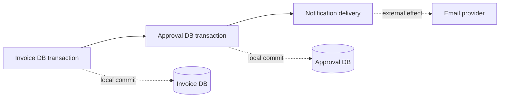
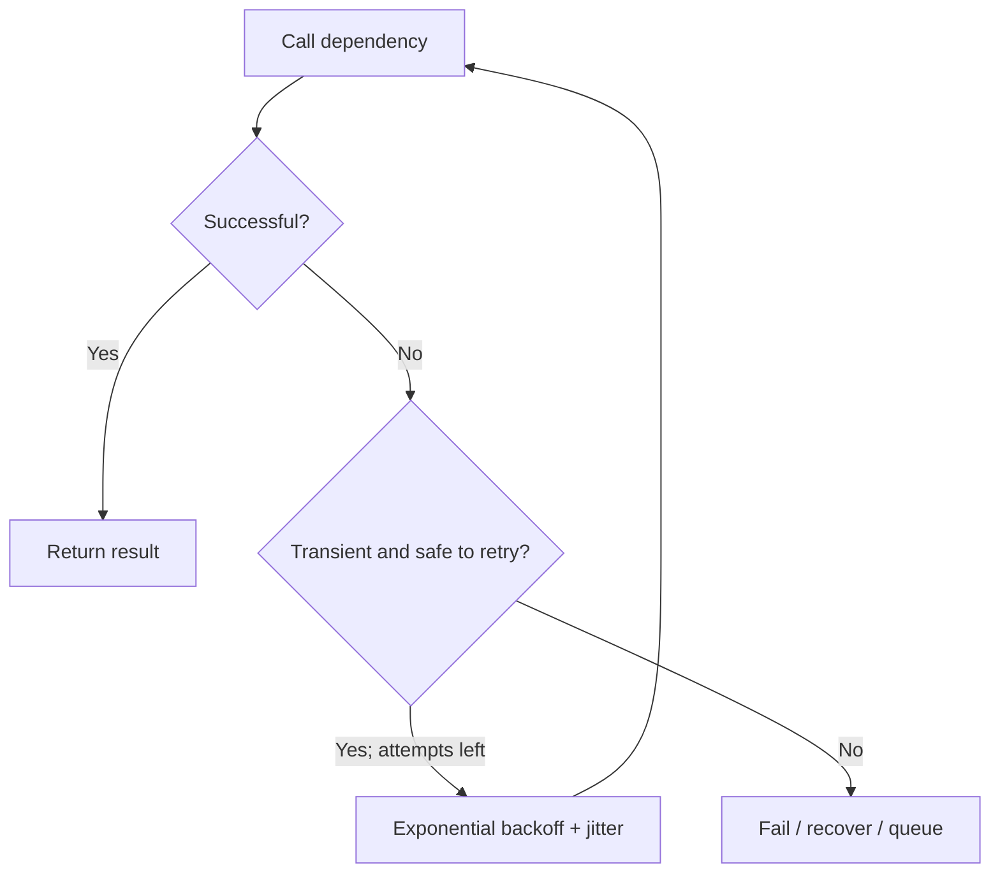
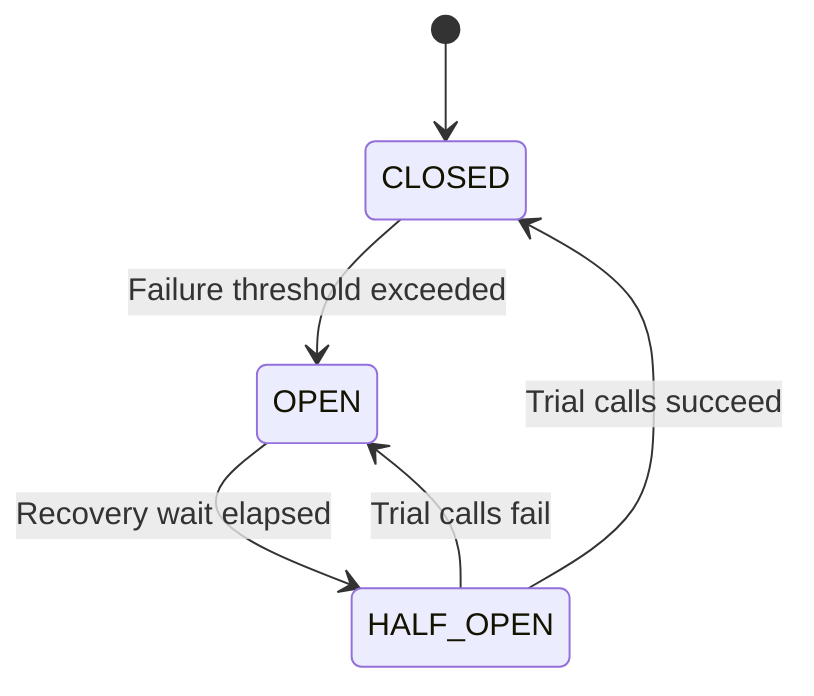
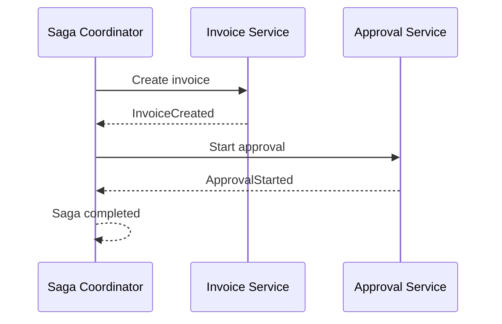
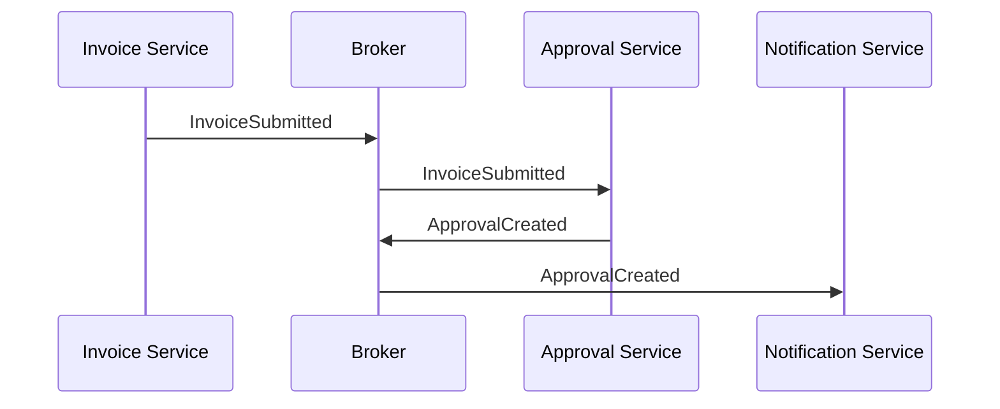
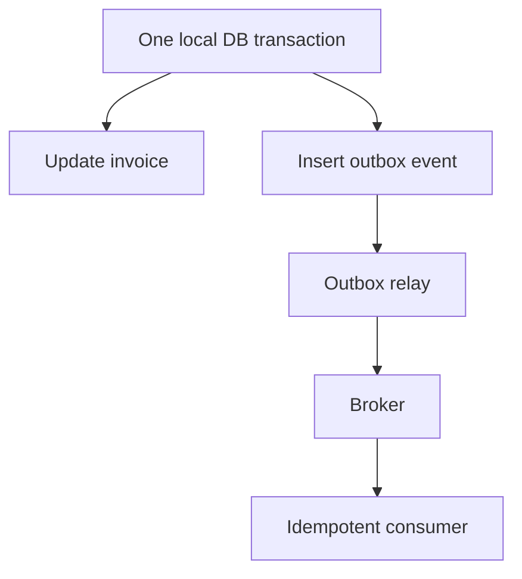

# Chapter 18 — Microservices Resilience and Distributed Transactions

> **Goal:** Design failure-tolerant Java services and explain how state remains correct when independent components fail.

**Stack:** Java 21, Spring Boot 3.x, MySQL, message brokers · **Level:** Senior Java / Tech Lead · **Study plan:** theory → diagrams → implementation → interview Q&A.

## 1. Why distributed transactions are difficult

Imagine an Invoice Service saves an invoice, an Approval Service starts an approval, and Notification Service sends an email. Three processes may fail independently; a local `@Transactional` annotation cannot atomically commit all their databases and external side effects.

A distributed system must plan for timeouts, duplicates, partial completion, slow consumers, unavailable dependencies, and recovery after process crashes.

## 2. Local ACID transaction vs distributed workflow

| Local database transaction | Multi-service workflow |
|---|---|
| One database transaction manager controls commit/rollback | Each service commits independently |
| Strong atomicity inside its scope | Partial completion is possible |
| Usually simple `@Transactional` in Spring | Requires coordination, durable messaging and recovery |
| Rollback can undo uncommitted SQL | Compensation is a new business operation, not a global rollback |



## 3. Failure types and recovery contracts

- **Timeout:** Caller cannot tell if the remote operation committed. Do not assume timeout means failure.
- **Unavailable dependency:** Fail fast, degrade safely or queue work depending on business rules.
- **Duplicate delivery:** Event handlers may see the same event more than once.
- **Out-of-order delivery:** Related events may arrive in unexpected order.
- **Partial success:** Earlier steps are committed while later ones have not run.
- **Poison message:** A permanent invalid payload repeatedly fails; needs isolation and investigation.

**Design principle:** Model transitions such as `SUBMITTED`, `APPROVAL_PENDING`, `APPROVED`, `NOTIFICATION_PENDING`, and `NOTIFICATION_SENT` explicitly where useful, rather than pretending every downstream operation is instantaneous.

## 4. Timeouts, retries, backoff and jitter

Set **connection**, **response/read**, and overall request time budgets appropriately for the HTTP client in use. A retry is only safe for operations with acceptable replay semantics.



A simple backoff idea: delay = minimum of maximum delay and `base * 2^attempt`, plus random jitter. Avoid retry storms; enforce a total deadline and retry budget. For an invoice approval request, use a stable idempotency key before retrying.

## 5. Circuit breaker and bulkhead

A **circuit breaker** reduces repeated calls to a failing dependency: CLOSED permits requests, OPEN rejects requests temporarily, HALF_OPEN allows limited trial calls.



A **bulkhead** isolates capacity, such as a bounded semaphore or executor per dependency, to prevent one slow downstream from exhausting all resources. Circuit breakers protect availability; they do not guarantee data correctness.

**Illustrative Spring service** (requires compatible Resilience4j dependencies and properly configured proxy integration):

```java
@Service
class VendorLookupService {
    private final VendorClient client;
    VendorLookupService(VendorClient client) { this.client = client; }

    @CircuitBreaker(name = "vendor", fallbackMethod = "unavailable")
    VendorDto get(String code) { return client.find(code); }

    private VendorDto unavailable(String code, Throwable cause) {
        throw new VendorServiceUnavailableException("Vendor unavailable", cause);
    }
}
```

**Why throw in the fallback?** For financial validations, returning a fabricated vendor or stale eligibility result could be unsafe. Fallback is a business choice, not always a default value.

## 6. Saga orchestration vs choreography

A **Saga** coordinates multiple *local* transactions with explicit failure handling. It is not a single global ACID transaction.

### Orchestration — coordinator owns transitions



If approval creation fails permanently, the coordinator can mark the invoice as `APPROVAL_SETUP_FAILED`, request a permissible compensation, or escalate for repair. Decide this using business rules.

### Choreography — services react to events



| Orchestration | Choreography |
|---|---|
| Centralized flow visibility | Loose event-based coupling |
| Easier explicit steps and timeouts | Fewer coordinator responsibilities |
| Coordinator design becomes important | Event chains may be difficult to trace |

Do not use compensations to erase an irreversible external action (for example, an email already delivered). Model a corrective notification if necessary.

## 7. Transactional outbox — preventing a dual-write gap

**Bad sequence:** Insert invoice → commit → publish event; process crashes after commit and before publish. Approval never begins.

**Outbox:** Insert both invoice and event into the **same MySQL transaction**, then publish from an outbox worker.



Illustrative schema:

```sql
CREATE TABLE outbox_event (
    event_id CHAR(36) PRIMARY KEY,
    aggregate_type VARCHAR(50) NOT NULL,
    aggregate_id VARCHAR(80) NOT NULL,
    event_type VARCHAR(80) NOT NULL,
    payload JSON NOT NULL,
    published_at TIMESTAMP NULL,
    created_at TIMESTAMP NOT NULL DEFAULT CURRENT_TIMESTAMP
);
```

The relay may publish an event and crash before marking it sent. **Expect duplicates**. A polling relay should claim rows safely among multiple workers; change-data-capture is another approach.

## 8. Consumer idempotency and the inbox pattern

Store a processed event ID with the local business effect *in the same transaction*.

```sql
CREATE TABLE processed_event (
    consumer_name VARCHAR(80) NOT NULL,
    event_id CHAR(36) NOT NULL,
    processed_at TIMESTAMP NOT NULL DEFAULT CURRENT_TIMESTAMP,
    PRIMARY KEY (consumer_name, event_id)
);
```

Pseudocode within one consumer database transaction:

```text
BEGIN
  INSERT processed_event(consumer_name, event_id)
  IF duplicate key: return already-processed
  Apply approval-related change
COMMIT
Acknowledge message after successful commit
```

A real implementation must distinguish duplicate-key errors from other database errors; do not catch all SQL exceptions and pretend an event succeeded. Acknowledge according to the broker's actual consumer semantics.

## 9. HTTP idempotency keys

For `POST /invoices/101/approve` clients may retry after losing a response. The API should distinguish:

1. Same key + same operation/body → return stored result when completed.
2. Same key + different body → reject conflict.
3. A still-processing key → return a documented in-progress response or coordinate safely.

Persist a request fingerprint, key, state and result; enforce uniqueness at database level. **Idempotency keys are not authorization**: still check the authenticated user and business approval route.

## 10. Event delivery and ordering

- **At-most-once:** A message may be lost, but not retried by the delivery mechanism.
- **At-least-once:** Messages can be redelivered; consumers must handle duplicates.
- **Exactly-once:** Usually scoped to specific broker/transaction processing boundaries; does not mean arbitrary external database/email effects run exactly once.

Order can be preserved within a partition or key-based stream under broker-specific conditions, not necessarily across all consumers and partitions. Use aggregate versions or explicit transition guards to reject stale updates.

## 11. Consistency models and reporting

An approval may commit in Approval Service before the reporting projection consumes the event. The report may temporarily show an older state. This is **eventual consistency**.

Define business expectations, for example: approval confirmation must be accurate immediately, while dashboard counts may lag within a monitored threshold. Show timestamps or processing state when useful, and support repair/replay of stale projections.

## 12. Retries, DLQ and poison messages

Retry bounded transient failures with backoff. Route permanently invalid or repeatedly failing events to a dead-letter mechanism only when the business process and broker support it.

A DLQ is not a trash can. Record error context, alert an owner, protect sensitive data, and define a safe replay process. Replaying must preserve idempotency and relevant ordering constraints.

## 13. Concurrency and the database still matter

Two different approvers might submit conflicting decisions at nearly the same time. Neither a circuit breaker nor a Kafka partition alone solves cross-transaction correctness.

Use a database transition such as:

```sql
UPDATE invoice
SET status = 'APPROVED', version = version + 1
WHERE invoice_id = 101
  AND status = 'PENDING_APPROVAL'
  AND version = 7;
```

Verify that exactly one row changed. A result of zero may mean stale state or no matching invoice; read state and return the correct business response. Also ensure proper approver authorization.

## 14. Performance and service overload

Retries multiply incoming traffic. If 100 initial requests each retry twice, a failing dependency may receive 300 attempts. Combine deadlines, backoff/jitter, bounded concurrency and capacity-aware shedding.

Metrics to monitor: request p95/p99, timeout and retry rates, circuit state, worker saturation, queue depth, event lag, DLQ volume, saga age and idempotency conflicts.

## 15. Production incident walkthrough

**Incident:** Invoice is approved in the database; the email was not sent after a deployment restart.

1. Confirm approval persisted; do not blindly run approval again.
2. Find the related outbox event and its delivery state.
3. Check relay health, broker acknowledgment and consumer lag.
4. Check consumer dedupe entries and email provider failure logs.
5. Safely replay the event if eligible, respecting duplicate-email policy.
6. Correct the underlying issue and alert on stuck outbox age.

**Takeaway:** Production recovery must be repeatable and auditable, not a manual database update without a trace.

## 16. Common senior interview mistakes

- Assuming HTTP timeout proves the server did not commit.
- Claiming `@Transactional` spans microservices.
- Retrying all 5xx responses on non-idempotent business requests.
- Calling Saga compensation the same as database rollback.
- Claiming outbox alone creates exactly-once external delivery.
- Using a synchronized block to protect state across multiple JVMs.
- Storing deduplication only in memory.
- Creating a DLQ without an ownership/replay process.
- Ignoring event ordering and stale versions.
- Returning insecure default data when a crucial validation service is down.

## 17. Interview questions and natural answers

**Q1. What is a Saga?** A coordination pattern for a sequence of local transactions, with explicit business recovery or compensation when later steps fail.

**Q2. Orchestration vs choreography?** An orchestrator directs the steps; choreography uses independently reacting services and events. I choose based on flow complexity and visibility needs.

**Q3. What is a circuit breaker?** It stops calling a dependency temporarily when failure conditions exceed a threshold, then probes recovery.

**Q4. Retry vs circuit breaker?** A retry attempts an operation again; a breaker avoids repeated traffic to an unhealthy dependency. Neither guarantees correct duplicate handling.

**Q5. What is a bulkhead?** Isolation of limited resources so one slow dependency cannot consume all service capacity.

**Q6. What is the outbox pattern?** Persist the business change and the intent to publish an event in one database transaction; publish asynchronously later.

**Q7. Can the outbox deliver an event twice?** Yes. A relay can crash between publish and marking delivery. Consumers must be idempotent.

**Q8. How do you design an idempotent approval API?** Persist request keys and results, enforce a uniqueness constraint, validate approval state and authorization transactionally, and return consistent outcomes for retries.

**Q9. What is eventual consistency?** Services or projections converge after asynchronous updates; for a period, a report may lag the source of truth.

**Q10. What is the difference between at-least-once and exactly-once?** At-least-once permits duplicates. Exactly-once claims only apply within specified transactional boundaries and do not automatically extend to SMTP or external databases.

**Q11. What is a DLQ?** An isolation channel for messages that cannot be processed after defined retry rules, with operational investigation and replay controls.

**Q12. What if a remote API timed out after committing?** First check operation state using an idempotency key or status endpoint; avoid assuming the server did nothing.

**Q13. Why use jitter in retries?** It helps spread retries so many clients do not retry simultaneously and overwhelm a recovering dependency.

**Q14. Can `@Transactional` solve distributed consistency?** It covers a local transaction under an appropriate transaction manager; services need explicit coordination patterns across database boundaries.

**Q15. How do you handle out-of-order events?** Carry aggregate IDs and versions/sequence where needed, validate state transitions and reject or defer stale events.

**Q16. What metrics would you monitor?** Error rate, p99 latency, timeout/retry rate, circuit state, event lag, stale saga age, outbox backlog and DLQ count.

**Q17. How do you avoid duplicate notification?** Use durable event IDs and a dedupe policy, understanding that a provider accepting a send followed by a lost acknowledgment may still create ambiguity.

**Q18. When should you choose orchestration?** For a multi-step process needing explicit state management, timeout rules, compensation and a clear operational view.

## 18. Exercises

1. Design saga states for InvoiceSubmitted → ApprovalCreated → NotificationQueued.
2. Draw an orchestration diagram with a permanent Approval Service failure.
3. Write a transactional outbox insertion alongside an invoice update.
4. Create a processed-event table with a composite unique key.
5. Explain what happens when the relay crashes after publishing.
6. Add a version-checked SQL update for approval decisions.
7. Define an HTTP idempotency-key request and result contract.
8. Design backoff and a maximum retry budget for a vendor lookup.
9. Decide which fallbacks must fail closed in an invoice system.
10. Create an operational plan for DLQ investigation and replay.

## 19. Quick revision

- Local ACID transaction ≠ distributed transaction.
- Timeout ≠ confirmed failure.
- Retry requires safety, a deadline and jitter.
- Circuit breaker protects availability; bulkhead isolates capacity.
- Saga coordinates local transactions and compensation.
- Outbox makes state change plus publish intent atomic.
- Consumer dedupe handles at-least-once redelivery.
- Version checks protect state transitions.
- Eventual consistency requires clear business expectations.
- Monitoring and repair paths are part of the architecture.

**Next chapter:** Kafka internals, partitioning, consumer groups, offset management and delivery guarantees.

### Further reading

- [Spring Cloud CircuitBreaker](https://docs.spring.io/spring-cloud-circuitbreaker/reference/)
- [Resilience4j documentation](https://resilience4j.readme.io/docs/getting-started)
- [Transactional outbox pattern](https://microservices.io/patterns/data/transactional-outbox.html)
- [Saga pattern](https://microservices.io/patterns/data/saga.html)
