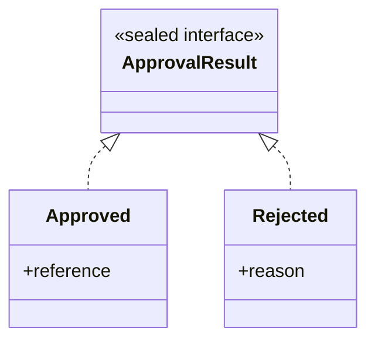
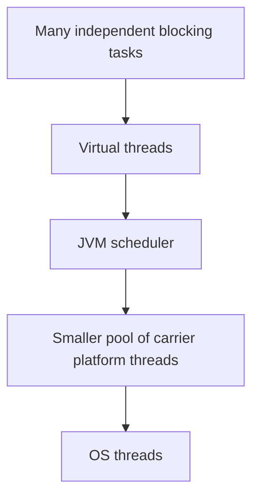

# Chapter 12 — Modern Java 17 and Java 21 Features

> **Goal:** Understand modern Java features, explain why they were introduced, and decide where they are appropriate in Spring Boot applications.

**Java version:** Java 21 LTS · **Audience:** Senior Java / Backend Engineers · **Study approach:** Concept → diagrams → examples → interview answers → practice

## 1. Why should backend developers learn modern Java?

Modern Java helps make domain models concise, prevents invalid class hierarchies, simplifies branching, and improves concurrency for blocking I/O workloads. But a new feature is not automatically better in every situation.

**Version discipline:** Java 17 and Java 21 are LTS releases. Some features were introduced earlier and became permanent in these releases; others remained preview in Java 21. Interviewers may ask whether a particular feature is production-ready without preview flags.

## 2. Feature reference by version

| Feature | Permanent since | Example purpose |
|---|---|---|
| Switch expressions | Java 14 | Return a value from a switch |
| Text blocks | Java 15 | Readable multiline strings |
| Records | Java 16 | Data carriers with generated methods |
| Pattern matching for `instanceof` | Java 16 | Type check plus binding |
| Sealed classes/interfaces | Java 17 | Restrict permitted subtypes |
| Pattern matching for `switch` | Java 21 | Switch on type patterns |
| Record patterns | Java 21 | Deconstruct record values |
| Sequenced Collections | Java 21 | Uniform first/last/reversed operations |
| Virtual Threads | Java 21 | Scale thread-per-task blocking I/O |

**Preview examples in Java 21:** String Templates (JEP 430), Scoped Values (JEP 446), and Structured Concurrency (JEP 453) were preview features. **Do not present these as permanent Java 21 APIs.** String Templates were later withdrawn rather than becoming a finalized language feature.

## 3. Records — concise data carriers

A record declares components and Java generates a canonical constructor, accessors, `equals`, `hashCode`, and `toString` unless suitably provided.

```java
public record InvoiceSummary(String invoiceNumber, int amount) {
    public InvoiceSummary {
        if (invoiceNumber == null || invoiceNumber.isBlank()) {
            throw new IllegalArgumentException("Invoice number required");
        }
        if (amount < 0) {
            throw new IllegalArgumentException("Amount cannot be negative");
        }
    }
}
```

```java
var invoice = new InvoiceSummary("INV-101", 2500);
System.out.println(invoice.invoiceNumber());
System.out.println(invoice);
```

**Output:**

```text
INV-101
InvoiceSummary[invoiceNumber=INV-101, amount=2500]
```

**Important:** Records are *shallowly immutable*. Their component fields are final, but a mutable object held as a component can still be changed. Records cannot extend arbitrary classes (they implicitly extend `java.lang.Record`) and are implicitly final.

**Use cases:** DTOs, query projections and message payloads. Avoid assuming all JPA entities should be records: entity lifecycle, proxying and mutability requirements differ.

## 4. Sealed classes — limit allowed subtypes

A sealed type explicitly defines its allowed direct subclasses.

```java
sealed interface ApprovalResult permits Approved, Rejected {}

record Approved(String reference) implements ApprovalResult {}

record Rejected(String reason) implements ApprovalResult {}
```



Permitted direct subclasses must appropriately declare themselves `final`, `sealed`, or `non-sealed` (records are implicitly final). Java also enforces applicable module/package restrictions for sealed hierarchies.

**Why use it?** A workflow may have a known set of outcomes. A sealed interface makes the domain alternatives explicit and supports exhaustive pattern switching.

## 5. Pattern matching for `instanceof`

Before:

```java
if (value instanceof String) {
    String text = (String) value;
    System.out.println(text.length());
}
```

Modern Java:

```java
Object value = "Purchase Order";
if (value instanceof String text) {
    System.out.println(text.length());
}
```

**Output:** `14`.

The variable `text` is in scope only where the compiler knows the matching pattern succeeded.

## 6. Switch expressions

A switch expression returns a value.

```java
enum Status { DRAFT, APPROVED, REJECTED }

static String label(Status status) {
    return switch (status) {
        case DRAFT -> "Pending";
        case APPROVED -> "Completed";
        case REJECTED -> "Closed";
    };
}
```

An exhaustive enum switch expression may omit `default` (provided it handles all current constants); the compiler helps detect missing cases when the enum changes.

For a block arm, use `yield`:

```java
int amount = 7500;
String band = switch (amount / 1000) {
    case 0, 1, 2 -> "LOW";
    default -> {
        String computed = amount >= 5000 ? "HIGH" : "MEDIUM";
        yield computed;
    }
};
```

## 7. Pattern matching for switch (Java 21)

```java
static String describe(Object value) {
    return switch (value) {
        case null -> "Missing";
        case String s -> "Text: " + s;
        case Integer n -> "Number: " + n;
        default -> "Other";
    };
}
```

This supports type-based branching without chains of casts. Cases must obey dominance and exhaustiveness rules.

**Interview trap:** `case null` is not automatically handled by a `default` label in every switch form. Know the null behavior of the construct you write.

## 8. Record patterns (Java 21)

Record patterns deconstruct record values directly.

```java
record Vendor(String code) {}
record PurchaseOrder(String number, Vendor vendor) {}

static String vendorCode(Object obj) {
    if (obj instanceof PurchaseOrder(String number, Vendor(String code))) {
        return number + " -> " + code;
    }
    return "Not a purchase order";
}
```

**Usage:** Type-safe extraction from nested immutable-style DTOs or sealed domain events. Avoid deeply nested patterns if they reduce readability.

## 9. Text blocks

Text blocks simplify multiline literals:

```java
String sql = """
        SELECT invoice_number, amount
        FROM invoice
        WHERE status = ?
        ORDER BY received_date DESC
        """;
```

They are useful for SQL, JSON examples and test fixtures. **Text blocks do not make SQL safe by themselves.** Continue to use bound parameters instead of concatenating untrusted values.

## 10. Sequenced Collections (Java 21)

Java 21 introduces interfaces such as `SequencedCollection`, `SequencedSet`, and `SequencedMap`.

```java
import java.util.ArrayList;
import java.util.List;

public class SequencedExample {
    public static void main(String[] args) {
        List<String> steps = new ArrayList<>(
            List.of("PO uploaded", "Invoice received", "Approval"));
        System.out.println(steps.getFirst());
        System.out.println(steps.getLast());
        System.out.println(steps.reversed());
    }
}
```

**Output:**

```text
PO uploaded
Approval
[Approval, Invoice received, PO uploaded]
```

The reversed result is a view, not necessarily an independent copy. This topic also appears in the Collections chapter because it is part of the Java 21 Collections API.

## 11. Virtual Threads (Java 21)

Virtual threads are lightweight Java threads managed by the runtime. They are valuable when a server has many concurrent **blocking I/O** operations (database calls, network operations) and a traditional thread-per-request model consumes too many platform threads.



Simple example:

```java
import java.util.concurrent.Executors;

public class VirtualThreadDemo {
    public static void main(String[] args) throws Exception {
        try (var executor = Executors.newVirtualThreadPerTaskExecutor()) {
            var result = executor.submit(() -> {
                Thread.sleep(100);
                return "Invoice checked";
            });
            System.out.println(result.get());
        }
    }
}
```

**Output:** `Invoice checked`.

**Key cautions:**
- Virtual threads improve concurrency scalability for many blocking tasks; they do **not** make CPU-heavy computations faster.
- Do not pool virtual threads to limit concurrency. Limit the actual scarce resource using semaphores, connection pools, rate limits, etc.
- In Java 21, some blocking operations while holding a monitor can pin a virtual thread to its carrier. This behavior is JVM/version-specific and has evolved in later Java releases.
- A JDBC pool still limits concurrent database connections even if you create thousands of virtual threads.

For a deeper discussion, use **Chapter 10 — Advanced Concurrency**.

## 12. Other useful modern Java APIs

### Helpful additions up to Java 21

- `String.isBlank()`, `strip()`, `repeat()` (Java 11).
- `Files.readString()` and `Files.writeString()` (Java 11).
- `List.of`, `Set.of`, `Map.of` (Java 9): unmodifiable factory collections.
- `Stream.toList()` (Java 16): returns an unmodifiable list.
- Helpful `NullPointerException` messages (runtime enhancement; details depend on JVM settings).
- Java Platform Module System (Java 9): modules and explicit dependencies.

**Note:** These are not all “Java 17 features.” Knowing introduction versions prevents confusing interview answers.

## 13. Practical design: sealed outcome + record + pattern switch

Save as `ModernJavaDemo.java`:

```java
public class ModernJavaDemo {
    sealed interface Result permits Success, Failure {}
    record Success(String invoiceNo) implements Result {}
    record Failure(String reason) implements Result {}

    static String message(Result result) {
        return switch (result) {
            case Success(String number) -> "Approved: " + number;
            case Failure(String reason) -> "Rejected: " + reason;
        };
    }

    public static void main(String[] args) {
        System.out.println(message(new Success("INV-101")));
        System.out.println(message(new Failure("Amount mismatch")));
    }
}
```

Run:

```bash
javac ModernJavaDemo.java
java ModernJavaDemo
```

**Output:**

```text
Approved: INV-101
Rejected: Amount mismatch
```

This program uses only permanent Java 21 features; no `--enable-preview` flag is needed.

## 14. Spring Boot scenarios

| Requirement | Feature worth considering | Trade-off |
|---|---|---|
| Read-only response model | Record DTO | Shallow immutability, JSON binding compatibility |
| Finite workflow outcomes | Sealed interface + record variants | More explicit type modeling |
| Type-dependent event handling | Pattern switch | Keep switch readable |
| Multiline test SQL | Text blocks | Always parameterize user input |
| Concurrent blocking service calls | Virtual Threads | DB pools and remote-service limits remain |
| Ordered lists | Sequenced collections | Requires Java 21 APIs |

**Senior mindset:** Choose a feature only when it makes behavior, correctness or maintainability better. Avoid rewriting stable code solely to demonstrate language syntax.

## 15. Interview questions and natural answers

**Q1. What are the main Java 17 features?**  
Java 17 is an LTS release. Key language capabilities available by Java 17 include records, sealed classes, pattern matching for instanceof, and switch expressions, although these features became permanent across earlier releases.

**Q2. What's important in Java 21?**  
Virtual Threads, Sequenced Collections, Record Patterns and Pattern Matching for switch are key finalized features. Java 21 also had preview and incubating APIs that should not be mistaken for finalized features.

**Q3. Record vs class?**  
Records are concise data-carrier types with generated methods and final component fields. Regular classes offer more flexible inheritance, encapsulation and mutable design choices.

**Q4. Are records deeply immutable?**  
No. Their fields are final, but a mutable component value may still be modified. Defensive copying is necessary when deep immutability is required.

**Q5. When would you use a sealed interface?**  
When a domain has a controlled set of alternatives, such as approved/rejected outcomes, and I want the compiler to help enforce a known hierarchy.

**Q6. What is the advantage of switch expressions?**  
They return values directly, avoid accidental fall-through with arrow syntax, and require exhaustive handling when used as expressions.

**Q7. What is pattern matching for instanceof?**  
It combines a type check with a new variable binding, eliminating a redundant explicit cast.

**Q8. What is a record pattern?**  
A pattern that deconstructs record components during matching, so nested values can be accessed concisely.

**Q9. Why were Virtual Threads introduced?**  
To enable very high numbers of concurrent blocking tasks without requiring one costly platform thread per task. They are especially useful for I/O-bound work.

**Q10. Are Virtual Threads always faster?**  
No. They can improve scalability and throughput for workloads constrained by blocking, but don't make individual CPU-bound tasks faster.

**Q11. Can Virtual Threads overload a database?**  
Yes. More threads do not create more database capacity. Use connection pools, bounded concurrency and timeouts.

**Q12. What are Sequenced Collections?**  
Java 21 interfaces that unify ordered collection operations, including retrieving first/last elements and obtaining reversed views.

**Q13. What is the use of text blocks?**  
They make multiline text such as SQL and JSON easier to read. They don't replace SQL parameter binding or escaping.

**Q14. Does every Java 21 feature require preview flags?**  
No. Records, virtual threads, record patterns, switch patterns and sequenced collections are permanent. Some other Java 21 features were preview and required explicit opt-in.

**Q15. Should we convert all DTOs and entities to records?**  
No. Records can be good for data-transfer models, but entities may need proxying, mutable lifecycle state and a different design.

## 16. Exercises

1. Convert an immutable-style DTO class into a record with validation.
2. Model `Approved`, `Rejected`, and `Pending` with a sealed hierarchy.
3. Use a pattern switch to convert each outcome into an API message.
4. Write a text block for a parameterized SQL query.
5. Run the Sequenced Collections example and compare `reversed()` with making a new list.
6. Start 20 virtual-thread tasks doing `Thread.sleep(100)` and explain why sleep is not CPU work.
7. Explain why connection-pool limits still matter when using virtual threads.
8. Identify which features in this chapter were permanent by Java 17 and which were finalized in Java 21.

## 17. Quick revision

- Records = concise data carriers, **shallowly** immutable.
- Sealed types = controlled subtype hierarchy.
- `instanceof` patterns = type test + binding.
- Switch expressions = value-returning branching.
- Pattern switch and record patterns = finalized in Java 21.
- Sequenced collections = uniform ordered collection API.
- Virtual threads = scalable blocking I/O, not faster CPU.
- Preview feature ≠ permanent feature.

**Next chapter:** Spring Framework fundamentals — IoC, Dependency Injection, Bean lifecycle and Spring Boot architecture.

### Further reading

- [OpenJDK JEP 395 — Records](https://openjdk.org/jeps/395)
- [OpenJDK JEP 409 — Sealed Classes](https://openjdk.org/jeps/409)
- [OpenJDK JEP 440 — Record Patterns](https://openjdk.org/jeps/440)
- [OpenJDK JEP 441 — Pattern Matching for switch](https://openjdk.org/jeps/441)
- [OpenJDK JEP 431 — Sequenced Collections](https://openjdk.org/jeps/431)
- [OpenJDK JEP 444 — Virtual Threads](https://openjdk.org/jeps/444)
