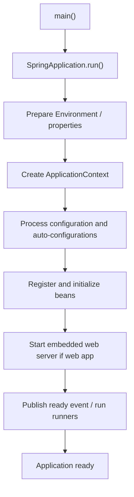
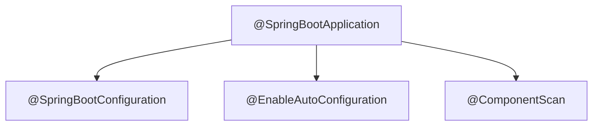
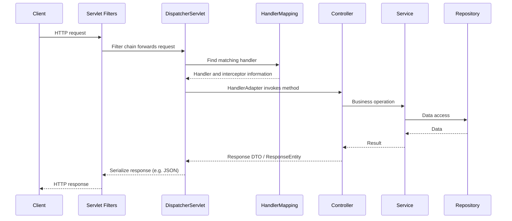

# Chapter 14 — Spring Boot Auto-Configuration, Spring MVC and REST APIs

> **Goal:** Explain how a Spring Boot application starts, how an HTTP request reaches a controller, how auto-configuration works, and how to design production-ready APIs.

**Recommended stack:** Java 21 · Spring Boot 3.x / Spring Framework 6.x · **Audience:** Senior Java Backend Engineers

## 1. Why learn Spring Boot internals?

You may write `@RestController` and `@GetMapping` every day. But interviewers at senior level often ask:

- Who creates the controller object?
- How does a request reach the right method?
- Why does Spring Boot configure a database or MVC automatically?
- What happens when an API throws an exception?
- Why does changing a property sometimes create or remove a bean?

Understanding the execution pipeline helps with debugging and designing predictable backend services.

## 2. Spring Framework vs Spring Boot

| Spring Framework | Spring Boot |
|---|---|
| Provides dependency injection, MVC, transactions, AOP and more | Builds on Spring to simplify configuration and application startup |
| Can require significant explicit setup | Applies conventions and auto-configuration |
| Works without Spring Boot | Depends on Spring Framework |
| `ApplicationContext` manages beans | Boot creates/configures the context using application settings and classpath |

**Remember:** Spring Boot does not replace Spring; it provides a streamlined way to use it.

## 3. Spring Boot startup sequence



This is a simplified conceptual sequence. Some context refresh and web-server lifecycle events are interleaved; don't interpret the diagram as an exact internal call stack.

### Minimal application

```java
package com.example.handbook;

import org.springframework.boot.SpringApplication;
import org.springframework.boot.autoconfigure.SpringBootApplication;

@SpringBootApplication
public class HandbookApplication {
    public static void main(String[] args) {
        SpringApplication.run(HandbookApplication.class, args);
    }
}
```

`SpringApplication.run()` prepares the environment, creates and refreshes the application context, and launches the embedded server for a servlet web application.

## 4. What does `@SpringBootApplication` mean?

It combines three major annotations:

- `@SpringBootConfiguration`: identifies application configuration (a specialized `@Configuration`).
- `@EnableAutoConfiguration`: enables Boot's conditional auto-configuration.
- `@ComponentScan`: discovers eligible components from the application package and its descendants by default.



**Package design:** Put the application class in a sensible root package, or explicitly configure component scanning. Otherwise, components in unrelated packages may not be discovered.

## 5. Auto-configuration — what really happens?

Auto-configuration evaluates conditions based on **classpath contents, properties and existing beans**. It configures conventional components when the prerequisites are met.

For example, an MVC application with `spring-boot-starter-web` generally gets embedded servlet-server and Spring MVC infrastructure without manually declaring every bean.

Important condition annotations include:

| Annotation | Typical purpose |
|---|---|
| `@ConditionalOnClass` | Configure only if a class exists |
| `@ConditionalOnMissingBean` | Back off if a bean was already defined |
| `@ConditionalOnProperty` | Activate based on a configuration property |
| `@ConditionalOnBean` | Activate when another bean exists |
| `@ConditionalOnWebApplication` | Configure depending on web application type |

**Simplified example:**

```java
@Configuration
class NotificationConfiguration {
    @Bean
    @ConditionalOnMissingBean(NotificationSender.class)
    NotificationSender defaultNotificationSender() {
        return new EmailNotificationSender();
    }
}
```

Here, a default implementation is created only when the condition finds no matching bean. This is an example of conditional configuration, not a complete implementation of Boot's own auto-configuration discovery.

**How to debug:** Enable `--debug` for a condition evaluation report, or inspect the `conditions` Actuator endpoint when configured and securely exposed.

## 6. Starter dependencies

Starters group compatible dependencies for a feature.

Examples:

- `spring-boot-starter-web`: servlet-based REST/MVC stack.
- `spring-boot-starter-validation`: Bean Validation integration.
- `spring-boot-starter-data-jpa`: Spring Data JPA integration.
- `spring-boot-starter-security`: security defaults and integration.
- `spring-boot-starter-actuator`: production diagnostics endpoints.

Adding a starter does not guarantee your application is correctly secured, configured, or performant.

## 7. Spring MVC request lifecycle



**Important detail:** The MVC `DispatcherServlet` is a front controller. It delegates handler resolution to `HandlerMapping` and invocation to a suitable `HandlerAdapter`. JSON conversion is typically performed by an `HttpMessageConverter` such as Jackson-based converters.

Security filters execute in the servlet filter chain; not all authentication checks happen inside the controller.

## 8. REST controller example

```java
@RestController
@RequestMapping("/api/invoices")
class InvoiceController {
    private final InvoiceService service;

    InvoiceController(InvoiceService service) {
        this.service = service;
    }

    @GetMapping("/{id}")
    ResponseEntity<InvoiceResponse> find(@PathVariable long id) {
        return ResponseEntity.ok(service.find(id));
    }
}
```

**Why constructor injection?** Dependencies are explicit, testable, and can be held in final fields.

`@RestController` combines `@Controller` and `@ResponseBody` semantics. It does not automatically make an API RESTful; resource modeling, HTTP semantics and error handling still matter.

## 9. Request mapping and parameter binding

| Annotation | Example purpose |
|---|---|
| `@GetMapping` | Retrieve resource representation |
| `@PostMapping` | Create or submit an operation |
| `@PutMapping` | Replace a representation |
| `@PatchMapping` | Apply partial changes |
| `@DeleteMapping` | Delete a resource |
| `@PathVariable` | Bind path segment |
| `@RequestParam` | Bind query parameter |
| `@RequestBody` | Deserialize HTTP request body |
| `@RequestHeader` | Bind an HTTP header |

**REST principle:** GET should be safe and not cause intended business state changes. POST is not automatically idempotent; implement idempotency keys when retries must not duplicate business actions.

## 10. DTOs, entities and validation

Expose API DTOs rather than returning persistence entities directly, especially when entities have bidirectional relationships or confidential fields.

```java
import jakarta.validation.constraints.NotBlank;
import jakarta.validation.constraints.Positive;

public record CreateInvoiceRequest(
    @NotBlank String invoiceNumber,
    @Positive long amount
) {}
```

```java
@PostMapping
ResponseEntity<Void> create(@Valid @RequestBody CreateInvoiceRequest request) {
    service.create(request);
    return ResponseEntity.status(HttpStatus.CREATED).build();
}
```

`@Valid` triggers validation when the appropriate validation infrastructure is configured. Define validation for API inputs, and enforce critical business invariants in the service/domain layer as well.

## 11. Exception handling with `@RestControllerAdvice`

```java
@RestControllerAdvice
class ApiExceptionHandler {
    @ExceptionHandler(InvoiceNotFoundException.class)
    ResponseEntity<ProblemDetail> missing(InvoiceNotFoundException ex) {
        ProblemDetail detail = ProblemDetail.forStatus(HttpStatus.NOT_FOUND);
        detail.setTitle("Invoice not found");
        detail.setDetail(ex.getMessage());
        return ResponseEntity.status(HttpStatus.NOT_FOUND).body(detail);
    }
}
```

Spring Framework 6 includes `ProblemDetail`, which supports RFC 7807-style structured errors. Avoid exposing stack traces, SQL errors, internal paths or secrets to API clients.

**Suggested status mapping:** validation errors 400, unauthenticated 401, forbidden 403, missing 404, conflict 409, unexpected server failures 500. Exact mappings depend on the API contract.

## 12. Content negotiation and JSON serialization

The client's `Accept` header indicates acceptable response media types. The server chooses a compatible representation using its configured converters, handler metadata and other request information.

`Content-Type` describes the media type of a request body. Mixing these two headers is a common interview mistake.

**Troubleshooting:** A 415 response often signals an unsupported request media type; a 406 response indicates that the requested acceptable representation cannot be produced.

## 13. Filters vs interceptors vs AOP

| Mechanism | Execution context | Typical use |
|---|---|---|
| Servlet Filter | Before/after servlet processing | Security chain, CORS, request wrappers |
| HandlerInterceptor | Within Spring MVC handler processing | Handler-specific pre/post logic |
| Spring AOP | Around Spring-managed method execution | Cross-cutting service-level concerns |

Do not rely on a controller interceptor alone to secure the whole application. Security should be enforced through a correctly configured security filter chain and authorization design.

## 14. Configuration and profiles

Spring Boot reads configuration from multiple property sources with defined precedence (including application files, environment variables and command-line arguments).

Example:

```yaml
spring:
  application:
    name: invoice-service
  profiles:
    active: dev
server:
  port: 8080
```

Prefer environment-specific configuration rather than hardcoding UAT/production URLs. Do not commit passwords, tokens or private keys to a public GitHub repository.

Use `@ConfigurationProperties` for structured settings and validation instead of scattering property lookups across services.

## 15. Actuator and production readiness

Useful Actuator concepts:

- `health`: health status; readiness/liveness integration when configured.
- `metrics`: supported meter data.
- `info`: explicitly configured build/application information.
- `conditions`: condition evaluation and auto-configuration diagnostics.
- `mappings`: information about registered request mappings.

**Security:** Only expose endpoints required operationally. Restrict sensitive management endpoints with suitable authentication, authorization and network controls.

## 16. Spring MVC vs WebFlux

Spring MVC typically uses a servlet request-processing model. WebFlux supports non-blocking reactive execution based on Reactor and can be valuable when the full I/O path is reactive.

**Senior-level trade-off:** Rewriting a traditional JDBC/JPA application into reactive controllers does not make blocking database calls non-blocking. For familiar JPA workloads, Spring MVC with appropriate resource limits is often a straightforward choice.

## 17. Production scenario — API unexpectedly returns 404

An endpoint worked locally but returns 404 in UAT:

1. Verify the deployed application version and context path.
2. Inspect `@RequestMapping`, HTTP method, trailing paths and proxy routing.
3. Confirm controller component scanning and bean creation.
4. Review Spring Security or reverse-proxy behavior separately.
5. Inspect Actuator `mappings` (when securely enabled) and server logs.

Never assume every 404 is a database or controller coding problem.

## 18. Production scenario — slow invoice API

Check request timings, controller/service traces, database query execution, connection-pool usage, serialization size and GC behavior. `@RestController` itself is rarely the cause. Add database pagination and appropriate indexes when response size/queries are the bottleneck.

## 19. Senior interview questions and natural answers

**Q1. What is Spring Boot?**  
It simplifies building Spring applications through auto-configuration, starter dependencies and conventions while retaining the underlying Spring Framework.

**Q2. What does `@SpringBootApplication` contain?**  
It combines Spring Boot configuration, component scanning and auto-configuration enabling.

**Q3. How does auto-configuration work?**  
It evaluates conditional configuration based on the classpath, settings and existing beans. It provides conventional beans while often backing off when the application supplies its own.

**Q4. What is DispatcherServlet?**  
It is Spring MVC's front controller. It receives servlet requests and delegates mapping, method invocation and response handling to configured components.

**Q5. What does HandlerMapping do?**  
It identifies an eligible handler for a request. HandlerAdapter is then responsible for invoking the handler.

**Q6. Difference between `@Controller` and `@RestController`?**  
`@RestController` adds response-body semantics to controller methods by default, making it common for JSON APIs.

**Q7. `@RequestParam` vs `@PathVariable`?**  
RequestParam binds query parameters; PathVariable binds named segments from the URI route.

**Q8. What is `@Valid` used for?**  
It triggers configured Bean Validation when resolving a request object. It complements, but does not replace, domain/business validation.

**Q9. Why use DTOs instead of JPA entities as API responses?**  
DTOs control exposed fields and prevent unintended persistence/lazy-loading behavior from leaking into API contracts.

**Q10. How do you implement global exception handling?**  
With `@RestControllerAdvice` and targeted `@ExceptionHandler` methods, returning consistent HTTP status codes and structured errors.

**Q11. Filters vs interceptors?**  
Filters operate in the servlet chain, while interceptors run in Spring MVC's handler execution process.

**Q12. What is content negotiation?**  
Choosing a response media type compatible with the client's `Accept` header and the application's supported representations.

**Q13. How would you debug missing beans?**  
Check component scan boundaries, configuration conditions, qualifiers, profiles and application startup logs/condition reports.

**Q14. Why does Spring Boot sometimes configure a DataSource automatically?**  
Because supported database/JDBC classes and properties match auto-configuration conditions and no conflicting application bean overrides that setup.

**Q15. How do you secure Actuator?**  
Expose only required endpoints and apply appropriate network restrictions, authentication and authorization.

**Q16. MVC vs WebFlux?**  
MVC suits servlet-based applications; WebFlux is designed for reactive non-blocking processing. Choice depends on the complete workload and dependencies.

**Q17. Is POST always non-idempotent?**  
No. POST has no general idempotency guarantee, but a specific API can implement idempotent behavior through request keys and server-side controls.

**Q18. What happens if no controller mapping matches?**  
Spring MVC cannot select a handler and normally produces a 404 response, subject to configured fallback/resource handling and exception behavior.

## 20. Exercises

1. Create a minimal Spring Boot 3.x REST service with Java 21.
2. Explain how `SpringApplication.run()` creates the application context.
3. Draw DispatcherServlet, HandlerMapping, HandlerAdapter and converter flow.
4. Implement a `GET /api/invoices/{id}` controller.
5. Validate a POST request record using `@NotBlank` and `@Positive`.
6. Create a custom 404 response using `ProblemDetail`.
7. Add `@ConfigurationProperties` for a notification service.
8. Explore the condition report using `--debug` locally.
9. Show an example where `@ConditionalOnMissingBean` backs off.
10. Explain why a WebFlux controller calling blocking JDBC remains blocking.

## 21. One-minute revision

- Spring Boot extends Spring Framework with starters and auto-configuration.
- `@SpringBootApplication` = configuration + scan + auto-configuration.
- Classpath, properties and existing beans drive conditional configuration.
- `DispatcherServlet` handles MVC dispatch; adapters invoke controllers.
- Message converters serialize/deserialize response/request bodies.
- DTO validation and domain rules are both needed.
- Filters, MVC interceptors and AOP have different boundaries.
- Actuator offers diagnostic data but must be secured.
- MVC vs WebFlux is an architectural choice, not a simple speed ranking.

**Next chapter:** Spring Data JPA and Hibernate internals, including transactions, fetch strategies, N+1 queries, entity states, pagination and performance.

### Further reading

- [Spring Boot 3.5 Reference Documentation](https://docs.spring.io/spring-boot/3.5/reference/)
- [Spring Framework Web MVC Reference](https://docs.spring.io/spring-framework/reference/web/webmvc.html)
- [Spring Boot Auto-configuration](https://docs.spring.io/spring-boot/reference/using/auto-configuration.html)
