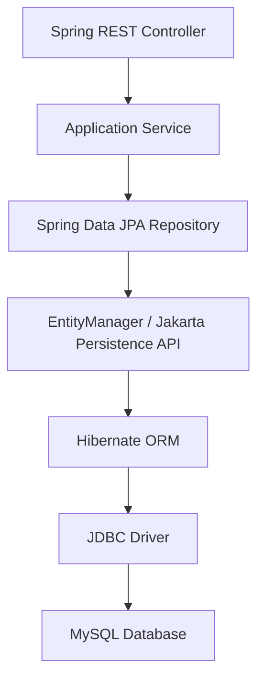
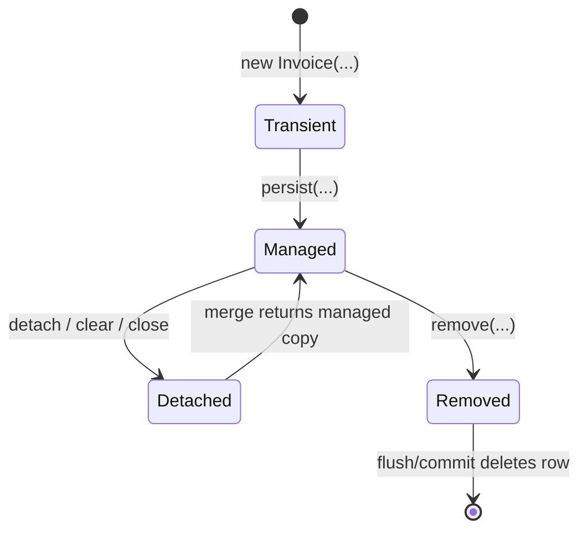
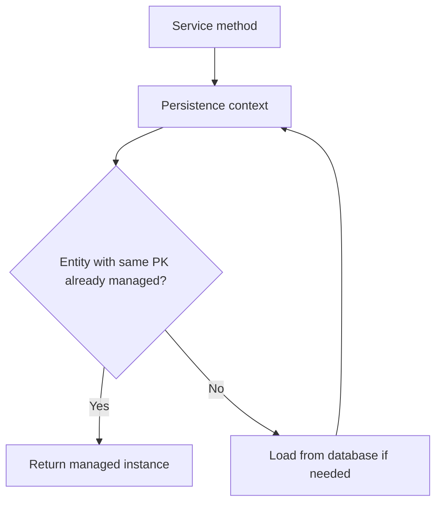
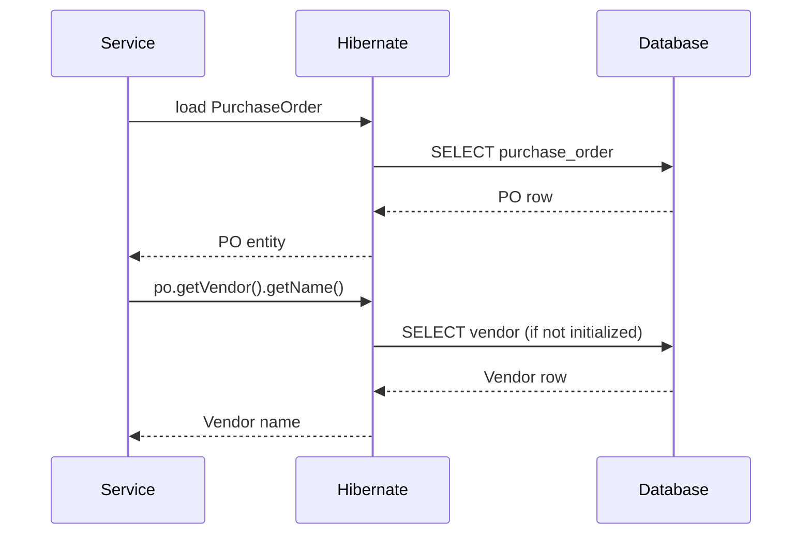
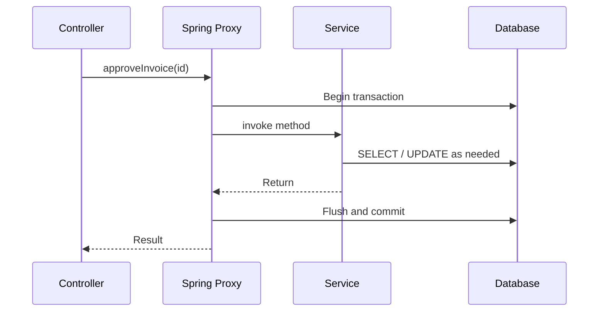
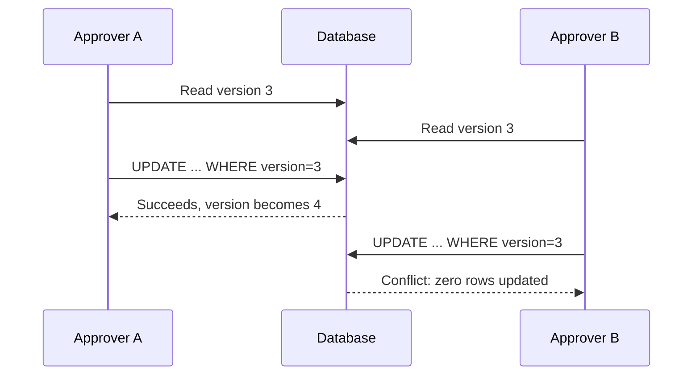

# Chapter 15 — Spring Data JPA and Hibernate Internals

> **Goal:** Understand how Java objects become database rows, how Hibernate tracks changes, and how to prevent slow queries, transaction bugs and concurrency errors in production.

**Target stack:** Java 21 · Spring Boot 3.x · Spring Data JPA · Hibernate 6 · MySQL 8  
**Learning flow:** Notes → diagrams → code → real production scenarios → interview Q&A → exercises

## 1. Why learn JPA internals?

Suppose you have an invoice approval API. You load an invoice, change its status and return a response. Sometimes Hibernate sends an UPDATE even without an explicit `save()` call. Sometimes accessing `invoice.getVendor()` triggers an unexpected query. Sometimes two approvers overwrite each other's changes.

All three behaviors become easier to understand once you know the **persistence context, dirty checking, fetch plans and database transactions**.

## 2. JDBC vs JPA vs Hibernate vs Spring Data JPA

| Term | Meaning | Responsibility |
|---|---|---|
| JDBC | Java database connectivity API | Executes SQL through a driver and handles results |
| JPA / Jakarta Persistence | Persistence specification | Defines entities, EntityManager, queries, mappings and lifecycle |
| Hibernate ORM | JPA provider / ORM implementation | Implements mappings, SQL generation, dirty checking and more |
| Spring Data JPA | Repository abstraction on top of JPA | Reduces standard repository/query boilerplate |

**Interview answer:** Spring Data JPA does **not** replace Hibernate. For a typical Spring Boot application, Spring Data repositories delegate to JPA infrastructure, which is often backed by Hibernate.



## 3. Entity mapping

An entity represents a persistent domain object whose identity is managed by the persistence provider.

```java
import jakarta.persistence.*;
import java.math.BigDecimal;

@Entity
@Table(name = "invoice")
public class Invoice {
    @Id
    @GeneratedValue(strategy = GenerationType.IDENTITY)
    private Long id;

    @Column(name = "invoice_number", nullable = false, unique = true)
    private String invoiceNumber;

    @Column(nullable = false, precision = 15, scale = 2)
    private BigDecimal amount;

    @Enumerated(EnumType.STRING)
    @Column(nullable = false)
    private Status status = Status.DRAFT;

    protected Invoice() {} // Required by JPA

    public Invoice(String invoiceNumber, BigDecimal amount) {
        this.invoiceNumber = invoiceNumber;
        this.amount = amount;
    }

    public void approve() {
        if (status != Status.DRAFT) {
            throw new IllegalStateException("Invoice is not in DRAFT");
        }
        status = Status.APPROVED;
    }
}

enum Status { DRAFT, APPROVED, REJECTED }
```

**Important points:**
- Entity classes require a public/protected no-argument constructor under JPA.
- `BigDecimal` is preferable to `double` for monetary values where decimal precision matters.
- `EnumType.STRING` stores a readable name but renaming an enum constant may require a data migration.
- Schema constraints and migrations are still required; annotations alone are not a production database migration strategy.

## 4. Entity lifecycle

Entities move between four common states:

| State | Description |
|---|---|
| Transient / new | Plain Java object not associated with a persistence context |
| Managed | Entity tracked by an active persistence context |
| Detached | Previously persistent entity no longer associated with that context |
| Removed | Managed entity marked for deletion |



**Nuance:** `merge(detached)` usually returns a managed instance; it does not simply reattach the original detached object. In real application code, use the returned reference where appropriate.

## 5. Persistence context and first-level cache

A **persistence context** tracks managed entities and ensures identity within its scope: for a given entity type and primary key, repeated retrieval usually returns the same managed Java object.

```java
@Transactional(readOnly = true)
public boolean sameInstance(Long id) {
    Invoice a = entityManager.find(Invoice.class, id);
    Invoice b = entityManager.find(Invoice.class, id);
    return a == b; // ordinarily true in one persistence context
}
```

This does **not** mean every query is automatically answered from memory. JPQL queries can still be executed, and first-level caching is not the same as Hibernate second-level caching.



## 6. Dirty checking — why UPDATE happens without `save()`

For a **managed** entity, Hibernate detects relevant state changes during flushing and generates SQL as needed.

```java
@Service
class InvoiceApprovalService {
    private final InvoiceRepository invoices;

    InvoiceApprovalService(InvoiceRepository invoices) {
        this.invoices = invoices;
    }

    @Transactional
    public void approve(Long id) {
        Invoice invoice = invoices.findById(id)
            .orElseThrow(() -> new IllegalArgumentException("Not found"));
        invoice.approve();
        // Managed entity: no explicit repository.save(invoice) required
    }
}
```

**Do not generalize:** Dirty checking depends on entity state, transaction/persistence-context scope and flush mode. It is not “every object change automatically updates the database.”

## 7. Flush vs commit vs save

- **`persist()`** makes a new entity managed; an INSERT is scheduled/performed according to generator and flush behavior.
- **`flush()`** synchronizes pending persistence-context changes with the database; it **does not commit** the transaction.
- **Commit** finalizes the database transaction if successful.
- **`save()`** is a Spring Data repository method with provider-dependent behavior for deciding whether to persist or merge an entity; it is not identical to a JDBC commit.

**Interview trap:** Flushing may reveal constraint violations before commit. A later transaction rollback can still undo the SQL changes.

## 8. Lazy and eager relationships

```java
@Entity
class PurchaseOrder {
    @Id
    private Long id;

    @ManyToOne(fetch = FetchType.LAZY)
    private Vendor vendor;
}
```

For JPA, `@ManyToOne` and `@OneToOne` default to EAGER, while `@OneToMany` and `@ManyToMany` default to LAZY. Defaults are not necessarily the best performance choices.

**LAZY:** Related data loads when accessed (subject to session/provider rules).  
**EAGER:** Related data must be fetched as part of the required fetch plan, but not necessarily in the same SQL JOIN.



## 9. The N+1 query problem

**Scenario:** Fetch 100 purchase orders, then call `po.getVendor().getName()` for each one.

Potential SQL: 1 query for all POs + up to 100 queries for vendors = **N+1**. The exact count depends on how many related IDs are unique and what is already loaded.

**Possible solutions:**
1. Fetch join only required relationships where appropriate.
2. Use `@EntityGraph`.
3. Use DTO projections for read APIs.
4. Configure batching where useful.
5. Measure SQL query counts and database latency.

```java
public interface PurchaseOrderRepository extends JpaRepository<PurchaseOrder, Long> {
    @EntityGraph(attributePaths = "vendor")
    List<PurchaseOrder> findByStatus(String status);
}
```

**Pagination caution:** Fetch-joining a collection association with pageable queries can produce unexpected or inefficient pagination behavior. Prefer carefully designed two-step fetches or DTO queries for large paginated results.

## 10. `LazyInitializationException`

This usually occurs when application code tries to initialize a lazy association without the required open Hibernate session/persistence context.

**Poor workaround:** Enable an open persistence context for all view rendering just to avoid the exception, without considering query behavior.

**Better approach:** Load exactly the needed data inside a service transaction, map it into DTOs, and return the DTO. Do not rely on database queries being performed during JSON serialization.

## 11. Transaction boundaries with `@Transactional`



**Important defaults in typical Spring transaction management:**
- `@Transactional` rolls back by default for `RuntimeException` and `Error`, not all checked exceptions.
- Transaction behavior requires a suitable configured transaction manager.
- Self-invocation (`this.approve()`) bypasses proxy-based interception.
- `readOnly = true` is a hint/optimization, not a guarantee that the database rejects writes.
- Spring transactions are thread-bound in conventional imperative transaction management; they do not automatically propagate to separately executed asynchronous threads.

## 12. Propagation and isolation

| Propagation | Meaning |
|---|---|
| `REQUIRED` | Join an existing transaction or create one |
| `REQUIRES_NEW` | Suspend existing transaction and start an independent transaction |
| `MANDATORY` | Fail if no transaction exists |
| `SUPPORTS` | Participate if present; otherwise execute without one |
| `NOT_SUPPORTED` | Suspend an existing transaction |
| `NESTED` | Use savepoints when supported by the transaction manager/driver |

**`REQUIRES_NEW` caution:** It may need a second database connection while an outer transaction holds one; size connection pools accordingly.

**Isolation levels:** READ_UNCOMMITTED, READ_COMMITTED, REPEATABLE_READ and SERIALIZABLE describe visibility guarantees, but exact locking and anomalies depend on the database implementation. MySQL InnoDB defaults to REPEATABLE READ in typical installations; verify your actual configuration.

## 13. Optimistic locking — prevent lost updates

```java
@Version
private long version;
```

Hibernate includes version checking in updates for a versioned entity. If two transactions load version 3 and the first commits an update to version 4, the second may fail with an optimistic-lock conflict instead of silently overwriting it.



**Production rule:** Translate this into an appropriate conflict response/retry strategy. Do not blindly retry a non-idempotent approval without checking its business state.

## 14. Pessimistic locking

```java
@Lock(LockModeType.PESSIMISTIC_WRITE)
@Query("select i from Invoice i where i.id = :id")
Optional<Invoice> lockById(@Param("id") Long id);
```

A pessimistic write lock may block conflicting transactions. It can be appropriate for short critical sections but increases contention and deadlock risk. SQL and lock behavior vary by database dialect, isolation level and query plan.

## 15. Idempotency and invoice approval

JPA locking alone does not solve duplicate requests from multiple application instances.

For an approval endpoint:

- Validate current invoice state in the database transaction.
- Use a unique request/idempotency key when retries must not repeat the operation.
- Enforce database uniqueness and optimistic/pessimistic locking as appropriate.
- Save the business result consistently with the state change.
- Consider an outbox/event-delivery pattern if a committed approval must trigger reliable asynchronous notification.

A JVM `synchronized` block protects only one process, not all deployed nodes.

## 16. Performance: pagination, projections and batching

**Avoid:** `findAll()` on a million-row invoice table followed by `.stream().filter(...)`.

**Prefer:** A query that filters and pages in the database.

```java
Page<Invoice> page = repository.findAll(
    PageRequest.of(0, 50, Sort.by("id").descending())
);
```

Spring Data may execute an extra count query for `Page`. A `Slice` can be preferable when you only need to know whether another page exists.

**DTO projections** reduce selected columns and avoid hydrating full entities when domain behavior is not needed. For bulk updates, use deliberate JDBC batching or bulk JPQL/SQL. Bulk update queries can bypass normal managed-entity dirty checking and leave existing managed instances stale unless refreshed/cleared.

## 17. Stored procedures and JPA

In stored-procedure-first applications, JPA can coexist with `JdbcTemplate` or native SQL. Use the persistence API that best fits the workload.

```java
@Procedure(procedureName = "sp_generate_invoice_report")
void generateInvoiceReport();
```

This is a schematic Spring Data repository declaration; the actual signature, parameters, mappings and transaction behavior must match the stored procedure and database driver. For multi-result-set stored procedures, direct JDBC control can be simpler.

**Senior interview framing:** Choosing stored procedures vs JPA involves trade-offs in database portability, execution planning, version control, transaction boundaries and maintenance.

## 18. Common mistakes

1. Saying JPA, Hibernate and Spring Data JPA are the same.
2. Assuming a managed entity always needs `save()` after modifying fields.
3. Assuming `flush()` commits the transaction.
4. Assuming EAGER means “one SQL JOIN.”
5. Returning lazy JPA entities directly from a REST controller.
6. Ignoring N+1 SQL caused by mapping entities to DTOs.
7. Assuming `@Transactional` works on self-invoked methods through a proxy.
8. Assuming `readOnly=true` blocks writes in all databases.
9. Treating optimistic locking as a complete idempotency solution.
10. Disabling pagination for large report APIs.
11. Assuming Spring's transactions span all async tasks.
12. Assuming a second-level cache is always enabled by default.

## 19. Interview questions and natural answers

**Q1. JDBC vs JPA vs Hibernate?**  
JDBC is a low-level database API. JPA defines object-relational persistence interfaces. Hibernate implements JPA and provides additional ORM functionality.

**Q2. What is Spring Data JPA?**  
A repository abstraction on top of JPA that simplifies common queries, pagination and data access code.

**Q3. What are entity states?**  
Transient, managed, detached and removed. The persistence context tracks managed instances.

**Q4. What is the first-level cache?**  
The persistence context's identity map for managed entities. It typically avoids reloading the same entity by primary key within that context.

**Q5. What is dirty checking?**  
Hibernate tracks managed entity changes and can synchronize them to the database during flush.

**Q6. Do I need `save()` after changing a managed entity?**  
Typically not when the change occurs within an appropriate transaction and managed context; dirty checking handles it.

**Q7. What is the difference between flush and commit?**  
Flush synchronizes pending SQL changes; commit finalizes the transaction.

**Q8. EAGER vs LAZY?**  
EAGER requires data to be fetched according to the fetch plan; LAZY defers retrieval until needed. Neither guarantees a specific query count by itself.

**Q9. What is N+1?**  
One query loads parent records, followed by one query per parent or unique relation in a loop. Use planned fetching/projections and measure SQL counts.

**Q10. What is LazyInitializationException?**  
A lazy association is accessed when Hibernate cannot initialize it through a suitable session. Fetch data inside the service boundary and return DTOs.

**Q11. What is transaction propagation?**  
It determines whether a method joins, requires or suspends an existing transaction. REQUIRED is common; REQUIRES_NEW creates an independent transaction.

**Q12. Does `@Transactional` roll back for checked exceptions by default?**  
No. Typical Spring defaults roll back for unchecked exceptions and errors; configure rollback rules for checked exceptions where needed.

**Q13. What is optimistic locking?**  
A version-based approach that detects conflicting updates without locking rows for the entire transaction.

**Q14. Optimistic vs pessimistic locking?**  
Optimistic detects conflicts during update; pessimistic attempts to lock data while working. Choice depends on contention and business requirements.

**Q15. How would you prevent duplicate invoice approval?**  
Validate state transactionally, enforce uniqueness/idempotency keys and use appropriate database locking or version checks. Avoid relying on an in-memory JVM lock across services.

**Q16. What is the benefit of DTO projections?**  
They select only required data, often reducing database work, network transfer and entity materialization.

**Q17. Why can `Page` execute a count query?**  
It often needs total result count metadata. A `Slice` can avoid that requirement when a total is unnecessary.

**Q18. When would you use stored procedures instead of Hibernate entities?**  
For complex existing database workflows or optimized database-side operations where direct SQL/procedure control is clearer, while evaluating portability and maintenance trade-offs.

## 20. Practice exercises

1. Create a basic Invoice entity and a Spring Data repository.
2. Explain managed vs detached entities using EntityManager operations.
3. Demonstrate dirty checking inside `@Transactional`.
4. Create an N+1 scenario and remove it using an EntityGraph or DTO query.
5. Describe why fetching multiple collection associations with pagination can be problematic.
6. Add `@Version` and reason through two concurrent approvals.
7. Compare optimistic and pessimistic locking for invoice approval.
8. Design an idempotent POST `/invoices/{id}/approve` operation.
9. Explain REQUIRED vs REQUIRES_NEW and connection-pool implications.
10. Replace `findAll()` with a paginated DTO query.
11. Explain why `this.transactionalMethod()` is not normally intercepted by Spring proxy AOP.
12. Explain when JDBC/stored procedures are a better choice than entity persistence.

## 21. Quick revision

- **JPA = specification; Hibernate = provider; Spring Data JPA = repository abstraction.**
- Managed entities are tracked by the persistence context.
- Dirty checking synchronizes changes at flush; flush is not commit.
- EAGER does not guarantee one SQL; LAZY may issue later SQL.
- N+1 requires deliberate fetch plans and measurement.
- Transaction rollback, propagation and isolation have specific semantics.
- Optimistic locking detects lost updates; idempotency handles duplicate requests.
- Pagination and projections prevent unnecessary memory and database work.
- Database constraints and stored procedures still matter alongside an ORM.

**Next:** Spring Security, JWT and OAuth 2.0, followed by Microservices transaction design.

### Further reading

- [Jakarta Persistence Specification](https://jakarta.ee/specifications/persistence/)
- [Hibernate ORM User Guide](https://docs.jboss.org/hibernate/orm/6.6/userguide/html_single/Hibernate_User_Guide.html)
- [Spring Data JPA Reference](https://docs.spring.io/spring-data/jpa/reference/)
- [Spring Transaction Management Reference](https://docs.spring.io/spring-framework/reference/data-access/transaction.html)
