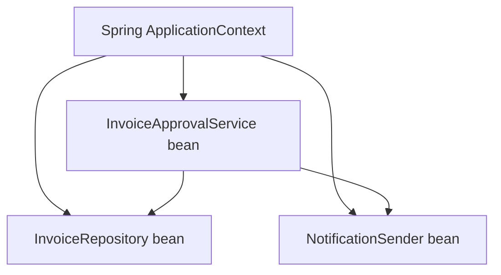
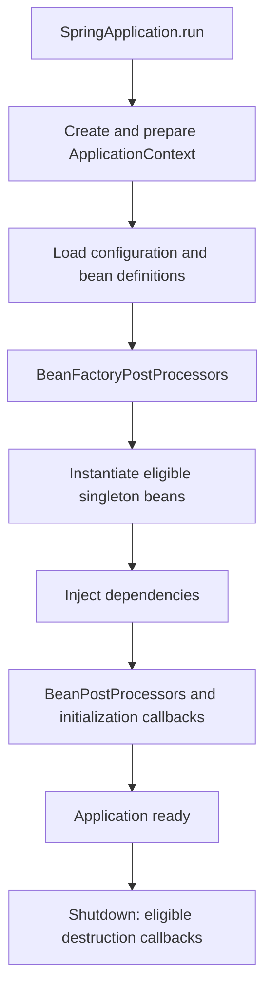
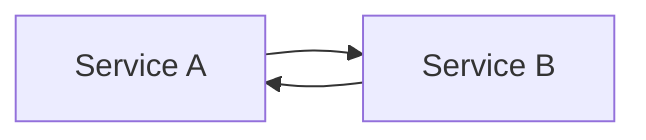
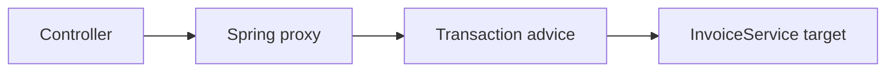
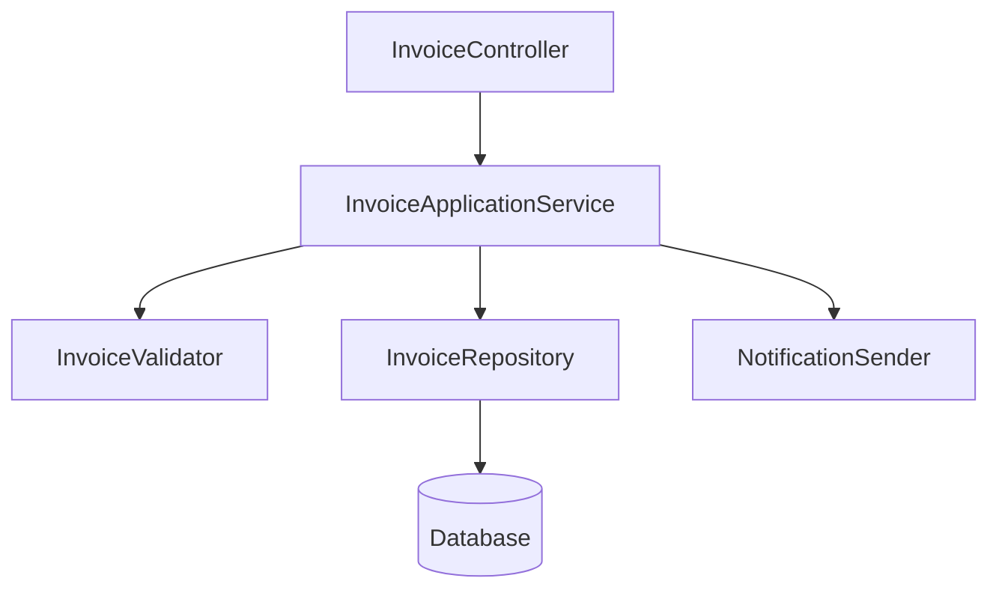

# Chapter 13 — Spring Framework Fundamentals: IoC, Dependency Injection and Beans

> **Learning objective:** Understand how Spring creates and wires application objects, why dependency injection improves design, and what actually happens to Spring-managed beans during application startup.

**Level:** Foundation to senior-level · **Target:** Java 21, Spring Framework 6 / Spring Boot 3 concepts · **Study time:** 60–90 minutes

## 1. Why Spring?

Imagine an InvoiceApprovalService that needs a ValidationService, InvoiceRepository and NotificationSender. Without a container, you can construct each dependency manually. That is completely valid Java, but large applications require lifecycle management, configuration, observability, testing and consistent wiring. Spring's IoC container manages those responsibilities.

**Key idea:** Spring does not replace OOP. It helps assemble objects with clear responsibilities.

## 2. IoC — Inversion of Control

**Inversion of Control** means a framework controls some part of object creation, assembly and lifecycle instead of the application explicitly constructing every dependency.



The central **IoC container** is accessed through `ApplicationContext`; Spring registers **bean definitions**, creates eligible beans, resolves dependencies and applies lifecycle behavior.

- **Bean:** An object managed by Spring.
- **Dependency:** Another component an object needs.
- **Dependency Injection (DI):** Supplying a dependency from outside rather than constructing it inside the dependent class.
- **ApplicationContext:** Spring's bean factory plus additional application facilities.

## 3. IoC versus DI

IoC is the broader architectural principle. **Dependency Injection is one technique that Spring uses to implement IoC.** Other forms of IoC exist; the terms are related but not synonyms.

Without DI:

```java
class ApprovalService {
    private final EmailSender sender = new EmailSender();
}
```

The service chooses its implementation, making replacement and isolated testing harder.

With constructor DI:

```java
interface NotificationSender { void send(String message); }

class ApprovalService {
    private final NotificationSender sender;
    ApprovalService(NotificationSender sender) {
        this.sender = sender;
    }
    void approve(String invoiceNo) {
        sender.send("Approved: " + invoiceNo);
    }
}
```

**Benefit:** The service depends on a contract rather than creating the concrete implementation.

## 4. Three dependency injection styles

| Style | Example | Recommendation |
|---|---|---|
| Constructor injection | Dependency provided through constructor | Prefer for required dependencies |
| Setter injection | Dependency set after construction | Sometimes suitable for optional/reconfigurable dependency |
| Field injection | `@Autowired` directly on field | Often discouraged: hidden dependencies and harder plain-unit testing |

**Spring detail:** A single constructor in a Spring-managed component does not need `@Autowired`. With multiple constructors, be explicit about the intended wiring.

## 5. Bean registration: stereotype annotations versus `@Bean`

Spring can discover components by classpath scanning:

```java
import org.springframework.stereotype.Service;

@Service
public class InvoiceApprovalService {
    private final NotificationSender sender;
    public InvoiceApprovalService(NotificationSender sender) {
        this.sender = sender;
    }
}
```

The `@Service` stereotype communicates the class's intended role. `@Component`, `@Repository` and `@Controller` are related Spring stereotypes with different purposes.

When configuring a class you do not own, or when explicit construction is useful, register it with `@Bean`:

```java
import org.springframework.context.annotation.Bean;
import org.springframework.context.annotation.Configuration;

@Configuration
class NotificationConfiguration {
    @Bean
    NotificationSender notificationSender() {
        return new ConsoleNotificationSender();
    }
}
```

**Important:** This is illustrative. The complete example below includes all required types.

## 6. A runnable Spring Boot example

This example uses Spring Boot 3.x and Spring Framework 6, so it must be run within a Spring Boot project with the appropriate Maven/Gradle dependencies. It is **not** a plain `javac` example.

```java
package demo;

import org.springframework.boot.SpringApplication;
import org.springframework.boot.autoconfigure.SpringBootApplication;
import org.springframework.stereotype.Component;
import org.springframework.stereotype.Service;

interface NotificationSender {
    void send(String message);
}

@Component
class ConsoleNotificationSender implements NotificationSender {
    @Override
    public void send(String message) {
        System.out.println(message);
    }
}

@Service
class InvoiceApprovalService {
    private final NotificationSender sender;

    InvoiceApprovalService(NotificationSender sender) {
        this.sender = sender;
    }

    void approve(String invoiceNo) {
        sender.send("Approved: " + invoiceNo);
    }
}

@SpringBootApplication
public class DemoApplication {
    public static void main(String[] args) {
        var context = SpringApplication.run(DemoApplication.class, args);
        context.getBean(InvoiceApprovalService.class).approve("INV-101");
    }
}
```

**Expected relevant output:** `Approved: INV-101` (alongside Spring Boot startup logs). The file must be named `DemoApplication.java` in the `demo` package.

## 7. What happens during Spring startup?



This is a **simplified** lifecycle; order varies by bean type, laziness and framework configuration. For example, `BeanPostProcessor`s surround initialization, and aspects such as configuration proxies can alter the object returned from a bean lookup.

### Lifecycle hooks

- `@PostConstruct`: Called after dependencies are injected, as part of initialization processing.
- `InitializingBean.afterPropertiesSet()`: Spring-specific initialization contract.
- Custom `initMethod`: Configured on `@Bean`.
- `@PreDestroy`: Cleanup callback for eligible beans when the container shuts down gracefully.

**Caution:** Spring generally does not automatically manage destruction callbacks for prototype beans after handing them to the caller.

## 8. Bean scopes

| Scope | Meaning | Interview note |
|---|---|---|
| singleton | One shared bean instance per bean definition in a container | Spring's default; not the same as one instance across the whole JVM |
| prototype | A new instance each time Spring is asked for it | Container does not usually manage full destruction lifecycle |
| request | One instance per HTTP request | Requires web-aware context |
| session | One instance per HTTP session | Requires web-aware context |
| application | One per ServletContext | Web-specific |
| websocket | WebSocket-scoped instance | Web-specific |

**Production issue:** A singleton Spring service can be called concurrently by many request threads. Mutable shared fields may create race conditions.

Incorrect pattern:

```java
@Service
class UnsafeCounterService {
    private int count;
    int next() { return ++count; } // race condition under concurrency
}
```

Usually keep service beans **stateless**. For shared mutable counters, use the correct concurrency strategy or store critical business state transactionally in the database.

## 9. Injecting multiple implementations

If Spring finds two `NotificationSender` beans, injection by type alone may be ambiguous.

Options include `@Qualifier`, `@Primary`, and selecting collections/maps of implementations.

```java
@Service
class ApprovalService {
    ApprovalService(@org.springframework.beans.factory.annotation.Qualifier("emailSender")
                    NotificationSender sender) {
        // Assign dependency here
    }
}
```

Use meaningful bean names and avoid relying on incidental parameter names as the primary design mechanism.

## 10. Circular dependencies

Suppose Service A needs Service B via its constructor, and B needs A. This creates a dependency cycle that cannot be satisfied through ordinary constructor injection.



**Prefer redesign:** Extract shared responsibility or introduce an event/callback boundary. `@Lazy` or provider-based techniques may defer resolution, but should not replace proper domain boundaries.

## 11. Spring proxies and AOP

Spring can wrap beans in proxies to add behavior such as transaction management, security or logging.



**Classic interview trap — self invocation:** Calling one method on `this` from another method in the same target object may bypass proxy-based advice on the called method. Therefore, placing `@Transactional` on an internal method does not always apply the expected transaction boundary.

Proxy details differ between JDK interface-based proxies and class-based proxies. Not every method can be advised in the same way.

## 12. `@Component`, `@Service`, `@Repository` and `@Controller`

- `@Component`: General Spring-managed component.
- `@Service`: Marks a service-layer component; primarily communicates intent.
- `@Repository`: Persistence component; participates in persistence-exception translation when applicable.
- `@Controller`: MVC web controller.
- `@RestController`: Convenience annotation combining `@Controller` and `@ResponseBody`.

**Do not claim** each stereotype automatically adds entirely separate execution layers. Their primary roles and additional framework behavior vary.

## 13. `@Configuration` and Spring Boot auto-configuration

`@Configuration` classes declare bean definitions. Spring Boot **auto-configuration** conditionally configures infrastructure based on classpath, properties and existing beans. Auto-configuration is not the same as component scanning.

For example, adding a supported web starter can cause Boot to configure web infrastructure and an embedded server (depending on the application setup). You can override defaults through properties or your own beans.

## 14. Dependency injection and unit tests

Constructor DI makes unit testing simple because you can provide a fake implementation without launching the Spring container.

```java
class RecordingSender implements NotificationSender {
    String lastMessage;
    public void send(String message) { lastMessage = message; }
}

// In a unit test:
RecordingSender fake = new RecordingSender();
ApprovalService service = new ApprovalService(fake);
service.approve("INV-101");
// Assert fake.lastMessage equals "Approved: INV-101"
```

This example is conceptual and uses the earlier pure-Java `ApprovalService` shape. A test runner such as JUnit can provide assertions.

## 15. Real-world design: Invoice Tracking application

Recommended layers:



- Controller: HTTP request/response concerns.
- Application service: Coordinates use case and transaction boundaries.
- Validator/domain rules: Reject invalid business transitions.
- Repository: Persistence operations.
- Notification sender: External communication through a contract.

Do not store request-specific fields (invoice ID, user identity, current approver) in a shared singleton service. Pass them as method arguments or use a properly scoped context.

## 16. Interview Q&A — natural answers

**Q1. What is IoC in Spring?**  IoC means the framework controls creation, assembly and lifecycle of managed components. Instead of every service constructing dependencies itself, the Spring container provides them.

**Q2. IoC versus Dependency Injection?**  IoC is the broader principle; DI is the technique of supplying dependencies from outside a class.

**Q3. Why constructor injection?**  It makes required dependencies explicit, supports immutable fields and enables plain unit tests without a full Spring context.

**Q4. What is a Spring bean?**  An object managed by the container according to a bean definition, including its creation, dependencies and eligible lifecycle callbacks.

**Q5. BeanFactory versus ApplicationContext?**  ApplicationContext builds on BeanFactory capabilities and adds features such as event publication, resource resolution and application-aware integration.

**Q6. What is the default bean scope?**  Singleton, meaning one instance per bean definition per container, not one universally shared instance in every JVM.

**Q7. Is a singleton Spring service thread-safe?**  Not automatically. Thread safety depends on its state and operations. Stateless services are usually easier to use concurrently.

**Q8. `@Component` versus `@Bean`?**  Component scanning finds annotated classes; `@Bean` registers an object produced by a configuration method, useful for explicit construction or third-party classes.

**Q9. What are `@Service` and `@Repository`?**  Stereotype annotations indicating service and persistence roles; repository support can also integrate persistence exception translation.

**Q10. How does Spring choose between two beans of the same interface?**  Through qualifiers, primary designation and resolution rules. Ambiguity should be resolved explicitly.

**Q11. What is a circular dependency?**  A dependency graph in which beans require each other. Constructor cycles usually fail to resolve and often indicate design problems.

**Q12. What is a BeanPostProcessor?**  A hook for processing bean instances before and after initialization; Spring infrastructure uses it for features such as proxy creation.

**Q13. Explain bean lifecycle briefly.**  Spring registers definitions, constructs eligible beans, injects dependencies, runs post-processors and initialization hooks, and invokes cleanup callbacks for eligible beans on shutdown.

**Q14. What is the proxy self-invocation issue?**  Internal calls on the target object can bypass proxy-based advice, so transactional or other AOP annotations on the called method may not take effect.

**Q15. Spring versus Spring Boot?**  Spring Framework provides the core programming model and IoC container; Spring Boot adds opinionated auto-configuration, starters, production features and convenient application bootstrap.

**Q16. Why can a singleton service cause race conditions?**  Multiple requests share the same bean, so mutations to unsynchronized instance fields may interleave incorrectly.

## 17. Quick revision and exercises

1. Draw an IoC container linking an approval service to repository and notification beans.
2. Explain IoC vs DI aloud in 30 seconds.
3. Replace `new EmailSender()` with constructor injection.
4. Name the default Spring scope and explain its container boundary.
5. Find the bug in a singleton service that stores `currentInvoiceId` in a field.
6. Describe how `@Qualifier` fixes ambiguous dependency selection.
7. Explain the self-invocation limitation of proxy-based `@Transactional`.
8. Write a unit test using a fake NotificationSender.

**Next chapter:** Spring Boot Auto-Configuration and Spring MVC/REST API internals.

### References

- [Spring Framework Reference — IoC Container](https://docs.spring.io/spring-framework/reference/core/beans.html)
- [Spring Framework Reference — Bean Scopes](https://docs.spring.io/spring-framework/reference/core/beans/factory-scopes.html)
- [Spring Framework Reference — AOP](https://docs.spring.io/spring-framework/reference/core/aop.html)
