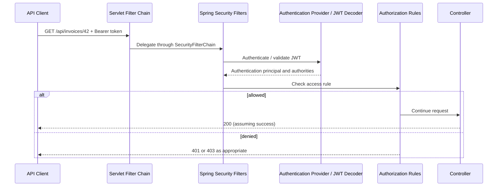
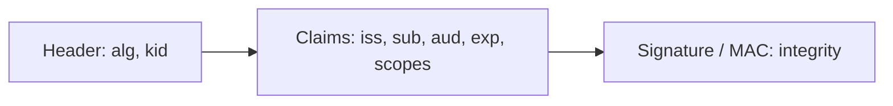
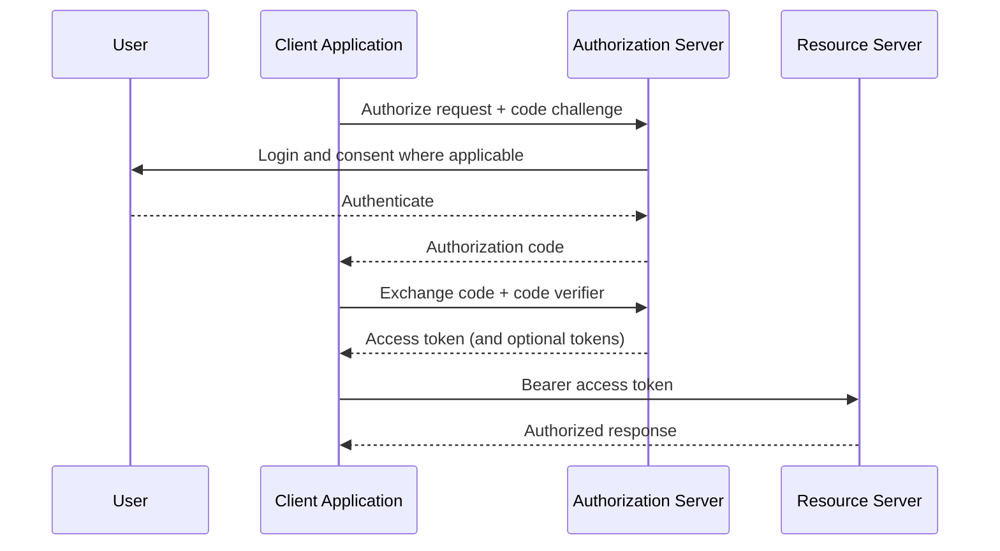
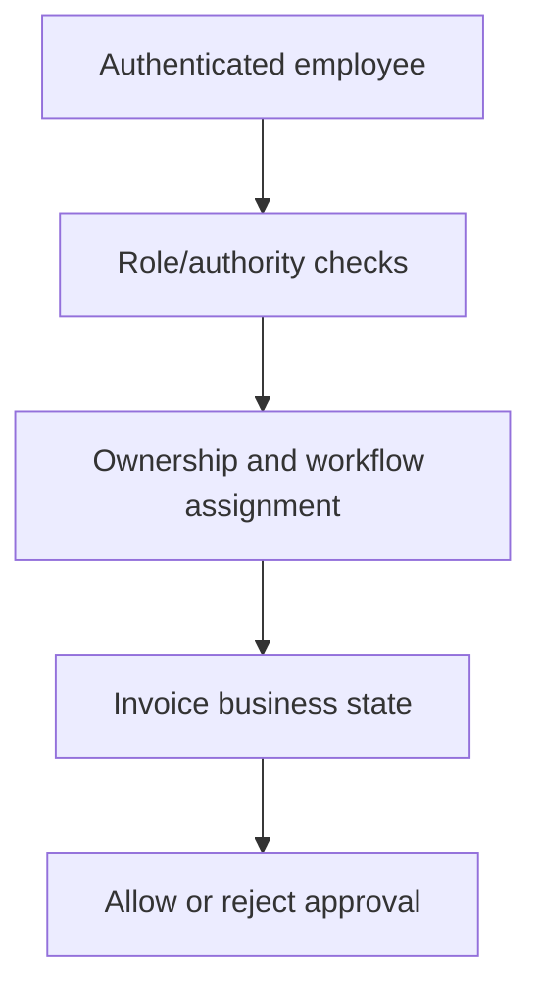

# Chapter 16 — Spring Security, JWT, OAuth 2.0 and RBAC

> **Learning objective:** Explain authentication and authorization, trace a secured request through Spring Security, implement a secure JWT resource server, and discuss real backend security decisions in senior Java interviews.

**Stack:** Java 21 · Spring Boot 3.x · Spring Security 6.x. **Study order:** concepts → diagrams → code → scenarios → interview Q&A → exercises.

## 1. Why API security matters

An invoice-tracking API may allow an employee to view invoices, a PO owner to approve them, and an administrator to manage users. Being logged in must not automatically grant access to every invoice or action. A robust system checks **who the caller is**, **what they may do**, and often **which specific invoice they may access**.

Authentication answers **“Who are you?”** Authorization answers **“Are you allowed to perform this action?”**

## 2. Authentication versus authorization

| Authentication | Authorization |
|---|---|
| Establishes caller identity | Evaluates permissions for a resource/action |
| Login, SSO, valid token | Roles, authorities, ownership, policy |
| Failed authentication normally yields 401 | Insufficient rights normally yields 403 |

**Example:** A valid employee token proves identity, but approving PO-42 must also require being its authorized approver.

## 3. Spring Security request flow



`DelegatingFilterProxy` bridges servlet filtering to Spring-managed security filtering; `FilterChainProxy` selects a matching `SecurityFilterChain`. The exact list and order of individual filters depends on configuration.

## 4. Authentication, SecurityContext and authorities

After successful authentication, Spring Security represents the caller using an `Authentication` object, often accessed from `SecurityContextHolder`. The object contains a principal and granted authorities. Authorities may be derived from roles, scopes or custom business policy.

**Roles vs authorities:** `hasRole("ADMIN")` normally checks `ROLE_ADMIN` (the conventional prefix); `hasAuthority("invoice:approve")` checks that exact authority. Token claims do not automatically become application permissions unless correctly mapped.

## 5. Sessions versus stateless token APIs

Traditional web login may use a server-side session and cookie. A resource server using bearer JWTs can authenticate each request without an application login session.

- Stateless request authentication does **not** mean your entire system contains no state: revocation, audit, rate limits and business data remain stateful.
- Cookies can be automatically sent by browsers; understand CSRF implications.
- Bearer tokens must be protected against theft because possession can enable use.

## 6. JWT structure and claims

A common signed JWT compact representation has three dot-separated Base64URL-encoded parts:

`BASE64URL(header).BASE64URL(payload).BASE64URL(signature)`



**Critical:** Base64URL is encoding, **not encryption**. Signed JWT payloads can generally be read by their holder. Do not put credentials, private keys or confidential invoice records into ordinary signed JWT claims. JWTs may also be encrypted (JWE), but a JWS signature alone provides no confidentiality.

Common claims:

| Claim | Meaning |
|---|---|
| `iss` | Issuer |
| `sub` | Subject identifier |
| `aud` | Intended audience |
| `exp` | Expiration instant |
| `nbf` | Not valid before |
| `iat` | Issued-at instant |
| `jti` | Token identifier, sometimes used in replay controls |

## 7. How a resource server validates JWTs

A secure API validates more than the token's shape:

1. Parse the bearer token without trusting unverified claims.
2. Verify its signature using the trusted issuer's configured key material and accepted algorithms.
3. Validate token expiry and applicable time-based claims.
4. Validate expected issuer and **audience** for this API.
5. Translate scopes/claims into supported authorities using controlled rules.
6. Enforce action-level and resource-level authorization.

**Never** blindly accept the JWT-provided algorithm, use an untrusted key URL, or skip signature checks. Clock skew may be configured within a small justified tolerance.

## 8. Spring Boot resource server example

**Dependencies** (managed through a compatible Spring Boot BOM): `spring-boot-starter-security`, `spring-boot-starter-oauth2-resource-server`, and `spring-boot-starter-web`.

```java
@Configuration
@EnableMethodSecurity
public class SecurityConfiguration {
    @Bean
    SecurityFilterChain apiSecurity(HttpSecurity http) throws Exception {
        return http
            .securityMatcher("/api/**")
            .csrf(csrf -> csrf.disable()) // Only for an API that truly does not rely on cookie auth
            .sessionManagement(sm -> sm.sessionCreationPolicy(SessionCreationPolicy.STATELESS))
            .authorizeHttpRequests(auth -> auth
                .requestMatchers(HttpMethod.GET, "/api/public/**").permitAll()
                .anyRequest().authenticated())
            .oauth2ResourceServer(oauth2 -> oauth2.jwt(Customizer.withDefaults()))
            .build();
    }
}
```

Required Spring imports include `org.springframework.security.config.annotation.web.builders.HttpSecurity`, `org.springframework.security.web.SecurityFilterChain`, `org.springframework.security.config.http.SessionCreationPolicy`, `org.springframework.security.config.Customizer`, `org.springframework.context.annotation.*`, `org.springframework.http.HttpMethod` and `org.springframework.security.config.annotation.method.configuration.EnableMethodSecurity`.

Configure the issuer as a trusted provider:

```yaml
spring:
  security:
    oauth2:
      resourceserver:
        jwt:
          issuer-uri: https://identity.example.org/issuer
```

**Replace the example issuer with your real trusted identity-provider URL.** The issuer configuration enables discovery/signature validation and issuer checks in supported setups. **Audience validation is application-specific and must be configured explicitly** if required; do not assume the above snippet enforces the API's audience.

**Important configuration boundary:** The example filter chain matches `/api/**` only. Other paths require their own appropriate security chain/default policy; do not accidentally leave endpoints unprotected. This snippet illustrates mechanics, not a drop-in complete production security configuration.

## 9. JWT access tokens versus refresh tokens

An **access token** is presented to an API. A **refresh token** is presented to an authorization server to obtain new access tokens when permitted.

Refresh tokens should not be sent to ordinary business APIs. They need secure storage, limited lifetime, revocation/reuse controls and rotation where supported. Avoid storing long-lived browser tokens in places vulnerable to script-based theft.

## 10. OAuth 2.0 is not JWT and not login by itself

OAuth 2.0 is an authorization framework for granting constrained access. It defines roles such as resource owner, client, authorization server and resource server. An OAuth access token does not have to be JWT-shaped; an opaque token can also be used.

**OpenID Connect (OIDC)** adds standardized identity authentication on top of OAuth 2.0, often using ID tokens. Do not use an **ID token** as though it were necessarily an access token for your backend API.

## 11. Authorization Code Flow with PKCE

Modern browser/mobile clients commonly use Authorization Code with PKCE instead of exposing credentials to the application.



PKCE binds the code exchange to the initiating client using a verifier/challenge; it does not replace redirect URI checks, state, token validation or secure token storage.

## 12. RBAC and resource ownership

**RBAC:** Roles such as `INVOICE_VIEWER`, `PO_OWNER`, `HOD`, `ADMIN` map to allowed actions. For real invoice approval you may need **attribute- or relationship-based rules** too: ownership, department, workflow level and invoice state.



A user with the correct role still must not approve an invoice assigned to a different approver. Enforce these rules on the server using authoritative database data, not client-provided IDs/roles alone.

## 13. Method-level authorization

```java
@Service
public class InvoiceApprovalService {
    @PreAuthorize("hasAuthority('invoice:approve')")
    public void approve(long invoiceId, String employeeCode) {
        // Also verify logged-in employee owns this approval task,
        // invoice is in an approvable state, and commit atomically.
    }
}
```

`@EnableMethodSecurity` must be configured, and proxy/interception behavior applies. Do not trust `employeeCode` supplied by the caller; derive identity from the authenticated principal and use the database to enforce authorization. Method-level RBAC alone does not establish ownership.

## 14. 401 versus 403 versus 404

- **401 Unauthorized:** Authentication is missing or invalid; the caller may need valid credentials.
- **403 Forbidden:** Authenticated caller lacks required permission (and sometimes anonymous access is forbidden depending on configured entry points).
- **404 Not Found:** Requested resource does not exist; some APIs intentionally use 404 to avoid revealing resource existence, with a consistent policy.

A resource-server response may include `WWW-Authenticate` details. Keep errors helpful without leaking sensitive information.

## 15. CORS versus CSRF

**CORS:** Browser mechanism controlling whether scripts on one origin can read cross-origin responses. Incorrect origin configuration can break browser API calls, but CORS is **not a substitute for authentication or authorization**. Non-browser clients are not protected by it.

**CSRF:** Abuses automatically attached credentials such as cookies. Disabling CSRF can be justified for a genuinely stateless bearer-token API that never relies on browser-automatically-attached credentials, but is unsafe as a general copy-paste rule.

**Production example:** Accidentally copying UAT origins into production can cause CORS failures. Keep environment-specific allowlists, validate origins and avoid blindly permitting all origins with credentials.

## 16. Passwords, secrets and transport security

- Use HTTPS/TLS for token and credential transport.
- Passwords should use an adaptive one-way hash, for example BCrypt or Argon2 via supported libraries, not plaintext or reversible encryption.
- Keep signing keys and client secrets outside source control, in a controlled secret store.
- Rotate keys and tokens using documented procedures; avoid logging bearer tokens.
- Avoid storing sensitive claims in a readable signed JWT.

## 17. Service-to-service authentication

Microservices should authenticate each caller, not assume that internal network traffic is trusted. Depending on the architecture use OAuth 2.0 client credentials, mTLS or workload identity. Validate the API audience and enforce least-privilege service permissions.

**API Gateway:** A gateway can validate requests centrally, but downstream services must still enforce their own trust boundary and resource authorization, especially when internal routes might be accessed through other paths.

## 18. Production troubleshooting scenarios

**Scenario A — JWT works locally but returns 401 in UAT.** Inspect issuer/realm, JWKS availability, signature key rotation, accepted algorithms, `exp`, `nbf`, audience, clock and token type. Never disable validation to make the request work.

**Scenario B — Valid token but approval returns 403.** Inspect the mapped authorities and user-to-approval-task assignment. The problem may be role mapping, policy or database ownership, not token validity.

**Scenario C — Browser CORS error in production.** Verify actual request origin, allowed headers/methods, credentials policy, proxy behavior and environment-specific configuration. Do not use wildcard origins indiscriminately.

**Scenario D — Duplicate approval request.** Authorization does not prevent request duplication. Combine identity checks with transactional business-state validation, idempotency rules and database concurrency controls.

## 19. Interview questions and natural answers

**Q1. Authentication vs authorization?** Authentication establishes identity. Authorization determines whether that identity may perform a specific action on a specific resource.

**Q2. How does Spring Security work internally?** It uses a servlet filter chain before MVC controller execution. Filters establish authentication and enforce authorization according to configured rules.

**Q3. Is JWT encrypted?** A signed JWT is not encrypted by default. Its encoded payload can be read; the signature protects integrity and authenticity when verified correctly.

**Q4. Which JWT claims do you validate?** Signature, issuer, expiry, intended audience and applicable time constraints; then map permissions using trusted application rules.

**Q5. What is the difference between roles and authorities?** Roles are usually a higher-level grouping convention; Spring `hasRole` commonly applies a `ROLE_` prefix. Authorities are direct permission strings.

**Q6. JWT vs OAuth 2.0?** JWT is a token format; OAuth 2.0 is an authorization framework and may use JWT or opaque access tokens.

**Q7. OAuth 2.0 vs OIDC?** OAuth focuses on delegated authorization. OIDC layers standardized authentication and identity claims over OAuth.

**Q8. Access token vs ID token?** The access token targets a resource API. The ID token communicates authenticated identity to an OIDC client and is not automatically appropriate as an API bearer token.

**Q9. What is a refresh token?** A credential used with the authorization server to obtain new access tokens where allowed; it needs strong storage, lifecycle and replay controls.

**Q10. What is PKCE?** It helps protect authorization-code exchange by requiring proof that the client exchanging the code initiated the flow.

**Q11. What does `SecurityFilterChain` configure?** Request matching, authorization rules, authentication mechanisms, session policy, CSRF/CORS and other filter behavior.

**Q12. What is the difference between 401 and 403?** 401 commonly means missing/invalid authentication; 403 means the request is understood but access is forbidden.

**Q13. Why is `@PreAuthorize` not sufficient for invoice approval?** Role checks cannot establish ownership, current workflow stage or business state. These also require server-side validation.

**Q14. CORS vs CSRF?** CORS controls browser cross-origin response access. CSRF concerns unwanted actions using automatically attached credentials.

**Q15. How should signing keys be managed?** Use trusted key management, controlled rotation and server-side verification; never commit private keys or tokens to the repository.

**Q16. How do you secure a microservice behind an API Gateway?** Authenticate incoming service/client identity, validate intended audience and issuer, then independently authorize requested resources/actions in the service.

**Q17. What is stateless authentication?** Each request carries the data needed to authenticate without relying on a login session at the API, but business and revocation state may still exist.

**Q18. How would you debug a sudden increase in 403 errors?** Correlate deployed configuration, claim-to-authority mapping, endpoint rule changes, task ownership and identity-provider changes using safe logs.

## 20. Practice exercises

1. Draw the Spring Security FilterChain request lifecycle.
2. Explain 401, 403 and 404 using invoice API examples.
3. Identify header, payload and signature in a sample JWT structure without putting real credentials into online decoders.
4. Build a resource server using a trusted issuer and configure audience validation.
5. Implement `@PreAuthorize` for an invoice-read permission, then check resource ownership in the service.
6. Explain why a role check alone cannot protect approval workflow integrity.
7. Compare OAuth Authorization Code + PKCE with Client Credentials.
8. Diagnose an intentionally misconfigured production CORS allowlist.
9. Describe secure refresh-token rotation and revocation trade-offs.
10. Design an idempotent, authorized invoice approval operation across two application instances.

## 21. One-minute revision

- Authentication = identity; authorization = permission **and resource context**.
- Spring Security integrates primarily through filter chains.
- Signed JWTs are readable, not encrypted.
- Validate signature, issuer, time conditions and intended audience.
- OAuth 2.0 ≠ JWT; OIDC adds authentication.
- `@PreAuthorize` is useful, but business ownership still needs checking.
- CORS is not authorization; CSRF depends on credential transport.
- Never expose secrets or real tokens in public GitHub notes.

**Next chapter:** REST API security testing and Spring transaction/authorization integration, followed by Microservices Architecture and API Gateway design.

### Reference reading

- [Spring Security Reference](https://docs.spring.io/spring-security/reference/)
- [Spring Security OAuth2 Resource Server JWT](https://docs.spring.io/spring-security/reference/servlet/oauth2/resource-server/jwt.html)
- [OAuth 2.0 Security Best Current Practice — RFC 9700](https://www.rfc-editor.org/rfc/rfc9700)
- [JSON Web Token — RFC 7519](https://www.rfc-editor.org/rfc/rfc7519)
- [OAuth 2.0 for Native Apps — RFC 8252](https://www.rfc-editor.org/rfc/rfc8252)
