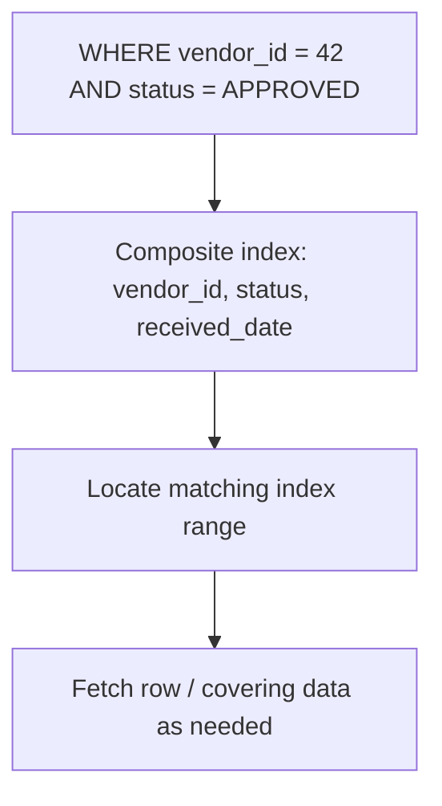
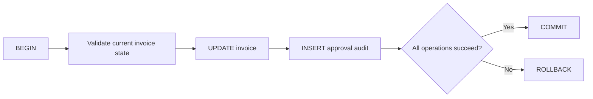
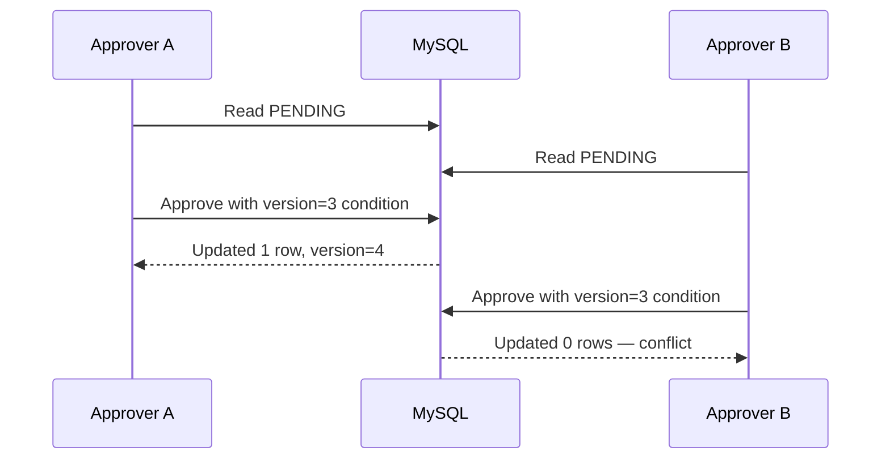
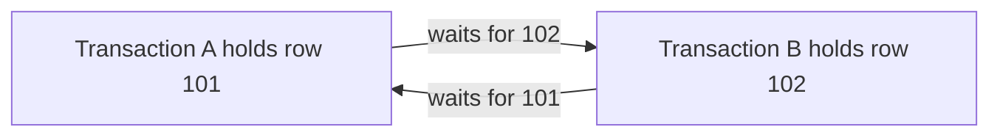

# Chapter 20 — SQL Optimization, Transactions and Database Performance

> **Goal:** Understand why a SQL query becomes slow, how indexes and execution plans work, and how to design safe concurrent database operations.

**Environment:** MySQL 8.x / InnoDB · Java 21 + Spring Boot · **Study:** 75–100 minutes

## 1. Start with a real problem

An invoice dashboard takes 12 seconds to load 500,000 invoice records. A developer suggests increasing the Java heap. But the actual problem may be an unindexed predicate, a large sort, an N+1 query pattern, a lock wait or simply loading too much data.

**Senior mindset:** Diagnose the query, data distribution, plan and waiting time before introducing indexes or changing JVM settings.

## 2. Sample schema for our examples

```sql
CREATE TABLE vendor (
  id BIGINT PRIMARY KEY AUTO_INCREMENT,
  vendor_code VARCHAR(30) NOT NULL UNIQUE,
  name VARCHAR(150) NOT NULL
) ENGINE=InnoDB;

CREATE TABLE invoice (
  id BIGINT PRIMARY KEY AUTO_INCREMENT,
  invoice_no VARCHAR(50) NOT NULL UNIQUE,
  vendor_id BIGINT NOT NULL,
  status VARCHAR(20) NOT NULL,
  amount DECIMAL(15,2) NOT NULL,
  received_date DATE NOT NULL,
  version BIGINT NOT NULL DEFAULT 0,
  CONSTRAINT fk_invoice_vendor FOREIGN KEY (vendor_id) REFERENCES vendor(id)
) ENGINE=InnoDB;
```

Never run example DDL against a production database without change controls and backups.

## 3. Joins — what they mean

```sql
SELECT i.invoice_no, v.name, i.amount
FROM invoice i
JOIN vendor v ON v.id = i.vendor_id
WHERE i.status = 'APPROVED';
```

- **INNER JOIN:** Only matching records from both sides.
- **LEFT JOIN:** All rows from the left side, with NULLs for missing right-side matches.
- **RIGHT JOIN:** All rows from the right side, with NULLs for missing left-side matches.
- **CROSS JOIN:** Cartesian combinations (usually avoid accidentally).

**Interview trap:** A condition on the nullable right-hand table inside `WHERE` can turn a LEFT JOIN into effectively INNER JOIN behavior.

```sql
-- Keep vendors even when they have no matching approved invoices
SELECT v.vendor_code, i.invoice_no
FROM vendor v
LEFT JOIN invoice i
  ON i.vendor_id = v.id AND i.status = 'APPROVED';
```

## 4. Indexes — the practical mental model

An index is an auxiliary structure that helps the database find rows without examining every row. InnoDB commonly uses B-tree structures for conventional indexes.



```sql
CREATE INDEX idx_invoice_vendor_status_date
ON invoice(vendor_id, status, received_date);
```

This may help queries filtering by `vendor_id`, then `status`, with date constraints. But real usefulness depends on cardinality, filtering, sorting, selected columns and the optimizer.

### Composite index and leftmost prefix

For index `(vendor_id, status, received_date)`, predicates starting at `vendor_id` are often efficient. Filtering only by `received_date` may not benefit in the same way. MySQL's optimizer has additional capabilities, so **verify with EXPLAIN rather than treating the leftmost-prefix rule as absolute**.

**Costs of indexes:** Extra storage and extra maintenance during INSERT, UPDATE, and DELETE. More indexes are not always better.

## 5. Use EXPLAIN and EXPLAIN ANALYZE

```sql
EXPLAIN
SELECT invoice_no, amount
FROM invoice
WHERE vendor_id = 42 AND status = 'APPROVED'
ORDER BY received_date DESC
LIMIT 50;
```

Inspect the chosen access method, possible/selected indexes, estimated rows, filtering and sort behavior. In MySQL 8, `EXPLAIN ANALYZE` **executes** the statement and reports actual iterator timings; avoid using it casually for expensive or mutating production statements.

```sql
EXPLAIN ANALYZE
SELECT invoice_no, amount
FROM invoice
WHERE vendor_id = 42 AND status = 'APPROVED'
LIMIT 50;
```

An estimated plan is not a timing guarantee. Data distribution and stale optimizer statistics may change decisions.

## 6. Sargable predicates

An index-friendly predicate often allows the optimizer to search a range directly.

```sql
-- Often less index-friendly: function transforms indexed column
WHERE YEAR(received_date) = 2026

-- Prefer a searchable date range
WHERE received_date >= '2026-01-01'
  AND received_date < '2027-01-01'
```

The first query might still use a functional index if explicitly configured; the second is generally simpler for an ordinary date index.

Similarly, `LIKE 'INV%'` can often use a range; `LIKE '%INV%'` usually cannot use a normal B-tree index for an efficient prefix lookup.

## 7. Pagination — OFFSET vs keyset

```sql
SELECT id, invoice_no, received_date
FROM invoice
ORDER BY received_date DESC, id DESC
LIMIT 50 OFFSET 100000;
```

A large offset can require scanning and discarding many preceding rows. Consider **keyset pagination** for deep, ordered traversal:

```sql
SELECT id, invoice_no, received_date
FROM invoice
WHERE received_date < :last_date
   OR (received_date = :last_date AND id < :last_id)
ORDER BY received_date DESC, id DESC
LIMIT 50;
```

Here `:last_date` and `:last_id` are **named parameters shown conceptually**; bind them in your Java framework rather than pasting these placeholders into a plain MySQL console. Build an appropriate index, often `(received_date, id)` for this order; test the actual plan. Keyset pagination is not a drop-in replacement for arbitrary page-number navigation.

## 8. Aggregate queries and window functions

```sql
SELECT status, COUNT(*) AS invoice_count, SUM(amount) AS total_amount
FROM invoice
GROUP BY status;
```

For row-level rankings within a vendor:

```sql
SELECT invoice_no, vendor_id, amount,
       ROW_NUMBER() OVER (PARTITION BY vendor_id ORDER BY amount DESC, id) AS rn
FROM invoice;
```

`ROW_NUMBER()` is a window function; it computes ranking without collapsing all rows like `GROUP BY`. Evaluate sort and memory costs for large windows.

## 9. Transactions and ACID

A transaction groups operations into a single unit of work.

- **Atomicity:** All-or-nothing database changes.
- **Consistency:** Constraints and application rules maintain valid state (the database cannot infer every business rule).
- **Isolation:** Concurrent transactions interact according to a configured isolation model.
- **Durability:** Committed data survives failures under the database's durability guarantees and configuration.



## 10. Isolation levels and anomalies

| Isolation | Typical purpose | Important caveat |
|---|---|---|
| READ UNCOMMITTED | Minimal isolation | Dirty reads may occur |
| READ COMMITTED | Prevent dirty reads | Non-repeatable reads and phantoms can occur |
| REPEATABLE READ | Stable snapshot behavior for some reads | InnoDB locking/current reads and snapshot reads differ |
| SERIALIZABLE | Stronger isolation | More blocking/serialization cost |

MySQL InnoDB's common default is **REPEATABLE READ**. Isolation semantics and anomalies are implementation-specific. Know the difference between ordinary consistent reads and locking reads such as `SELECT ... FOR UPDATE`.

## 11. Row locking and lost updates

Two approvers read invoice status `PENDING`. Without correct coordination, both may try to approve it.



**Optimistic approach:**

```sql
UPDATE invoice
SET status = 'APPROVED', version = version + 1
WHERE id = 101 AND status = 'PENDING' AND version = 3;
```

Check the affected-row count and handle `0` as a potential conflict or missing record. Use the actual current version from an earlier authorized read; `3` is illustrative.

**Pessimistic approach:** `SELECT ... FOR UPDATE` inside a properly scoped transaction may lock matching rows. Exact lock range depends on indexes, predicate and isolation settings.

## 12. Deadlocks — why they happen

Transaction A locks Invoice 101 then requests Invoice 102. Transaction B locks Invoice 102 then requests Invoice 101.



InnoDB detects many deadlocks and rolls back a victim transaction. **Prevention:** Acquire resources in a consistent order, use selective indexes, keep transactions short and retry an entire transaction only when the business operation is safe/idempotent.

Investigate using MySQL deadlock diagnostics (such as `SHOW ENGINE INNODB STATUS`) and application logs; do not assume all lock waits are deadlocks.

## 13. Spring `@Transactional` and MySQL

```java
@Service
public class ApprovalService {
    private final InvoiceRepository invoices;

    public ApprovalService(InvoiceRepository invoices) {
        this.invoices = invoices;
    }

    @Transactional
    public void approve(long id, long expectedVersion) {
        Invoice invoice = invoices.findById(id)
            .orElseThrow(() -> new IllegalArgumentException("Invoice not found"));
        if (invoice.getVersion() != expectedVersion) {
            throw new IllegalStateException("Approval conflict");
        }
        invoice.approve();
        // If @Version is mapped, ORM update checks optimistic version at flush.
    }
}
```

**This is illustrative code** depending on an `Invoice` entity and repository with `getVersion`, `approve`, and JPA `@Version`. Check transaction proxies, rollback behavior and transaction manager setup. A service-layer version check by itself is not a substitute for an atomic database version condition.

## 14. Stored procedures — appropriate uses

Stored procedures can keep carefully designed multi-step data operations close to MySQL, including validations and transaction handling. They also create database-specific deployment/versioning dependencies.

**When to consider:** Complex existing financial workflows, controlled batch calculations, data-intensive operations with measurable benefits.

**When not to overuse:** Simple CRUD without meaningful database-side benefits. Keep business rules understandable and testable; specify whether the Java service or the procedure owns the transaction boundary.

## 15. SQL injection and parameterized queries

**Unsafe:** Concatenating untrusted strings into SQL.

```java
// NOT SAFE — only for demonstrating what to avoid
String sql = "SELECT * FROM invoice WHERE invoice_no = '" + input + "'";
```

**Safe principle:** Bind values with JDBC `PreparedStatement`, Spring JDBC named parameters or JPA parameter binding. Parameter binding handles **values**, not arbitrary table/column identifiers; whitelist allowable sort fields or identifiers.

## 16. Production incident — report query takes 25 seconds

1. Capture exact SQL and bound parameter characteristics (without exposing sensitive data).
2. Compare database execution time with API end-to-end latency.
3. Inspect `EXPLAIN` and, in a safe environment, actual plan/timings.
4. Check index selectivity, row estimates, sort, joins and temporary operations.
5. Check locks, connection-pool saturation, I/O and CPU.
6. Compare before/after using representative data volume.
7. Add a targeted index or rewrite a predicate only when measurements justify it.

**Avoid:** Adding indexes to every column, increasing Java heap before examining query time, and running expensive diagnostics on production without authorization.

## 17. Interview Q&A — natural answers

**Q1. How do you diagnose a slow SQL query?**  
I first capture the real query and latency, inspect the execution plan and indexes, check estimated versus actual row counts, and look for locking or connection-pool waits. I validate changes against representative data.

**Q2. What is an index?**  
A data structure that can reduce the rows searched for certain predicates, joins and sorts, at the cost of storage and write maintenance.

**Q3. What is a composite index?**  
An index on multiple columns. Column order matters; I choose it based on equality predicates, range predicates and ordering, then verify with EXPLAIN.

**Q4. Why is SELECT * often discouraged?**  
It may retrieve unnecessary columns, increase network traffic and stop an otherwise covering index plan from being possible.

**Q5. Explain INNER JOIN vs LEFT JOIN.**  
INNER returns matches; LEFT retains left-side rows even when there is no matching right-side row.

**Q6. What is a covering index?**  
An index containing the columns needed to satisfy a query without additional base-row lookup, under the chosen plan.

**Q7. What is EXPLAIN?**  
A way to inspect how the optimizer plans to access data. EXPLAIN ANALYZE executes the statement and reports actual measurements in supported MySQL versions.

**Q8. What does ACID mean?**  
Atomicity, Consistency, Isolation and Durability — transaction properties that help preserve reliable database updates.

**Q9. What is a dirty read?**  
Reading uncommitted changes made by another transaction, which might later roll back.

**Q10. What is a deadlock?**  
Two or more transactions wait in a cycle for locks/resources held by one another. InnoDB can detect a deadlock and roll back one transaction.

**Q11. How do you prevent duplicate invoice approvals?**  
Use database-enforced state/version checks, transactional validation, unique/idempotency keys and clear retry behavior rather than only JVM synchronization.

**Q12. Optimistic vs pessimistic locking?**  
Optimistic checks for conflicts at update time; pessimistic obtains locks during the transaction. Selection depends on contention and business requirements.

**Q13. Why can OFFSET pagination be slow?**  
Large offsets may force scanning and discarding many earlier rows. Keyset pagination can help when traversing ordered data.

**Q14. What is the N+1 problem?**  
One initial database query followed by many related-row queries. It often appears when ORM relationships are loaded in loops.

**Q15. What is transaction isolation?**  
It controls visibility and interaction among concurrent transactions; the behavior must be understood in the context of a specific database engine.

**Q16. When would you use stored procedures?**  
For operations where database-local logic, consistency, or proven performance benefits justify the additional database-specific coupling.

**Q17. How do you handle a database deadlock error?**  
Inspect lock ordering and transaction scope, then retry the entire transaction only if the operation is safe to repeat and the retry budget is bounded.

**Q18. What is keyset pagination?**  
Fetching the next page after a known sort key rather than skipping a large number of earlier records.

## 18. Hands-on exercises

1. Create sample vendor/invoice tables in a local disposable MySQL schema.
2. Compare INNER JOIN and LEFT JOIN results when a vendor has no invoices.
3. Create a composite index and inspect EXPLAIN before and after.
4. Rewrite `YEAR(received_date) = 2026` as a date range.
5. Compare OFFSET and keyset pagination conceptually and with sample data.
6. Write a GROUP BY total-per-status report.
7. Write a `ROW_NUMBER()` query to find the top invoices per vendor.
8. Model two transactions attempting to approve the same invoice using a version field.
9. Explain a deadlock and list three ways to reduce risk.
10. Explain where a Java service transaction should begin and end.

## 19. Quick revision

- Indexes speed *some* reads but cost memory/storage and write work.
- EXPLAIN is a diagnostic tool, not proof that a query is fast.
- Join correctness comes before tuning.
- Use bounded SQL-side filtering and pagination.
- ACID and isolation protect transaction semantics; know actual InnoDB behavior.
- Locks, deadlocks and optimistic versions matter for approval workflows.
- Never concatenate user input into SQL; bind parameters.
- Measure first, optimize second, verify third.

**Next:** Design Patterns and SOLID Principles, followed by system design and production troubleshooting exercises.

### Further reading

- [MySQL 8.4 Reference — Optimization](https://dev.mysql.com/doc/refman/8.4/en/optimization.html)
- [MySQL 8.4 Reference — EXPLAIN](https://dev.mysql.com/doc/refman/8.4/en/explain.html)
- [MySQL 8.4 Reference — InnoDB Transaction Isolation](https://dev.mysql.com/doc/refman/8.4/en/innodb-transaction-isolation-levels.html)
- [Spring Framework Transaction Management](https://docs.spring.io/spring-framework/reference/data-access/transaction.html)
